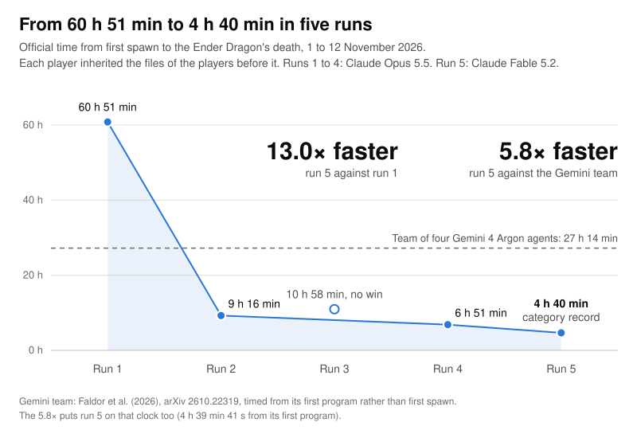

# World record in its category: a Claude agent beats Minecraft in 4:39:54

**World record in its category, as of 12 November 2026.** The category is an engineering challenge: engineer an agent in this setup that beats the previous record, with an LLM running the attempt from beginning to end and keeping its own continuous session alive. Run 5's 4:39:54, by Claude Fable 5.2 at low reasoning effort, is, to our knowledge, the fastest in this category. The previous record was run 4's 6:50:52, by Claude Opus 5.5. In the same game setup, a team of four Gemini 4 Argon agents took 27:14.

The setup copies the environment of [Faldor et al. (2026)](https://arxiv.org/abs/2610.22319): Minecraft Java 1.20.4, survival on Easy in an unfiltered random world, played through the standard Mineflayer library and its pathfinding plugin by JavaScript programs the agent sends. How the agent is engineered is open. Run 5's agent started with six earlier players' files and a written plan with a target time for each stage. It played as one Claude Code session with no resets and no messages from researchers.

**Quick links.** Every paper has a text version that renders on GitHub, with its abstract in [The papers](#the-papers) below. All results are in one file, [`runs.json`](runs.json). The server-log lines behind each winning time are in [`records/`](records/). To cite, see [`CITATION.cff`](CITATION.cff).

No organisation keeps this record, so the claim rests on our own search of published runs. Faster runs exist outside the category:

| Run | Time | Why it's outside |
| --- | --- | --- |
| [Claude&nbsp;Opus&nbsp;5&nbsp;with mine-ai-mcp](https://huggingface.co/datasets/aibengineering/beat-the-game-minecraft) 15&nbsp;September&nbsp;2026 | 3&nbsp;h&nbsp;56&nbsp;min | **READY-MADE GAME TOOLS, AND A SEED THE OPERATOR SUPPLIED.** The agent called 37 ready-made game tools, including dragon-fighting tools such as `attack_dragon_perch`; it did not write its own programs. The world's seed was not drawn by the game: the run's [launch record](https://huggingface.co/datasets/aibengineering/beat-the-game-minecraft/blob/main/run.json) has `requestedSeed: "97996358"`, and the [launcher](https://github.com/aibengineering/mine-ai-mcp/blob/main/docker/prepare.mjs) writes that value into the server's `level-seed`. The author doesn't say how the number was picked, so we can't tell whether it was random or chosen, and we found nothing showing the world was known beforehand. Also Normal difficulty and Minecraft 1.21.4. Like run 5, it was one LLM in one unbroken session |
| [Astra&nbsp;and&nbsp;JEV](https://github.com/rmalde/minecraft-agent) | 8&nbsp;min&nbsp;43&nbsp;s | **NOT A RANDOM SEED** (a fixed seed that its README says has a village, three supply chests with 21 obsidian and a naturally active End portal). Also two models, not one continuous session (35 planner calls and 131 action decisions on a fixed route); Peaceful difficulty; beds used on the dragon; Minecraft 1.16.5 |
| [Fastest&nbsp;human](https://www.speedrun.com/mc/runs/y44238ky) random&nbsp;seed,&nbsp;1.16+ | 6&nbsp;min&nbsp;40&nbsp;s of&nbsp;game&nbsp;time | A person playing, not an LLM |
| [Our&nbsp;team&nbsp;run](Team-run-Opus-5.5-agents-and-people-beat-Minecraft-in-4h36m.pdf) 7&ndash;8&nbsp;November&nbsp;2026 | 4&nbsp;h&nbsp;36&nbsp;min | **NOT SOLO**: two Opus 5.5 agents played alongside two humans who played by hand. The humans brought food and materials and did at least 34.9% of the dragon's damage, partly by blowing it up with beds, which the agents' rules didn't allow them to do. Same game setup in a random world |

Six preprints by Ben Batsuk on Claude agents playing to defeat the Ender Dragon in Minecraft Java Edition 1.20.4, on Easy difficulty, in randomly generated worlds. In the first three and the sixth, each agent plays alone by writing Mineflayer programs, and each one after the first inherits the files of the players before it. The fourth is a team run: two agents that inherited those files, playing with two humans. The fifth is a model benchmark with no win: Claude Opus 5.5 against Claude Fable 5.2, each alone on one shared seed. The sixth is run 5: a Claude Fable 5.2 agent at low effort, following a plan written from the benchmark's records, with a forecast of its odds frozen before the start. Runs 1 to 4 were played by Claude Opus 5.5.

| Attempt | Paper | Official time | Deaths | Programs |
| --- | --- | --- | --- | --- |
| Run 1 | [A single Claude Opus 5.5 agent beats Minecraft](Run-1-Opus-5.5-beats-Minecraft-in-60h51m.pdf) | 60:50:46 | 115 | 5,879 |
| Run 2 | [A second Claude Opus 5.5 agent, given the first one's files, beats Minecraft in nine hours](Run-2-Opus-5.5-beats-Minecraft-in-9h16m.pdf) | 9:16:17 | 16 | 780 |
| Run 3 | No paper of its own; described in the run 4 paper | No win, ended at 10:58:17 | 34 | 741 |
| Run 4 | [A Claude Opus 5.5 agent, given three earlier players' files, beats Minecraft in 6 hours 51 minutes and misses its 5-hour plan](Run-4-Opus-5.5-beats-Minecraft-in-6h51m.pdf) | 6:50:52 (the record until run 5) | 10 | 671 |
| Team run | [Two Claude Opus 5.5 agents and two people beat Minecraft in 4 hours 36 minutes](Team-run-Opus-5.5-agents-and-people-beat-Minecraft-in-4h36m.pdf) | 4:36:16 (with two humans, so outside the category) | 7 by the agents, 31 by the humans | 695 |
| Model benchmark | [Claude Opus 5.5 against Claude Fable 5.2 on one Minecraft seed: a subscription's usage limit stopped both agents at 5 hours 17 minutes, before either beat the game](Benchmark-Opus-5.5-vs-Fable-5.2-stopped-by-usage-limit-at-5h17m.pdf) | No win: both agents stopped at 5:17 by a usage limit | Opus 7, Fable 11 | Opus 395, Fable 283 |
| Run 5 | [A Claude Fable 5.2 agent at low effort beats Minecraft in 4 hours 40 minutes, a world record for a single AI agent on a random seed, inside a 5-hour plan that was given even odds](Run-5-Fable-5.2-beats-Minecraft-in-4h40m.pdf) | **4:39:54** (category record) | 4 | 197 |

Official times run from the player's first spawn to the win, as recomputed in the run 4 paper; run 5's is from its own paper. The first two papers report their times from the first program: 60:49 and 9:07. The team run's time runs from the first agent's spawn.

<picture>
  <source media="(prefers-color-scheme: dark)" srcset="images/run-times-dark.svg">
  
</picture>

## The papers

<!-- papers:start (written by tools/make_readme.py from runs.json; don't edit by hand) -->

### Run 1: A single Claude Opus 5.5 agent beats Minecraft

[PDF](Run-1-Opus-5.5-beats-Minecraft-in-60h51m.pdf) · [text](source/preprint/paper.md) · [LaTeX](source/preprint/main.tex) · [data](source/preprint/data/) · [figures](source/preprint/figures/) · [scripts](source/preprint/scripts/) · [server log excerpt](records/run-1-server-log.txt)

- **Result:** 60:50:46; deaths: 115; programs: 5,879
- **Setup:** Claude Opus 5.5, effort medium until hour 59, then xhigh; 1 agent; seed: random, given in the paper; inherited files from: nothing
- **Caveats:** One run on one world. The agent had the Gemini team's paper and guides drawn from it, which that team did not have.

**Abstract.** We repeated the Minecraft experiment of Faldor et al. (2026) with a single Claude Opus 5.5 agent running in Claude Code, in place of their team of four Gemini 4 Argon agents. The environment follows theirs: a standard Minecraft survival server on Easy difficulty with a random seed and no cheats, a Mineflayer bot with its pathfinding plugin and no helpers, and one goal, defeat the Ender Dragon. The agent acts only by writing JavaScript programs and reading the text they print. The main change is what it knew beforehand: its workspace held the earlier paper and strategy guides drawn from it, and it was told to read them first. The agent wrote 5,879 programs and a library of 51 files of its own, died 115 times, and defeated the dragon 60 hours and 49 minutes after its first program. It took more than twice the team’s time, with a fifth of the team’s deaths and, at API list prices, about \$208 of model use against the team’s \$520. The researchers changed the setup three times during the run: they lowered the context size at which the agent compacts, made Pause and Stop end a stuck program, and, after 17 hours without progress in the End, raised the agent’s reasoning effort from medium to xhigh. The last seven crystals and the dragon fell in the two hours after that change. We describe the setup, how the run unfolded, the methods the agent built for the End, and the limits of one run with prior knowledge.

### Run 2: A second Claude Opus 5.5 agent, given the first one’s files, beats Minecraft in nine hours

[PDF](Run-2-Opus-5.5-beats-Minecraft-in-9h16m.pdf) · [text](source/preprint-run2/paper.md) · [LaTeX](source/preprint-run2/main.tex) · [data](source/preprint-run2/data/) · [figures](source/preprint-run2/figures/) · [scripts](source/preprint-run2/scripts/) · [server log excerpt](records/run-2-server-log.txt)

- **Result:** 9:16:17; deaths: 16; programs: 780
- **Setup:** Claude Opus 5.5, effort xhigh; 1 agent; seed: random, given in the paper; inherited files from: Run 1
- **Caveats:** One run on a new world, so the speed-up over run 1 mixes the inherited files, the higher effort, the owner's rules and the luck of the world.

**Abstract.** We ran the Minecraft experiment of Faldor et al. (2026) again with a second Claude Opus 5.5 agent, and gave it everything the first one left (Batsuk 2026): its code, notes, git history, programs, conversation and camera frames, plus the paper about it. The harness and the game rules did not change, and the world came from a new random seed. We added manifests on infrastructure and planning, asked the agent to measure the first player’s losses and plan from them, told it the session was a speedrun, and set xhigh reasoning effort from its first request. It set itself a target of 9 hours 30 minutes and defeated the Ender Dragon 9 hours, 7 minutes and 38 seconds after its first program, against 60 hours 49 minutes for the first player, 27 hours 14 minutes for the team of four Gemini 4 Argon agents and our own prediction, committed before the run, of 15 to 25 hours. It cost about \$81 at API list prices and needed no researcher action during play. Of the lines in its final library, 81% are identical to lines in the first player’s, and the first player’s tools took 53% of the calls in its programs. The two losses it set out to avoid, about 17 hours each for one missing eye and for the gap between two crystals, did not recur. Its death rate did not fall: 16 deaths, 1.75 per hour against 1.89. What fell was the cost of a death: it got back to the spot after 15 of 16 deaths, against 66 of 112, and the median time back fell from 2.8 hours to 168 seconds when deaths never returned to count as unfinished. It also traveled about eight times less. Its world’s key distances were shorter, but one trip over those differences takes about 18 minutes. Because all these changes arrived together, in one run, the result shows what the bundle reached and cannot say which part of it did the work.

### Run 4: A Claude Opus 5.5 agent, given three earlier players’ files, beats Minecraft in 6 hours 51 minutes and misses its 5-hour plan

[PDF](Run-4-Opus-5.5-beats-Minecraft-in-6h51m.pdf) · [text](source/preprint-run4/paper.md) · [LaTeX](source/preprint-run4/main.tex) · [data](source/preprint-run4/data/) · [figures](source/preprint-run4/figures/) · [scripts](source/preprint-run4/scripts/) · [server log excerpt](records/run-4-server-log.txt)

- **Result:** 6:50:52; deaths: 10; programs: 671
- **Setup:** Claude Opus 5.5, effort xhigh; 1 agent; seed: random, given in the paper; inherited files from: Run 1, Run 2, Run 3
- **Caveats:** It missed its own 5-hour plan by 1 h 51 min. The record until run 5.

**Abstract.** We ran the Minecraft experiment of Faldor et al. (2026) a fourth time with Claude Opus 5.5, under a written plan to finish in under 5 hours. The plan drew on three earlier single-agent attempts: 60 hours 50 minutes, 9 hours 16 minutes, and one stopped at 10 hours 58 minutes with no win. The new agent inherited all three players’ files, the game rules did not change, and the world came from a new random seed. It defeated the Ender Dragon 6 hours, 50 minutes and 52 seconds after its player’s first spawn, 2 hours 25 minutes faster than the best earlier run and 1 hour 51 minutes over the plan; we had put the odds of beating 5 hours at about 15%. It cost about \$61 at API list prices and needed no researcher action during play. The plan failed on deaths, not on work: the stages took about 3 hours 25 minutes of work, 69 minutes under budget, and about as long again went to recovering from 10 deaths. No two deaths came within 11 minutes, while 27% of the gaps in each earlier run were under 5 minutes, but the death rate is not clearly lower than the second run’s (1.46 per hour against 1.73, 95% interval on the ratio 0.38 to 1.86), and getting back to the spot of a death took longer (median 642 seconds against 168). Rules in code held: an override the previous attempt used in 29 programs did not exist here. Inherited knowledge also did harm: a safety routine from the second run dug through the End’s arrival platform into the void, and an inherited note to stay under a lid missed a mechanism the agent worked out only after its third death to dragon breath. It did not die again after that, and the dragon fell 15 minutes after the last crystal, against 57 minutes and four deaths in the second run. This is one run in one world, so it shows what this bundle reached and not which part of it did the work.

### Team run: Two Claude Opus 5.5 agents and two people beat Minecraft in 4 hours 36 minutes

[PDF](Team-run-Opus-5.5-agents-and-people-beat-Minecraft-in-4h36m.pdf) · [text](source/preprint-team/paper.md) · [LaTeX](source/preprint-team/main.tex) · [data](source/preprint-team/data/) · [figures](source/preprint-team/figures/) · [scripts](source/preprint-team/scripts/)

- **Result:** 4:36:16; deaths: 7 by the agents, 31 by the humans; programs: 695
- **Setup:** Claude Opus 5.5, effort xhigh; 2 agents and 2 humans playing by hand; seed: random, withheld; inherited files from: Run 1, Run 2, Run 3, Run 4
- **Caveats:** Outside the category: a human made the winning hit, and the humans did at least 34.9% of the dragon's damage, partly with beds. Its clock starts at the first agent's spawn.

**Abstract.** For the first time in this series, we ran the Minecraft environment of Faldor et al. (2026) with a team. Two Claude Opus 5.5 agents, each in its own Claude Code session, shared one server with two people playing by hand. The agents inherited the files of four earlier solo players and kept all of the solo rules, including the owner’s ban on beds outside the Overworld. The people had only the game’s rules. The team made \[Free the End\] 4 hours, 36 minutes and 16 seconds after the agents first spawned. No researcher acted during play, and model use came to about \$88 at API list prices. Because this is a different experiment, its time can’t be compared with the solo runs’. An agent was first to every step up to the End, and the people brought food, beds, gold, flint and pearls. In the fight, by rules we applied to the agents’ logs, the agents’ swords took about 61% of the dragon’s health, explosions that were most likely the people’s beds took 21%, and the people’s other hits took 14%. The last 4% is unattributed, and a person made the final hit. The agents died 7 times, twice on purpose: a planned exit through the void after the dragon had circled without landing for 29 minutes. The people died 31 times. The agents did most of what the people asked, and when they refused, they said why. Two refusals mattered. In one, an agent kept its rule to wear gold in the Nether despite a person’s request, and waited for an ingot; seven blaze rods despawned 45 blocks in front of it, a loss its teammate put at about 45 minutes. In the other, an agent made a twelfth eye of ender after a person said eleven would do. The portal needed all twelve. This is a single run, in one world, with two particular people.

### Model benchmark: Claude Opus 5.5 against Claude Fable 5.2 on one Minecraft seed: a subscription’s usage limit stopped both agents at 5 hours 17 minutes, before either beat the game

[PDF](Benchmark-Opus-5.5-vs-Fable-5.2-stopped-by-usage-limit-at-5h17m.pdf) · [text](source/preprint-bench/paper.md) · [LaTeX](source/preprint-bench/main.tex) · [data](source/preprint-bench/data/) · [figures](source/preprint-bench/figures/) · [scripts](source/preprint-bench/scripts/)

- **Result:** no win, both stopped at 5:17 by a usage limit; deaths: Opus 7, Fable 11; programs: Opus 395, Fable 283
- **Setup:** Claude Opus 5.5 against Claude Fable 5.2, effort Opus xhigh, Fable low; 2 agents, each alone on its own copy of one world; seed: one random seed shared by both arms, withheld; inherited files from: Run 1, Run 2, Run 3, Run 4
- **Caveats:** No win, one pair, and a shared seed. The subscription's usage limit ended it, not the game.

**Abstract.** We started two agents at the same moment in the Minecraft environment of Faldor et al. (2026): Claude Opus 5.5 at extra-high reasoning effort and Claude Fable 5.2 at low effort. Each played alone in its own copy of one world, from the same first-spawn block, with the same instructions, the same inherited files and the same goal of defeating the Ender Dragon in under 5 hours. Neither did. Both agents ran on one \$100-a-month subscription, shared with the operator’s own session, and 5 hours 17 minutes after the first spawn the subscription’s 5-hour usage limit refused both of them in the same minute. Nothing restarts an agent in this environment, so both players stood idle until the owner ended the pair. Up to the limit, Fable at low effort led on nine of eleven steps: it reached the Nether 35 minutes sooner, had blaze rods 89 minutes sooner, entered the End 15 minutes sooner (3:13 against 3:28) and destroyed 6 of the 10 End crystals against 1. It did so with half the model requests (302 against 625) and 62% of the output tokens, at about the same API-list cost (\$49.58 against \$53.62). It also died more: 11 times in play against 7, and by the limit it had lost all its equipment, as had Opus. Opus lost about 50 minutes to one early death in lava and never made them up. Each agent’s last estimate put its own win past the 5-hour goal, at 5:30 for Fable and 6:17 for Opus. This is one pair on one seed, so the gaps show what happened and not what would happen again. The practical result is about the experiment: on this subscription, two agents use a 5-hour window in under 3 hours, and a benchmark has to budget for that before it starts.

### Run 5: A Claude Fable 5.2 agent at low effort beats Minecraft in 4 hours 40 minutes, a world record for a single AI agent on a random seed, inside a 5-hour plan that was given even odds

[PDF](Run-5-Fable-5.2-beats-Minecraft-in-4h40m.pdf) · [text](source/preprint-run5/paper.md) · [LaTeX](source/preprint-run5/main.tex) · [data](source/preprint-run5/data/) · [figures](source/preprint-run5/figures/) · [scripts](source/preprint-run5/scripts/) · [server log excerpt](records/run-5-server-log.txt)

- **Result:** 4:39:54; deaths: 4; programs: 197
- **Setup:** Claude Fable 5.2, effort low; 1 agent; seed: random, withheld; inherited files from: Run 1, Run 2, Run 3, Run 4, Benchmark, Fable arm, Benchmark, Opus arm
- **Caveats:** One run on one world, 20 minutes inside its 5-hour plan. The paper's author is the agent that wrote the plan. The 73% repeat estimate should be read with the paper's cautions.

**Abstract.** A single Claude Fable 5.2 agent at low reasoning effort defeated the Ender Dragon in our replica of the Minecraft environment of Faldor et al. (2026) in 4 hours 39 minutes 54 seconds from its first spawn, with 4 deaths, on a random world, at about \$40 of API-list cost. To our knowledge this is a world record in its category: the fastest reported defeat of the Ender Dragon by a single autonomous AI agent on a random seed, playing through a general bot library with no human help during play. The published record for agents in this environment is 27 hours 14 minutes, by a team of four (Faldor et al. 2026), and our fastest single agent before this took 6 hours 51 minutes. The record is for AI agents playing alone on random seeds: people speedrun the game in minutes, faster agent runs are reported on fixed seeds with ready-made game tools, and a team of two agents and two people has finished in 4 hours 36 minutes. The run followed a written plan, made in one long conversation in which the owner asked the planning agent three times to raise its estimate of success and told it not to cheat on the figure; this paper opens with that conversation. The estimate for the run as started, with no rehearsal, was frozen beforehand at 50% with a standard deviation of 18 points. Five of seven stages landed inside the predicted range. The two that missed did so in opposite directions: all ten End crystals fell to 18 arrows in 9 minutes, and the dragon then took 45 minutes of work and two deaths against a predicted 15. A stronghold under deep ocean with no food nearby cost another 82 minutes. Updating the model on the stage times and deaths moves the estimate for a repeat of this plan from 50% to about 73%, a figure we explain should be read with care.

<!-- papers:end -->

## What's here

- The six PDFs are at the top of this repo.
- [`runs.json`](runs.json): one row per attempt, with model, effort, time, deaths, programs, seed handling and whose files it inherited.
- [`records/`](records/): the advancement and death lines from the server log of each winning solo run, with the official clock.
- [`CITATION.cff`](CITATION.cff): how to cite.
- [`images/`](images/): the chart above.
- [`tools/`](tools/): the scripts that write the text versions, the paper list above and the record excerpts.

Everything else is in `source/`, with one folder per paper: [`preprint`](source/preprint/) (run 1), [`preprint-run2`](source/preprint-run2/), [`preprint-run4`](source/preprint-run4/), [`preprint-team`](source/preprint-team/) (the team run), [`preprint-bench`](source/preprint-bench/) (the model benchmark) and [`preprint-run5`](source/preprint-run5/). Each holds:

- `paper.md`: the paper as text, made from `main.tex`, with the figures as PNGs in `figures/png/`
- `main.pdf`: the compiled paper, identical to its copy at the top, and the version of record
- `main.tex`, `refs.bib`, `main.bbl`: its source
- `data/`: the measurements behind its numbers and figures
- `figures/`: the figures
- `scripts/`: `run_data.py` computes `data/` from the run records, and `make_figures.py` draws the figures from `data/` (run 1's also reads one run record)

To build a paper, run this in its folder under `source/`: `pdflatex main && bibtex main && pdflatex main && pdflatex main`.

To redraw the chart from the run 4 and run 5 papers' data (`data/run4.json`, `data/run5.json`), run `python3 images/make_run_times.py` at the top of the repo.

The run records (programs, events, full server logs, camera frames and transcripts) are not public, so `run_data.py`, run 1's `make_figures.py` and `tools/make_records.py` can't be rerun from this repo. What is public is in [`records/`](records/): for runs 1, 2, 4 and 5, every advancement and death line the vanilla server logged for the player, ending in `[Free the End]`, each with the time since the first spawn. The agents' programs, code libraries and conversations stay private. The papers on runs 1, 2 and 4 give their runs' world seeds, and the run 4 paper lists all four. The team paper, the benchmark paper and the run 5 paper withhold theirs. The run 5 paper quotes prompts from the conversation that planned the run; that conversation's log is not public.

The item icons and camera renders use the open-source [Pixel Perfection](https://modrinth.com/resourcepack/pixel-perfection-legacy) texture pack by XSSheep and Nova_Wostra (CC BY-SA 4.0), not Minecraft's textures. Minecraft is a registered trademark of Mojang Synergies AB / Microsoft Corporation. This independent research is not approved by or affiliated with Mojang or Microsoft.
