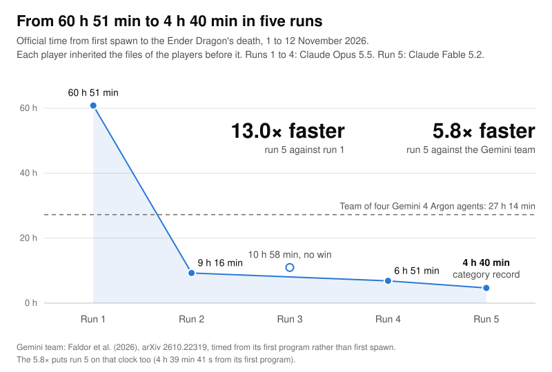

# World record in its category: Opus beats Minecraft in 6:50:52

**World record in its category, as of 7 November 2026.** The category is an engineering challenge: engineer an agent in this setup that beats the previous record, with an LLM running the attempt from beginning to end and keeping its own continuous session alive. Run 4's 6:50:52 is, to our knowledge, the fastest in this category. The previous record was run 2's 9:16:17. In the same game setup, a team of four Gemini 4 Argon agents took 27:14.

The setup copies the environment of [Faldor et al. (2026)](https://arxiv.org/abs/2610.22319): Minecraft Java 1.20.4, survival on Easy in an unfiltered random world, played through the standard Mineflayer library and its pathfinding plugin by JavaScript programs the agent sends. How the agent is engineered is open. Run 4's agent started with earlier players' files and written strategy notes. It played as one Claude Code session with no resets and no messages from researchers. The harness's standard line telling it to keep going reached it once, at 0:34.

No organisation keeps this record, so the claim rests on our own search of published runs. Faster runs exist outside the category:

| Run | Time | Why it's outside |
| --- | --- | --- |
| [Claude&nbsp;Opus&nbsp;5&nbsp;with mine-ai-mcp](https://huggingface.co/datasets/aibengineering/beat-the-game-minecraft) 15&nbsp;September&nbsp;2026 | 3&nbsp;h&nbsp;56&nbsp;min | **NOT A RANDOM SEED** (seed set to 97996358). Also a different setup: 37 ready-made game tools, including dragon-fighting tools; Normal difficulty; Minecraft 1.21.4. Like run 4, it was one LLM in one unbroken session |
| [Astra&nbsp;and&nbsp;JEV](https://github.com/rmalde/minecraft-agent) | 8&nbsp;min&nbsp;43&nbsp;s | **NOT A RANDOM SEED** (a fixed seed that its README says has a village, three supply chests with 21 obsidian and a naturally active End portal). Also two models, not one continuous session (35 planner calls and 131 action decisions on a fixed route); Peaceful difficulty; beds used on the dragon; Minecraft 1.16.5 |
| [Fastest&nbsp;human](https://www.speedrun.com/mc/runs/y44238ky) random&nbsp;seed,&nbsp;1.16+ | 6&nbsp;min&nbsp;40&nbsp;s of&nbsp;game&nbsp;time | A person playing, not an LLM |
| [Our&nbsp;team&nbsp;run](Team-run-Opus-5.5-agents-and-people-beat-Minecraft-in-4h36m.pdf) 7&ndash;8&nbsp;November&nbsp;2026 | 4&nbsp;h&nbsp;36&nbsp;min | **NOT SOLO**: two Opus 5.5 agents played alongside two humans who played by hand. The humans brought food and materials and did at least 34.9% of the dragon's damage, partly by blowing it up with beds, which the agents' rules didn't allow them to do. Same game setup in a random world |

Four preprints by Ben Batsuk on Claude Opus 5.5 agents defeating the Ender Dragon in Minecraft Java Edition 1.20.4, on Easy difficulty, in randomly generated worlds. In the first three, each agent plays alone by writing Mineflayer programs, and each one after the first inherits the files of the players before it. The fourth is a team run: two agents that inherited those files, playing with two humans.

| Attempt | Paper | Official time | Deaths | Programs |
| --- | --- | --- | --- | --- |
| Run 1 | [A single Claude Opus 5.5 agent beats Minecraft](Run-1-Opus-5.5-beats-Minecraft-in-60h51m.pdf) | 60:50:46 | 115 | 5,879 |
| Run 2 | [A second Claude Opus 5.5 agent, given the first one's files, beats Minecraft in nine hours](Run-2-Opus-5.5-beats-Minecraft-in-9h16m.pdf) | 9:16:17 | 16 | 780 |
| Run 3 | No paper of its own; described in the run 4 paper | No win, ended at 10:58:17 | 34 | 741 |
| Run 4 | [A Claude Opus 5.5 agent, given three earlier players' files, beats Minecraft in 6 hours 51 minutes and misses its 5-hour plan](Run-4-Opus-5.5-beats-Minecraft-in-6h51m.pdf) | **6:50:52** (category record) | 10 | 671 |
| Team run | [Two Claude Opus 5.5 agents and two people beat Minecraft in 4 hours 36 minutes](Team-run-Opus-5.5-agents-and-people-beat-Minecraft-in-4h36m.pdf) | 4:36:16 (with two humans, so outside the category) | 7 by the agents, 31 by the humans | 695 |

Official times run from the player's first spawn to the win, as recomputed in the run 4 paper. The first two papers report their times from the first program: 60:49 and 9:07. The team run's time runs from the first agent's spawn.

<picture>
  <source media="(prefers-color-scheme: dark)" srcset="images/run-times-dark.svg">
  
</picture>

## What's here

The four PDFs are at the top of this repo, and the chart is in `images/`. Everything else is in `source/`, with one folder per paper: `preprint` (run 1), `preprint-run2`, `preprint-run4` and `preprint-team` (the team run). Each holds:

- `main.pdf`: the compiled paper, identical to its copy at the top
- `main.tex`, `refs.bib`, `main.bbl`: its source
- `data/`: the measurements behind its numbers and figures
- `figures/`: the figures
- `scripts/`: `run_data.py` computes `data/` from the run records, and `make_figures.py` draws the figures from `data/` (run 1's also reads one run record)

To build a paper, run this in its folder under `source/`: `pdflatex main && bibtex main && pdflatex main && pdflatex main`.

To redraw the chart from the run 4 paper's `data/run4.json`, run `python3 images/make_run_times.py` at the top of the repo.

The run records (programs, events, server logs, camera frames and transcripts) are not public, so `run_data.py` and run 1's `make_figures.py` can't be rerun from this repo. Each solo paper gives its run's world seed, and the run 4 paper lists all four. The team paper withholds its seed.

The item icons and camera renders use the open-source [Pixel Perfection](https://modrinth.com/resourcepack/pixel-perfection-legacy) texture pack by XSSheep and Nova_Wostra (CC BY-SA 4.0), not Minecraft's textures. Minecraft is a registered trademark of Mojang Synergies AB / Microsoft Corporation. This independent research is not approved by or affiliated with Mojang or Microsoft.
