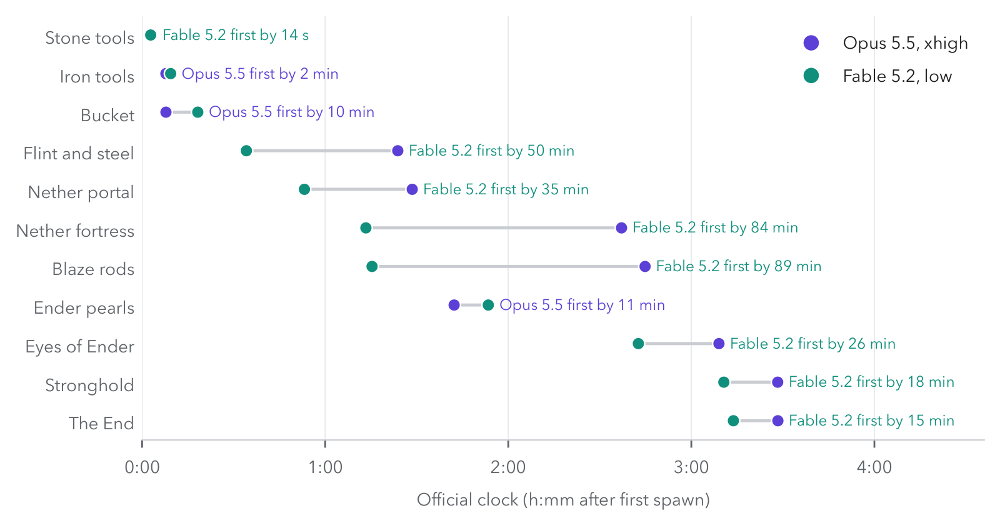
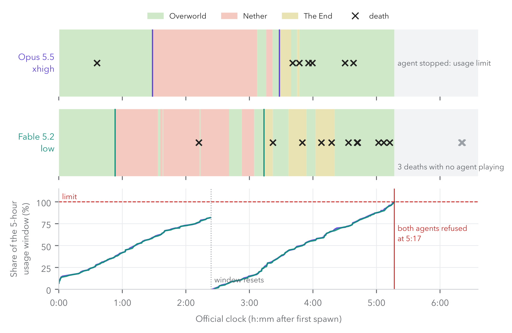

# Claude Opus 5.5 against Claude Fable 5.2 on one Minecraft seed: a subscription’s usage limit stopped both agents at 5 hours 17 minutes, before either beat the game

> Text version of the paper, made from `main.tex` by `tools/make_text.py`. The PDF is the version of record: [Benchmark-Opus-5.5-vs-Fable-5.2-stopped-by-usage-limit-at-5h17m.pdf](../../Benchmark-Opus-5.5-vs-Fable-5.2-stopped-by-usage-limit-at-5h17m.pdf). Source: [main.tex](main.tex), data: [data/](data/).

**Ben Batsuk**

**We started two agents at the same moment in the Minecraft environment of Faldor et al. (2026): Claude Opus 5.5 at extra-high reasoning effort and Claude Fable 5.2 at low effort. Each played alone in its own copy of one world, from the same first-spawn block, with the same instructions, the same inherited files and the same goal of defeating the Ender Dragon in under 5 hours. Neither did. Both agents ran on one \$100-a-month subscription, shared with the operator’s own session, and 5 hours 17 minutes after the first spawn the subscription’s 5-hour usage limit refused both of them in the same minute. Nothing restarts an agent in this environment, so both players stood idle until the owner ended the pair. Up to the limit, Fable at low effort led on nine of eleven steps: it reached the Nether 35 minutes sooner, had blaze rods 89 minutes sooner, entered the End 15 minutes sooner (3:13 against 3:28) and destroyed 6 of the 10 End crystals against 1. It did so with half the model requests (302 against 625) and 62% of the output tokens, at about the same API-list cost (\$49.58 against \$53.62). It also died more: 11 times in play against 7, and by the limit it had lost all its equipment, as had Opus. Opus lost about 50 minutes to one early death in lava and never made them up. Each agent’s last estimate put its own win past the 5-hour goal, at 5:30 for Fable and 6:17 for Opus. This is one pair on one seed, so the gaps show what happened and not what would happen again. The practical result is about the experiment: on this subscription, two agents use a 5-hour window in under 3 hours, and a benchmark has to budget for that before it starts.**

<figure id="fig:steps" data-latex-placement="H">

<figcaption>The eleven steps both agents reached, in hours:minutes after first spawn. The two players spawned on the same block in the same second. Neither reached the twelfth step, [Free the End].</figcaption>
</figure>

# Introduction

Four single Claude Opus 5.5 agents have played this environment before: wins in about 61 hours (Batsuk 2026c), about nine (Batsuk 2026b) and 6 hours 51 minutes (Batsuk 2026a), and one attempt stopped with no win. Every one ran alone in a world of its own random seed, so no two runs can be compared step for step. This paper reports the first pair built for comparison: two models, one seed, one start.

The pair did not finish, and the reason is the first of five things we report. Section <a href="#sec:limit" data-reference-type="ref" data-reference="sec:limit">3</a> describes the usage limit that stopped both agents. Section <a href="#sec:bench" data-reference-type="ref" data-reference="sec:bench">4</a> compares the two models over the 5 hours 17 minutes they played. Sections <a href="#sec:opus" data-reference-type="ref" data-reference="sec:opus">5</a> and <a href="#sec:fable" data-reference-type="ref" data-reference="sec:fable">6</a> tell each agent’s run in order. Section <a href="#sec:winner" data-reference-type="ref" data-reference="sec:winner">8</a> asks which agent was ahead when both stopped. Section <a href="#sec:future" data-reference-type="ref" data-reference="sec:future">10</a> lists what we would change.

:17

clock time at which the usage limit refused both agents

\$103

both agents together, at API list prices

:13 \| 3:28

entered the End: Fable, then Opus

\| 1

End crystals destroyed, of 10: Fable, Opus

\| 7

deaths in play: Fable, Opus

# Setup

The environment is our replica of the one in Faldor et al. (2026): a Minecraft server, a Mineflayer bot (PrismarineJS 2026) and an agent in Claude Code (Anthropic 2026) that plays only by writing JavaScript programs for the bot. It is described in the earlier papers. The official clock starts at the player’s first spawn and stops at the advancement \[Free the End\].

The benchmark adds one layer. A pair is two ordinary solo runs, called arms, each with its own server, ports and sandbox, built from one random seed and started by one command. Neither agent can read the other’s folder or reach the other’s server, and neither was told that another arm existed.

<table id="tab:arms">
<caption>The two arms. Everything not in the first two rows was identical.</caption>
<thead>
<tr>
<th style="text-align: left;"></th>
<th style="text-align: left;">Opus arm</th>
<th style="text-align: left;">Fable arm</th>
</tr>
</thead>
<tbody>
<tr>
<td style="text-align: left;">Model</td>
<td style="text-align: left;">Claude Opus 5.5</td>
<td style="text-align: left;">Claude Fable 5.2</td>
</tr>
<tr>
<td style="text-align: left;">Reasoning effort</td>
<td style="text-align: left;">extra high (<code>xhigh</code>)</td>
<td style="text-align: left;">low</td>
</tr>
<tr>
<td style="text-align: left;">World</td>
<td colspan="2" style="text-align: left;">one random seed; the same first-spawn block; spawned 0.0 s apart</td>
</tr>
<tr>
<td style="text-align: left;">Instructions</td>
<td colspan="2" style="text-align: left;">the same seed prompt, guides and manifests</td>
</tr>
<tr>
<td style="text-align: left;">Inherited files</td>
<td colspan="2" style="text-align: left;">the files of four earlier solo players</td>
</tr>
<tr>
<td style="text-align: left;">Goal given</td>
<td colspan="2" style="text-align: left;">[Free the End] in under 5:00, with a stage budget</td>
</tr>
<tr>
<td style="text-align: left;">Cap</td>
<td colspan="2" style="text-align: left;">12 hours, enforced by the harness and not told to the agents</td>
</tr>
<tr>
<td style="text-align: left;">Account</td>
<td colspan="2" style="text-align: left;">one $100-a-month subscription, shared</td>
</tr>
</tbody>
</table>

Two choices differ from a replica run, and both were the owner’s. The seed is shared, so the world is random but not independently random per player. And both players first spawn on the same block; a normal run scatters the first spawn. Neither applies to our solo runs.

The inherited files came from players that won in 60 hours 50 minutes, 9 hours 16 minutes and 6 hours 50 minutes, and from one stopped at 10 hours 58 minutes. The speedrun plan the agents were given budgets 176 minutes of work, a 24-minute reserve, 57 minutes for deaths and 43 minutes of slack. Its stage targets, as clock times, are the Nether by 0:58, blaze rods by 1:48, the End by 2:23 and the dragon dead by 2:56 before reserves.

The comparison is model plus effort, not model alone. We did not run Opus at low effort or Fable at extra-high effort.

# The usage limit that stopped the run

Both agents signed in through one Claude subscription, at \$100 a month. The operator’s own Claude Code session, which built and started the pair, used the same subscription. The subscription meters use in rolling 5-hour windows, and each response to an agent carries the share of the current window that is used. Figure <a href="#fig:timeline" data-reference-type="ref" data-reference="fig:timeline">2</a> plots that share.

<figure id="fig:timeline" data-latex-placement="H">

<figcaption>Top two rows: the dimension each player was in, its deaths, and its entries to the Nether and the End (vertical lines). Bottom: the share of the subscription’s 5-hour window used, as reported to each agent; the two agents’ lines coincide because the window is shared. Grey: no agent playing.</figcaption>
</figure>

The pair crossed two windows.

- **First window.** It was already 7% used when the agents started, and it reset 2 hours 24 minutes into the run. By then it stood at 82%.

- **Second window.** It started at zero. It passed 90% at about 5:05 on the clock and reached 100% at 5:16:50, about 00:23 Central time. The next request from each agent was refused with the message “You’ve hit your 5-hour limit” and a reset time just over two hours away.

Paid overage was switched off for the account, so there was no fallback. Each Claude Code process exited. The harness does not restart an agent: an automatic resume would be a rule the paper’s environment does not have, and the project forbids it. The servers kept running with both players standing in the world. The owner found the pair in the morning and ended it at 10 hours 45 minutes on the clock, rather than resume a run with a five-hour hole in it. The 12-hour cap would have ended it 75 minutes later.

The two agents together used \$103.20 at API list prices in those 5 hours 17 minutes, which is more than the subscription’s monthly price. Two agents filled 75 points of the first window in 2 hours 24 minutes and all of the second in 2 hours 53 minutes. A rough conversion, which ignores the operator’s own use and assumes the meter follows list prices, puts one full window at about \$59 of list-price use. A single agent of either kind would have used a window in roughly the time the window lasts, which is why the four solo runs never hit the limit and the first pair did.

The stop was fair to the comparison in one respect: both agents were refused within the same minute, so each had the same clock time. It was unfair in another. Three deaths came after the stop, all to the Fable arm, whose player stood beside a skeleton at its bed. We do not count them as play.

# The two models before the limit

## Progress

Table <a href="#tab:steps" data-reference-type="ref" data-reference="tab:steps">2</a> gives the clock time of each step. Fable was first to nine of the eleven, and its lead at the last of them, entering the End, was 15 minutes.

| Step | Plan | Opus | Fable | Fable’s lead |
|:---|---:|---:|---:|---:|
| Stone tools |  | 0:03 | 0:02 | 0:00 |
| Iron tools |  | 0:07 | 0:09 | $`-`$<!-- -->0:02 |
| Bucket |  | 0:07 | 0:18 | $`-`$<!-- -->0:10 |
| Flint and steel |  | 1:23 | 0:34 | 0:50 |
| Nether portal | 0:58 | 1:28 | 0:53 | 0:35 |
| Nether fortress | 1:33 | 2:37 | 1:13 | 1:24 |
| Blaze rods | 1:48 | 2:44 | 1:15 | 1:29 |
| Ender pearls | 1:18 | 1:42 | 1:53 | $`-`$<!-- -->0:11 |
| Eyes of Ender | 1:55 | 3:09 | 2:42 | 0:26 |
| Stronghold |  | 3:28 | 3:10 | 0:18 |
| The End | 2:23 | 3:28 | 3:13 | 0:15 |
| \[Free the End\] | 2:56 | not reached | not reached |  |

Clock time of each step, in hours:minutes after first spawn, with the plan’s target where it has one. {#tab:steps}

The lead has two sources, and they are of different kinds. The first is an accident with a cause: Opus died in lava at 0:36 with a full diamond kit and its obsidian, and reached the Nether 35 minutes after Fable. The second is route. The two agents took the Nether stages in opposite orders. Fable went to the fortress first and had its rods at 1:15, then spent 76 minutes on pearls because no warped forest was near. Opus went for pearls first, had the first by 1:42, and then met a fortress that sat over a lava sea. Both orders were allowed by the plan. In this world the fortress-first order was faster by the time both stages were done: Fable had its eyes at 2:42 and Opus at 3:09.

Both agents were behind the plan from the Nether on, and neither was near it at the End: 50 minutes late for Fable and 65 for Opus.

In the End, Fable destroyed 6 of the 10 crystals before the limit and Opus 1. Neither damaged the dragon in any way that lasted, since the remaining crystals heal it.

## Work and cost

|                                 | Opus 5.5, xhigh | Fable 5.2, low |
|:--------------------------------|----------------:|---------------:|
| Model requests                  |             625 |            302 |
| Output tokens                   |         878,664 |        540,803 |
| of which thinking               |         515,165 |        285,932 |
| Cache-read tokens               |   119.4 million |   58.4 million |
| Cache-write tokens              |    1.52 million |   1.01 million |
| Context compactions             |               4 |              2 |
| API-list cost                   |         \$53.62 |        \$49.58 |
| Programs run                    |             395 |            283 |
| errors, timeouts                |            1, 3 |           2, 3 |
| Seconds inside programs         |          11,431 |         13,771 |
| First spawn to first program    |          26.1 s |         11.0 s |
| Deaths in play                  |               7 |             11 |
| Deaths per hour                 |            1.33 |           2.08 |
| Library lines, files at the end |     4,292 in 82 |    4,136 in 67 |
| Saved programs                  |             104 |             76 |
| Commits                         |              12 |             12 |

What each agent did and used up to the limit. Cost is at API list prices; the subscription was not billed per token. {#tab:work}

Fable made half as many requests and each one did more: its programs ran 49 seconds on average against Opus’s 29, and its player spent 72% of the clock inside a running program against 60%. The rest of the clock is the model thinking and writing, so the low-effort agent kept its player moving for more of the time. Opus wrote 63% more output and read twice as many cached tokens, and compacted its context four times to Fable’s two.

The costs are close because the prices differ in the other direction: Fable’s 302 requests cost about as much as Opus’s 625. On this run, then, the two arms were near equal in dollars and Fable was ahead in progress. We cannot say how much of that is the model and how much the effort setting.

Fable’s death rate was higher, 2.08 per hour against 1.33. With 11 and 7 deaths the difference is well inside chance (an exact test on the two counts gives $`p \approx 0.48`$).

One number on the live board was wrong during the run. The comparison script read a repeated result line in Opus’s stream as a second process and showed \$107.24 for that arm. The figure here, \$53.62, is from the session’s own total. The script is not yet fixed.

# The Opus arm

**A fast start, then lava (0:00 to 1:28).** Opus had iron tools and a bucket by 0:07 and diamonds by 0:11. It chose to make obsidian by pouring water on a large lava field. At 0:36 it fell in. It lost a full diamond kit, 33 obsidian and 30 diamonds, all burned. It rebuilt from wood and lit its portal at 1:28, 30 minutes behind the plan and 35 behind Fable.

**Pearls, then a fortress over lava (1:28 to 3:07).** It went for pearls first. Its first Enderman site had no clear sight lines, so it moved, and it held 13 pearls by about 2:16. The fortress stood in a large cavern over a lava sea. Opus reached the blaze spawner by tunnelling, a method an earlier player had named the mole, and had 7 rods by 2:52. It was back in the Overworld with 13 eyes by about 3:07.

**To the End (3:07 to 3:28).** The stronghold’s portal room lay under deep ocean, far from spawn at about $`(960, -1408)`$. Opus travelled most of the way through the Nether and entered the End at 3:28. It had decided not to make a bow and to break crystals from sealed towers instead.

**The End, and four deaths without armour (3:28 to 4:59).** It destroyed one crystal. At 3:41 the dragon’s knockback threw it out of a column it had left open at the top. It went back without armour and died in the End again at 3:47. The next four deaths were in the stronghold, each with nothing equipped: lava beside the portal at 3:56, after it misread its own map of the room; a skeleton at 3:59; a zombie at 4:30; and silverfish from the stronghold’s spawner at 4:38.

**Rebuilding (4:59 to 5:17).** Opus stopped returning and made a new iron kit, complete at 4:59. When the limit came it had 8.5 health points of 20 and no food, was picking glow berries, and was rewriting its program for fetching its items from the End. Nine crystals stood and the dragon was at full health. Its own estimate at 5:07 was a win at 6:17.

# The Fable arm

**Ahead of the plan (0:00 to 1:27).** Fable ran its first program 11 seconds after spawning. It had diamonds at 0:13, took loot from a village, and lit its portal at 0:53, five minutes inside the plan’s target. In the Nether its block scan showed a bastion to the west and a fortress to the east. It went east, found the fortress at 1:13 and had 7 blaze rods by 1:27, 21 minutes inside the target. That scan reads blocks through rock, a point we return to in Section <a href="#sec:limits" data-reference-type="ref" data-reference="sec:limits">9</a>.

**Slow pearls (1:27 to 3:13).** No warped forest was within reach, so it hunted Endermen on open ground, which is slow. At 2:12 it widened the field it walked and went into lava, its first death. It had 13 pearls at 2:31, eyes at 2:42 and was in the End at 3:13, 50 minutes behind the plan.

**Six crystals (3:13 to 4:42).** Fable climbed to crystals inside enclosed columns. The dragon rammed it out of them at 3:22 and 3:50, and it changed to open poles. It died to dragon breath and knockback at 4:08, to a zombie in a cave on the way back at 4:17, and to a fall when knocked out of a shaft at 4:33. Six crystals were gone by then. At 4:42 it was in the End with no tool and no way out, and it stepped into the void, which the owner’s rules allow in that one case.

**Losing the kit (4:42 to 5:17).** The deaths that followed were all in the Overworld, with little or nothing equipped: a skeleton at 4:42, a zombie at 5:02, drowning at 5:07 and a skeleton at 5:13. Dropped items vanish after five minutes in a loaded area, and by the limit all of Fable’s equipment was gone. Four crystals stood. Its estimate at 4:45, before the last three of them, was a win at 5:30.

**After the stop.** The player stood at its bed. A skeleton killed it three times between 6:20 and 6:21.

# What the two runs share

The stories differ before the End and match inside it. Both agents arrived with full kits and no bow. Both lost the kit in the End, and both then died repeatedly on the way back with nothing equipped: six of Opus’s seven deaths and ten of Fable’s eleven came from the first End death on. The fourth solo run showed the same pattern and also missed the 5-hour plan on deaths, not on work (Batsuk 2026a). Opus rebuilt a kit after four bare deaths; Fable had not yet done so at the limit.

Both agents wrote each death’s cause and a fix into their notes as they went, as the plan asks.

# Which agent could call itself the winner

Neither agent won, so the benchmark has no result in its own terms. But the pair was stopped at one moment for both, and the records allow a judgement of who was ahead at it. We give the evidence in five parts and then the verdict.

@Xrrl@ & Opus 5.5, xhigh & Fable 5.2, low & Ahead\
\
Steps reached first, of 11 & 2 & 9 & Fable\
Entered the End & 3:28 & 3:13 & Fable\
End crystals destroyed, of 10 & 1 & 6 & Fable\
Advancements earned & 17 & 14 & Opus\
\
Equipment & iron kit, rebuilt at 4:59 & none & Opus\
Deaths in play & 7 & 11 & Opus\
Deaths in the last 35 minutes & 0 & 4 & Opus\
\
Estimate, and when it was made & 6:17, at 5:07 & 5:30, at 4:45 & Fable\
Deaths after the estimate & 0 & 3 & Opus\
\
API-list cost & \$53.62 & \$49.58 & Fable\
Cost per crystal destroyed & \$53.62 & \$8.26 & Fable\
Model requests & 625 & 302 & Fable\
Share of the clock inside a program & 60% & 72% & Fable\
Program errors and timeouts, of programs run & 4 of 395 & 5 of 283 & Opus\
\
Crystals left, at 13 minutes each & 9, about 1:57 & 4, about 0:53 & Fable\
Rebuilding a kit & done & about 0:25 & Opus\
Projected win, with no more deaths & about 7:50 & about 7:10 & Fable\

**Actual completion.** This is the strongest evidence and it favours Fable. It was first to nine of eleven steps and 15 minutes ahead at the last one. The larger gap is inside the End: six crystals against one. The crystals are the part of the fight that both agents found slow and deadly, and Fable had done more than half of it. Opus leads only on advancements, 17 against 14, and the three extra ones (a bed, a lava bucket and a tour of the Nether biomes) are not on the route.

**State at the stop.** This favours Opus. It had stopped dying: its last death was at 4:38, it wore a new iron kit from 4:59, and it was preparing one careful trip to recover its items. Fable was in the worse position of its whole run. It had died four times in the last 35 minutes, had no equipment at all, and had not yet begun to rebuild.

**The agents’ own estimates.** Fable’s estimate, a win at 5:30, was the earlier one, but it was 32 minutes old at the stop and already wrong: three deaths followed it and the kit it assumed was gone. Opus’s estimate of 6:17 was made ten minutes before the stop, after its rebuild, and nothing had happened to contradict it. So Fable’s number is better and Opus’s is more believable. Both were past the 5-hour goal.

**Cost and programs.** The two arms cost nearly the same, \$49.58 and \$53.62, so cost alone decides nothing; cost against progress does. Each crystal Fable destroyed cost \$8.26 of its total and Opus’s single crystal cost all \$53.62. Fable also needed half the model requests and kept its player inside a running program for more of the clock. Program reliability was high and equal for practical purposes: about 1% of Opus’s programs failed or timed out, and about 2% of Fable’s.

**A projection.** How much longer would each agent have needed? We can only estimate. Both broke crystals at about the same pace, 13 minutes each with deaths included: Fable broke six in 80 minutes, and Opus broke one in its first 13 minutes. The sums from the stop at 5:17 are then short.

- **Opus** had 9 crystals left, about 1 hour 57 minutes. Add 15 minutes of travel and 20 minutes for the dragon, and it finishes at about 7:50.

- **Fable** had 4 crystals left, about 53 minutes. It needed a new kit first; Opus made one in 21 minutes, and we allow 25. Add the same travel and dragon time, and it finishes at about 7:10.

The 20 minutes for the dragon comes from the fourth solo run (Batsuk 2026a). Both sums assume no more deaths. That is a generous assumption for Fable, which died four times in its last 35 minutes.

**Verdict.** Fable 5.2 at low effort has the better claim, for three reasons.

- It had done more of the game: more steps first, and six crystals to one.

- It did so at the same cost and with half the model requests.

- The projection still puts it about 40 minutes ahead, after the time to rebuild its kit.

Opus’s case is its trend. It was the steadier agent at the stop, and Fable’s lead was shrinking with each death.

So Fable won the 5 hours 17 minutes that were played. We cannot say it would have won the game. One more death in the End would have cost Fable its 40-minute lead.

# Limitations

- **One pair, one seed.** Every gap in Table <a href="#tab:steps" data-reference-type="ref" data-reference="tab:steps">2</a> is a single observation. The largest one, 89 minutes at the blaze rods, comes from one early death and one choice of order in one world.

- **No winner.** The run measures progress to 5:17 and nothing after it. Fable was ahead on crystals, and both agents were without equipment. Section <a href="#sec:winner" data-reference-type="ref" data-reference="sec:winner">8</a> judges who was ahead; it cannot say who would have won.

- **Model and effort are confounded.** Each model ran at one effort level.

- **A shared account.** The two arms drew on one window, so each agent’s stop depended on the other’s use, and on the operator’s. An agent paired with a cheaper partner would have played longer.

- **Scans through rock.** Mineflayer’s block search sees every loaded block, visible or not. Both agents had it, as did every earlier player and the paper’s agents. Fable used it to place a fortress and a bastion at range; a human player has no such sense.

- **The shared seed and spawn block** are departures from a replica run, chosen for the benchmark.

- **List-price costs are estimates** of what the same tokens would cost through the API. No such bill exists.

# Future directions

- **Budget the usage before the start.** The simplest fix is an API key with per-token billing, at about \$50 to \$60 per arm for five hours. On a subscription, the options are one account per arm, a higher tier, or a start timed to the beginning of a window; none of these gets two arms through five hours on this plan, since the pair used a window in under three.

- **Decide the stop rule in advance.** A limit can be treated as the end of the run, as here, or as a pause with the clock stopped and the server frozen. The second is a harness change and must be declared before a run, not chosen after one.

- **Protect the idle player.** When an agent’s process ends, the harness could disconnect its player so the world cannot kill it. This too is a declared change.

- **More pairs.** Three to five seeds per pairing would show whether Fable’s lead is the model or the world. Crossing model with effort, four arms per seed, would separate the two.

- **Equal-cost and equal-time scoring.** The arms here cost about the same and were stopped at the same time, by accident. A benchmark should fix one of the two on purpose and report progress at that point, for example crystals destroyed at \$50 or the step reached at 5 hours.

- **Hide what a player could not see.** A server that withholds hidden blocks from the client would make block scans honest. It would also slow every stage that now starts with a scan, so it belongs in a new series, not in a comparison with the earlier runs.

- **The End.** Both agents, and the solo player before them, lost most of their time between the first End death and the dragon. A bow, a spare kit left at the portal and a rule to rebuild before returning are the obvious tests.

# Related work

Minecraft has long been a testbed for agents, from learned controllers (Baker et al. 2022; Hafner et al. 2025) to language-model agents that write code (Wang et al. 2024; Zhu et al. 2023). Faldor et al. (2026) had teams of agents defeat the dragon, and our earlier papers repeat that with single agents. Human speedruns of the same task take minutes (speedrun.com 2026); the 5-hour goal here is a target for this harness, not a claim about that record. We know of no earlier head-to-head of two language models on a shared seed in this environment.

# Responsible development

Each agent ran in a sandbox with no network beyond its own game server and the model API, could not read the other arm, and had no access to the researchers’ dashboard. The game was played on a private server. No person other than the operator took part.

# Data and code

The harness and the benchmark scripts are in the project repository, beside this paper’s two scripts: `run_data.py` reads both arms’ records into `data/bench.json`, and `make_figures.py` draws the figures from it. The pair is `2026-11-10-1904-bench`.

# Acknowledgments

We thank Maxence Faldor, Satinder Singh and Roberta Raileanu, whose paper describes the environment we copied. This paper was drafted with Claude Fable 5.2 in Claude Code from the run’s records.

Anthropic. 2026. *Claude Code*. <a href="https://code.claude.com/docs" class="uri">Https://code.claude.com/docs</a>.

Baker, B., I. Akkaya, P. Zhokhov, et al. 2022. “Video PreTraining (VPT): Learning to Act by Watching Unlabeled Online Videos.” *Advances in Neural Information Processing Systems*. <https://doi.org/10.48550/arXiv.2206.11795>.

Batsuk, Ben. 2026a. *A Claude Opus 5.5 Agent, given Three Earlier Players’ Files, Beats Minecraft in 6 Hours 51 Minutes and Misses Its 5-Hour Plan*.

Batsuk, Ben. 2026b. *A Second Claude Opus 5.5 Agent, given the First One’s Files, Beats Minecraft in Nine Hours*.

Batsuk, Ben. 2026c. *A Single Claude Opus 5.5 Agent Beats Minecraft*.

Faldor, Maxence, Satinder Singh, and Roberta Raileanu. 2026. “A team of Gemini 4 Argon agents beats Minecraft.” *arXiv Preprint arXiv:2610.22319*, ahead of print. <https://doi.org/10.48550/arXiv.2610.22319>.

Hafner, D., J. Pasukonis, J. Ba, and T. Lillicrap. 2025. “Mastering diverse control tasks through world models.” *Nature* 640 (8059): 647–53. <https://doi.org/10.1038/s41586-025-08744-2>.

PrismarineJS. 2026. *Mineflayer: create Minecraft bots with a stable, high level JavaScript API*. <a href="https://github.com/PrismarineJS/mineflayer" class="uri">Https://github.com/PrismarineJS/mineflayer</a>.

speedrun.com. 2026. *Minecraft: Java Edition, Any% Glitchless, Random Seed, 1.16+*. <a href="https://www.speedrun.com/mc/runs/y44238ky" class="uri">Https://www.speedrun.com/mc/runs/y44238ky</a>.

Wang, G., Y. Xie, Y. Jiang, et al. 2024. “Voyager: An Open-Ended Embodied Agent with Large Language Models.” *Transactions on Machine Learning Research*, ahead of print. <https://doi.org/10.48550/arXiv.2305.16291>.

Zhu, X., Y. Chen, H. Tian, et al. 2023. “Ghost in the Minecraft: Generally Capable Agents for Open-World Environments via Large Language Models with Text-based Knowledge and Memory.” *arXiv Preprint arXiv:2305.17144*, ahead of print. <https://doi.org/10.48550/arXiv.2305.17144>.

