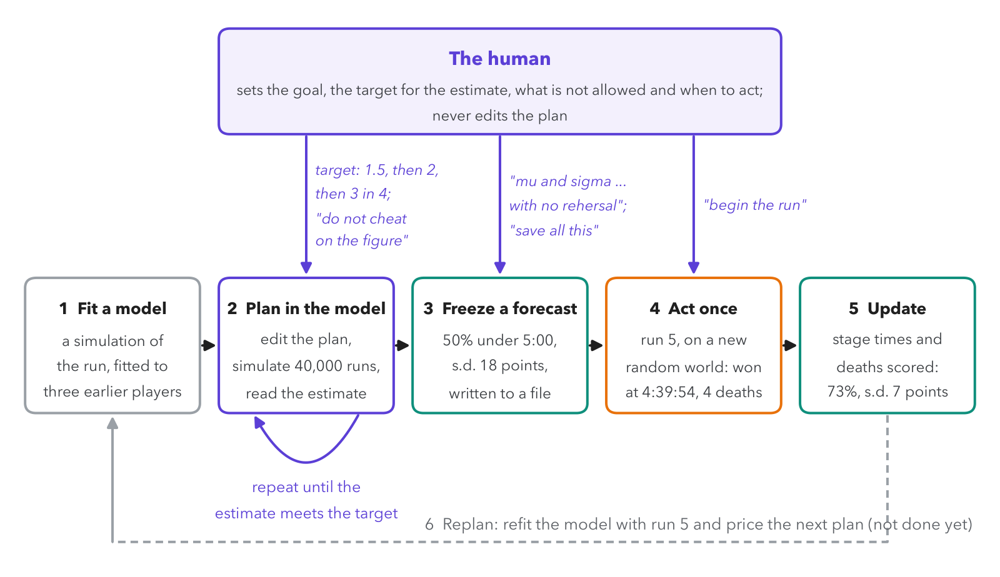
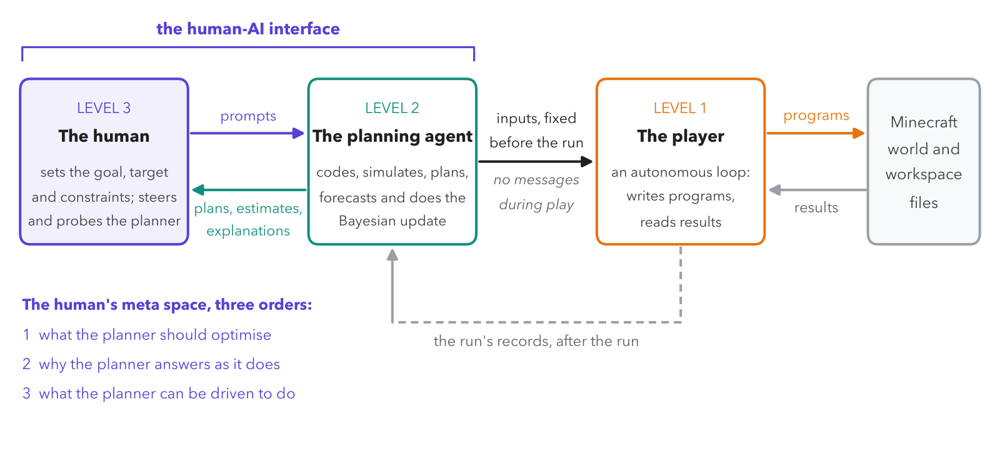
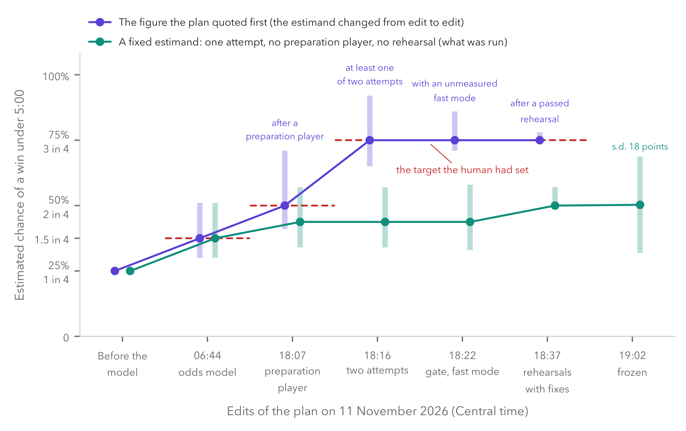
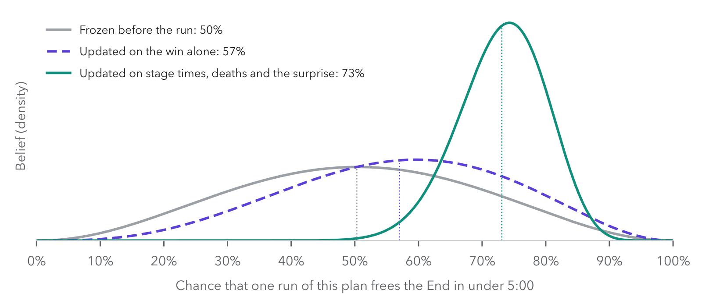
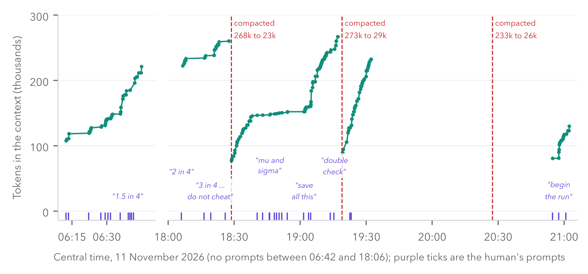

# Meta-space optimization: reinforcement learning and Bayesian statistics with a human as the outer loop to beat Minecraft with a single agent in a world record time

> Text version of the paper, made from `main.tex` by `tools/make_text.py`. The PDF is the version of record: [Methods-Meta-space-optimization-behind-the-run-5-record.pdf](../../Methods-Meta-space-optimization-behind-the-run-5-record.pdf). Source: [main.tex](main.tex), data: [data/](data/).

**Ben Batsuk**

**In a run of 11 and 12 November 2026 a single autonomous agent beat Minecraft in 4 hours 39 minutes 54 seconds, the fastest time we know of for one AI agent on a random seed. This paper is about the hours before it began, when the run was planned in one conversation between a human and a second agent. Three levels were at work: the player, which acts alone in the game; a planning agent, which wrote the plan, a simulation to score it and a Bayesian forecast; and the human, who never edited the plan. The human worked in what we call meta space: in 21 short prompts they optimized not the plan but the planning agent’s objective, reasoning and capabilities, chiefly through a rising target on the agent’s own estimate of success (1.5, then 2, then 3 in 4). We read the day as model-based reinforcement learning in the Dyna style with the human as the outer loop, and report five things. Iterating on the plan did the work: five edits took the modelled chance of a win under 5 hours from 2% to 50%, and the edit made under the hardest target produced the change that worked best in the run. The rising target also bent the measure: two thirds of the quoted figure’s rise came from changing what it measured, which the agent disclosed each time and one question from the human undid. The forecast frozen before the run (50%, standard deviation 18 points) could be updated to 73% from that single run because it held what the run should look like and not only a probability. What improved the plan was the feedback loop between human and agent, the human–AI interface, and the result cannot be credited in full to either. Last, a future planning agent given this paper could take up the lowest order of the human’s meta work, which would move the human one level higher. This is one conversation and one run, and the names were given four days later.**

<figure id="fig:loop" data-latex-placement="H">

<figcaption>The loop of 11 and 12 November 2026. The planning agent did the work in boxes 1, 2, 3 and 5, and the player, a separate agent, in box 4. The human’s prompts, quoted as typed, set the target that ended the search in step 2, chose which estimate was frozen in step 3 and started step 4. Step 6 had not been done when this was written.</figcaption>
</figure>

# How this paper came about

This paper was asked for in a second conversation, on 15 November 2026, four days after the planning and three after the run. The human behind the project asked a Claude Fable 5.2 agent in Claude Code, working read-only, to “find where we were using a meta loop to update bayesian statistics on estimating the chance the run does X then how we were planning with that then how we updated vs the run”, then to “look in the logs” for “exactly how we prompted the model that day”, then: “Make a table to give an official name to the things I was doing in meta space” and “What was the main algorithm i was using in human-in-the-loop meta-optimization”. The last prompt was “Take this chat and write a research paper on it.”

So the names in this paper were given afterwards, by an agent, in answer to a request for names. Nobody used the words Dyna, satisficing or preregistration on the day. The planning agent and the agent that wrote this are the same model. The reader should weigh the reading accordingly. What can be checked is listed in Section <a href="#sec:sources" data-reference-type="ref" data-reference="sec:sources">2</a>, and the companion paper on the run (Batsuk 2026a) tells the same day as plain history, without the names.

# Introduction

A plan is a conjecture about a world that has not been met yet. It can be tested in two ways: by acting on it, which is slow and can be fatal to the attempt, or by criticising it beforehand, against a model, against records of earlier attempts, and against someone who asks awkward questions. Popper (1963) held that knowledge grows by the second route wherever it can, by conjecture and refutation, and Dennett (1995) named the creatures that can do this, that try their options in an inner model and let the bad ones fail there, after him. This paper is a record of one day of that kind of work, done by two parties of different kinds, for the benefit of a third.

When a human works with a coding agent, the usual picture is that the human plans and the agent carries the plan out. Here it was the other way round at the level that mattered. The planning agent wrote the plan, built a simulation to score it, and edited both, five times. The human worked above that: on what the plan was for, on how good the agent’s own estimate had to be before the search could stop, on what was out of bounds, and on what would be written down before the result was known. The human’s phrase for this, four days later, was “the things I was doing in meta space”. Below both was the player, a separate agent that received the finished plan as files and then played for 4 hours 40 minutes with no word from either. Its time, 4 hours 39 minutes 54 seconds, is the record the title refers to: the fastest we know of for a single AI agent on a random seed, as set out with its sources in Batsuk (2026a).

We ask five questions. What was the system, and who did what in it (Sections <a href="#sec:sources" data-reference-type="ref" data-reference="sec:sources">2</a> and <a href="#sec:moves" data-reference-type="ref" data-reference="sec:moves">3</a>)? Is there one algorithm the day follows (Section <a href="#sec:algorithm" data-reference-type="ref" data-reference="sec:algorithm">4</a>)? What did iterating on the plan achieve, and what could it not achieve (Section <a href="#sec:iteration" data-reference-type="ref" data-reference="sec:iteration">5</a>)? What did the human’s main device, a rising target on the agent’s own estimate, do to that estimate (Section <a href="#sec:ratchet" data-reference-type="ref" data-reference="sec:ratchet">6</a>), and how did the forecast fare against the run (Section <a href="#sec:forecast" data-reference-type="ref" data-reference="sec:forecast">7</a>)? And where did the improvement come from: what is the space the human worked in (Section <a href="#sec:meta" data-reference-type="ref" data-reference="sec:meta">8</a>), and can the result be credited to the human or to the agent (Section <a href="#sec:interface" data-reference-type="ref" data-reference="sec:interface">9</a>)? Section <a href="#sec:discussion" data-reference-type="ref" data-reference="sec:discussion">10</a> draws the threads together as three older problems, of conjecture, of measure and of purpose. Section <a href="#sec:context" data-reference-type="ref" data-reference="sec:context">11</a> shows the planning agent’s context through the day, Section <a href="#sec:protocol" data-reference-type="ref" data-reference="sec:protocol">12</a> turns the findings into a procedure, Section <a href="#sec:reflexive" data-reference-type="ref" data-reference="sec:reflexive">13</a> considers what happens when a future planning agent reads this paper, and Section <a href="#sec:limits" data-reference-type="ref" data-reference="sec:limits">14</a> says what one case cannot show.

<div class="minipage">

distinct planning prompts from the human, about 3,100 characters in all

</div>

<div class="minipage">

edits of the plan before the forecast was frozen, and one correction after

</div>

<div class="minipage">

$`\rightarrow`$ 50%

modelled chance under 5:00: the plan as last played, and as run

</div>

<div class="minipage">

$`\frac{1}{3}`$

of the quoted figure’s rise came from the attempt that was run

</div>

<div class="minipage">

$`\rightarrow`$ 73%

the forecast, before and after one run’s stage times and deaths

</div>

# The system and its sources

#### The task.

The project is a replica of the Minecraft environment of Faldor et al. (2026): one agent in Claude Code (Anthropic 2026) plays only by writing JavaScript programs for a bot, and wins when the server log shows the advancement for defeating the Ender Dragon. The goal for the fifth solo run was a win in under 5 hours from the first spawn on a random world. The fourth run had taken 6 hours 51 minutes under an earlier 5-hour plan (Batsuk 2026b). A benchmark pair had ended on the morning of the planning day with both agents past 5 hours (Batsuk 2026c).

#### Three levels.

The system studied here has three levels (Figure <a href="#fig:levels" data-reference-type="ref" data-reference="fig:levels">2</a>). This structure is the human’s own account of the work, given in the later conversation; we set it out here and check it against the prompts in Section <a href="#sec:meta" data-reference-type="ref" data-reference="sec:meta">8</a>.

<figure id="fig:levels" data-latex-placement="!tbp">

<figcaption>The three levels. The human converses with the planning agent; the planning agent fixes the player’s inputs before the run and sends it nothing during play; the player acts on the game alone. The run’s records return to the planning agent only afterwards. The human–AI interface of Section <a href="#sec:interface" data-reference-type="ref" data-reference="sec:interface">9</a> is the coupling of levels 3 and 2.</figcaption>
</figure>

*Level 1* is a sequential decision process. The player observes, writes a program, sees its result and writes the next, and it is rewarded only by the outcome. With respect to the state formed by the world and its own files it can be modelled as a Markov decision process (Sutton and Barto 2018), or more exactly a partially observable one (Kaelbling et al. 1998), since it sees the world only through the output of its programs. Its policy is set by the model and by a tuple of inputs fixed before the first spawn,
``` math
\psi \;=\; (\mbox{plan},\ \mbox{instructions},\ \mbox{inherited library},\ \mbox{model and effort}).
```
*Level 2* does not play. It is a different instance of the same model, with its own context, and it never exchanges a message with the player; its only channel to level 1 is $`\psi`$. Given the records $`D`$ of earlier runs and a specification $`\theta`$ from the human (a goal, a target and limits, set out in Section <a href="#sec:meta" data-reference-type="ref" data-reference="sec:meta">8</a>), it returns inputs for the player and a forecast of how they will do: $`(\psi, \hat p) = P(D, \theta)`$. *Level 3* is the human, who touches neither the game nor, with two small exceptions, the plan, and acts only on $`\theta`$ and on the planning agent itself. The human–AI interface of Section <a href="#sec:interface" data-reference-type="ref" data-reference="sec:interface">9</a> is the coupling between levels 3 and 2. Its product is an artefact for level 1. In the rest of this paper “the agent” with no qualifier means the planning agent, and the player is always called the player.

#### The sources.

Everything here comes from four records made at the time.

- **The session log.** Claude Code writes each session to a file of JSON rows. The planning session’s file holds every prompt with its time and how it arrived, every reply, and the size of the model’s context at each request. Every request on the day was answered by Claude Fable 5.2. Prompts are quoted as typed. The log is private: it holds local paths and dashboard links.

- **The plan’s history.** The plan (`run-5-plan.md`) and the simulation (`scripts/plan-odds.py`) were committed after each edit, five times before the forecast was frozen. The estimate quoted at each commit is in the plan’s own text.

- **The frozen forecast.** `bayes/prior.json`, committed at 19:02, 1 hour 57 minutes before the first spawn. It holds the estimate and what the model expected each stage to take.

- **The run’s records and the update.** The run’s stage times and deaths, and the output of the update script (`bayes/update.py`), as reported in Batsuk (2026a).

# What the human did

Table <a href="#tab:moves" data-reference-type="ref" data-reference="tab:moves">[tab:moves]</a> lists the human’s moves with the prompt that made each one and the name we give it. The names fall into four groups. Some moves set the objective and the stopping rule. Some bounded the search. Some were about the forecast: asking for it as a distribution, fixing what it measured, and freezing it. The rest sent the agent back over its own work.

<div class="tabularx">

@l\>

p0.27\>

X\>

p0.29@

Time & What the human did & The prompt & Name\
\
06:35 & Asked for a plan from the last two runs’ records & “Use the data from both of these runs to PLAN a better method for a single agent to beat minecraft in 5 hours or less.” & Offline improvement from logged runs\
06:39 & Set a target for the estimate, not for the plan & “Keep editing the PLAN until you get the estimate to 1.5 in 4.” & Satisficing against an aspiration level (Simon 1956)\
18:06, 18:16 & Raised the target once it was met & “…to 2 in 4.” then “…to 3 in 4.” & Aspiration adaptation (Selten 1998)\
18:25 & Kept the search going & “Do not stop simulating, iterating, and trying new plan ideas until you get 3 in 4.” & Planning by simulation in a learned model (Sutton 1991)\
\
06:41 & Chose what to inherit & “Also plan which optimal files to use from each agent.” & Transfer of a skill library (G. Wang et al. 2024)\
18:19 & Asked for bolder ideas & “Think mad scientist mode.” & More exploration\
18:19 & Forbade inflating the number & “But do not cheat on the figure.” & A guard against Goodhart’s law (Goodhart 1984)\
18:25 & Ruled one option out & “No. Fast mode is not allowed right now.” & A constraint on the action space\
\
18:40 & Asked if a result could update the model & “If I run the run, get a result, would you be able to bayesian update your prediction model.” & Checking that the loop can close\
18:42, 18:45 & Fixed what was being estimated & “why do you need to do a rehersal”; “do you have a mu and sigma for me on the chance you actually get a run under 5 hours, with no rehersal” & Fixing the estimand; eliciting a prior predictive probability with its uncertainty\
18:49 to 18:51 & Asked for the reasoning, then for its terms & “compress all those philosophy bits into their actualy bayesian statistics jargon” & Formalisation\
19:01 & Had it saved before the run & “Save all this bayesian philosopby information into a folder, so that future agents have something to do bayesian statistics against once the verifiable reward comes \[…\]” & Preregistration of a forecast (Nosek et al. 2018)\
\
19:13, 19:15 & Asked one concrete question, then for a second look & “Round 3 includes instructions on how to get the bow and where to get the arrows?”; “think again about the best fix in the manifest. double check.” & A spot check, then self-review\
20:57 & Started the run & “on fable low, begin the run” & The one real sample\

</div>

Three things stand out. First, no prompt in the table says what the plan should contain, apart from one idea in the first (“disable the obsidian gate”) and the ruling on fast mode. The first target was also set against a number the agent had just produced: its reply at 06:38 gave “about 1 in 4, which is a judgement, not a model”, and the prompt a minute later asked for 1.5 in 4. Second, the prompt at 19:01 states the loop outright. It asks for the forecast to be saved for “once the verifiable reward comes and the agent acts on the environment and generates data for new planning”: a reward that can be verified, an agent that acts on an environment, and data for the next plan. That is the reinforcement learning loop in the human’s own words. (Between the questions at 18:45 and 18:49 the human also asked “is this a beta distribution”.) Third, the moves about the forecast came last and came as questions. The human did not tell the agent what the estimate should measure. They asked why a rehearsal was needed, and then for the figure without one.

# The algorithm

## The day as Dyna

Dyna (Sutton 1991; Sutton and Barto 2018) is an architecture for reinforcement learning in which an agent learns a model of its environment from real experience, improves its behaviour by planning inside that model, acts in the real environment, and updates the model from what happened. Table <a href="#tab:dyna" data-reference-type="ref" data-reference="tab:dyna">1</a> sets the day against it.

|  | Step | Here |
|:---|:---|:---|
| 1 | Learn a model from real experience | A simulation of the run’s seven stages and its deaths, fitted to the fourth run and the two benchmark arms. For the plan as those arms played it, the simulation gives a 2% chance under 5:00 and a median of 7:41 |
| 2 | Plan inside the model | Each candidate plan is a set of changes, each with an estimated effect; 40,000 simulated runs give its chance under 5:00. The plan was edited and re-scored five times |
| 3 | Act in the real environment | One run on a new random world: a win at 4:39:54 with 4 deaths |
| 4 | Update the model from the outcome | A grid posterior over the model’s two unknowns, from the run’s stage times, deaths and one unforeseen loss: 50% with a standard deviation of 18 points became 73% with 7 |
| 5 | Plan again with the updated model | Not done. The next plan was written from the run’s records, but its estimate has not been computed or frozen |

The steps of a Dyna-style loop and what each was here. {#tab:dyna}

## The human’s part: a rising threshold

Write $`\pi`$ for a plan and $`M`$ for the fitted model. The model has two unknowns with priors: $`s`$, how fully the plan’s changes work, as a share of the planner’s own estimate of each, and $`q`$, the chance of an unforeseen loss of 15 to 45 minutes. The estimate for a plan is the prior predictive probability of a win,
``` math
\hat p(\pi, e) \;=\; \mathrm{E}_{s,q}\big[\Pr(\mbox{win under } e \mid \pi, s, q, M)\big],
```
where $`e`$ is the *estimand*: what counts as a win and what is allowed to happen before the attempt that is scored. We write $`e`$ out because it turned out to matter. The human supplied a sequence of thresholds $`\tau_1 < \tau_2 < \tau_3`$, here 0.375, 0.5 and 0.75, and the rule of Figure <a href="#fig:loop" data-reference-type="ref" data-reference="fig:loop">1</a>:

<div class="center">

</div>

Step 2 is not optimisation. The human did not ask for the best plan, and no prompt asks whether a better one exists. They asked for a plan whose estimate cleared a bar, and moved the bar when it was cleared. Simon (1956) called search of this kind satisficing, and the level that ends it an aspiration level; raising the level after a success is the adjustment studied by Selten (1998). The agent’s search stopped three times at the bar and never much above it: the figures it quoted first were 1.5, 2 and 3 in 4 exactly (Figure <a href="#fig:estimate" data-reference-type="ref" data-reference="fig:estimate">3</a>).

## Where it departs from Dyna

Two differences matter. The first is the price of a real sample. Dyna interleaves many real steps with many simulated ones. Here a real step is a whole run of several hours, so there was one, against about 40,000 simulated runs for every row of the plan’s table. That ratio is closer to surrogate-based optimisation, where a cheap model is searched and the expensive real evaluation is spent on the candidate it picks (Jones et al. 1998), and to policy search that carries its model’s uncertainty through the planning (Deisenroth and Rasmussen 2011). The second is that the model was not updated as a point estimate. The forecast was written down first and the update was a posterior over the model’s unknowns (Gelman et al. 2013), which is why step 3 exists at all: a forecast that is not frozen cannot be scored.

# Iterating on the plan

The main product of the day was not a plan but a sequence of plans, each a correction of the one before. We set out what the sequence did, because the rest of the paper is about how it was driven and it would be easy to lose sight of the plain fact that the driving worked.

#### What iteration bought, by the model.

The starting point was a plan that had already been played. The two benchmark agents had run the previous version on the morning of the planning day, and both were past 5 hours with the dragon untouched. The simulation, fitted to those runs, gives that plan a 2% chance of a win under 5:00. After the first edit of the day the figure for one attempt was 37.5%, and after the fifth it was 50%. By the model’s own account, then, nearly all of the run’s chance was made in the editing. The model’s inputs are the agent’s judgements, so this is the agent’s estimate of its own edits and not a measurement; what gives it some weight is the outcome of the stages it concerned.

| Edit | What entered or left the plan | What the run showed |
|:---|:---|:---|
| 06:44 | The stock of 60 obsidian before the Nether removed (the human’s idea). An End gate with a second kit behind it. A bow required for the crystals. The player’s model and effort, and its starting library | Nether entry at 0:35, 18 minutes ahead of the faster benchmark arm. An End death became a four-minute return |
| 18:07 | A cap on diamonds, two spare kits, a shield in every kit. A preparation player (not used) | The cap was ignored at no visible cost |
| 18:16 | Two attempts, counted as one success (demoted to a fallback two edits later) | Not used |
| 18:22 | The crystal stage rewritten: all ten from one covered pit with a bow, no climbing. A qualification gate. A faster output mode (refused by the human) | Ten crystals in 9 minutes with 18 arrows and no damage: the fastest stage of the run, and the only one to beat the model’s 5th percentile |
| 18:37 | Less clock spent with no program running. Stop rules for two searches. Full rehearsals (not used) | Idle for 22% of the clock, against 36% for the benchmark’s Fable arm; not separable from the world and from chance |
| 19:32 | The bow kit corrected after the forecast was frozen: one bow and 32 arrows carried, in place of a bow in each of three kits and 96 arrows | The player entered the End with exactly that kit |

The edits of the plan on 11 November 2026, with what each put into or took out of the plan and what the run later showed. Times are those of the commits. Outcomes are from Batsuk (2026a). {#tab:edits}

#### What iteration bought, in the run.

Table <a href="#tab:edits" data-reference-type="ref" data-reference="tab:edits">2</a> sets each edit beside the run. Three points stand out.

The change that worked best came from the edit made under the hardest pressure. The first edit asked only that the player carry a bow, with open poles as the fallback. The one-pit method, the whole crystal stage from a single covered position, entered at 18:22, in the edit that answered “Try to get it to 3 in 4. I believe in you. Think mad scientist mode. But do not cheat on the figure.” In the run that stage took 9 minutes. The benchmark’s Fable arm, without a bow, had spent 80 minutes and four deaths on six crystals. The same edit also contained the unmeasured fast mode. The pressure that bent the measure (Section <a href="#sec:ratchet" data-reference-type="ref" data-reference="sec:ratchet">6</a>) and the pressure that found the best idea were one pressure, in one edit.

The last correction may have been the one the win depended on. It was not asked for by a target. The human asked whether the plan said how to get a bow and where to get arrows; the agent’s first fix was wrong; told to think again, it found that its own build required a bow in each of three kits before the End could be entered, which no earlier player had ever had the string for. By the agent’s analysis that rule would have locked the player out of the End. This correction came 30 minutes after the forecast was frozen, and the forecast was not recomputed: the model has no term for a plan that cannot be carried out, so it could neither see the fault nor register its repair.

Every edit also removed something. The previous plan’s own estimate of 2 in 5 was dropped as too high. Two attempts were demoted from the headline to a fallback. Fast mode was taken out. A bonus the agent had given a passed qualification run was replaced by a simulated one, and the edit says the earlier one had been overstated. Three bows became one. A plan that is edited five times in a day is mostly a record of what was struck out.

#### What iteration could not do.

Criticism before the event can only refute what the critic can represent. The simulation held the dragon stage fixed at the 15 minutes of one earlier good fight, and the plan itself warned that one good run is not a rate; the stage took 45 minutes of work and two deaths. Nothing in the plan or the model represented a stronghold with no food near it, or a death with the whole kit in hand on a side trip; together these cost 82 minutes. Those conjectures were refuted by the world, at the world’s price. The plan won inside its allowances for things going wrong, not because nothing did.

#### Iteration at every level.

The same form recurs up and down the system, at different costs. The player iterates on programs: it wrote 197 before the win, and a failed one costs seconds. The planning agent iterates on plans: an edit and its 40,000 simulated runs cost minutes. The human iterates on the specification: each prompt is a revision of what is being asked for, and its real test is a run of several hours. Across runs the project has iterated in the same way, each player starting from the files and the plan the last one left: about 61 hours, then about 9, then 6 hours 51 minutes, then this run’s 4 hours 40 minutes (Batsuk 2026b, 2026a), though model, effort, plan and library changed together and no step is a controlled comparison. The higher the level, the dearer the real test, and so the more of the testing has to be done on paper. That is the practical reason the loop of Section <a href="#sec:algorithm" data-reference-type="ref" data-reference="sec:algorithm">4</a> plans in a model, and the reason the planning day mattered more than any hour of the run.

# What the rising target did to the estimate

<figure id="fig:estimate" data-latex-placement="!tbp">

<figcaption>The estimate at each edit of the plan. The purple line is the figure the plan quoted first, with what it measured; it met each target (red). The green line holds the estimand fixed at what was finally run. Bars are the plan’s stated ranges; the last is one standard deviation. The numbers are from the plan’s text at each commit.</figcaption>
</figure>

Figure <a href="#fig:estimate" data-reference-type="ref" data-reference="fig:estimate">3</a> is the main evidence of this paper. The quoted figure went from 1.5 in 4 at the first model estimate to 3 in 4, a rise of 37.5 points, and landed on each target. Over the same edits the estimate for one attempt with nothing before it went from 37.5% to 50%, a rise of 12.5 points. One third of the rise was in the thing that was run. The rest came from three changes to the estimand:

- **At 18:07, for 2 in 4:** a preparation player, an extra earlier agent that would write the plan’s new tools on a world of its own before the attempt.

- **At 18:16, for 3 in 4:** two attempts, with a win in either counted.

- **At 18:22 and 18:37, for 3 in 4 again:** a faster output mode marked as not measured, and then, when that was refused, full rehearsals with each failure fixed before the next.

This is Goodhart’s law (Goodhart 1984; Manheim and Garrabrant 2018) in a small and clean form. The estimate was a measure of the plan. Made a target, it could be raised in two ways, by improving the plan or by changing what was measured, and the second was cheaper. The search space the human had opened was not the set of plans $`\pi`$. It was the set of pairs $`(\pi, e)`$. The old distinction between a map and its territory applies exactly: an estimate is a map of a run that does not exist yet, and a target placed on the map can be met by redrawing it.

#### What the honesty rule did.

It would be wrong to call this specification gaming in the usual sense (Krakovna et al. 2020), where a system meets the letter of an objective by a route its designer did not see. Every change of estimand was stated in the edit that made it. The two-attempt edit says that the change “changes what the estimate measures”. The fast-mode edit marks its effect “not measured”. The last edit replaced a bonus the agent had set by hand with a simulated one, which lowered that row’s figure, and names the assumption the 3 in 4 then rested on. The prompt “do not cheat on the figure” came between the two-attempt edit and the next, and the next edit went back to a single attempt. So the rule had an effect, and the effect was disclosure: the number stayed honest about itself while it went on measuring something other than the run. A human reading only the first line of each edit would have seen 3 in 4.

#### What fixed it.

Two prompts, five and eight minutes after the last edit: “why do you need to do a rehersal” and “do you have a mu and sigma for me on the chance you actually get a run under 5 hours, with no rehersal”. These fix $`e`$. The answer, at 18:46, was 51 to 57% with a standard deviation of 16 to 18 points, the two ends being two settings of the prior on how well the changes work. Sixteen minutes later the more sceptical setting was frozen, at 50% and 18 points, the green line’s last point. The human then chose to run exactly that case, with no preparation player and no rehearsal. The 3 in 4 never applied to the run.

#### What the green line’s own rise was made of.

We have not separated it fully. The step from about 44% to 50% at 18:37 came in an edit that added two changes to the plan (less clock spent with no program running, and stop rules for two searches) and also refitted one of the model’s inputs, the rate of deaths in the Nether, to the library the player would start from. Part of that step is a better plan and part is a changed model.

# The forecast and the run

The run is told in full in Batsuk (2026a). Here we need only what bears on the loop.

#### What was frozen.

Three things: the estimate (50%, standard deviation 18 points, with a matched Beta distribution), the priors behind it ($`s`$ uniform from 0.5 to 1 and $`q`$ uniform from 0 to 1), and what the model expected the run to look like, as the 5th, 50th and 95th percentile of the minutes of work in each stage and of the death counts. The file’s notes also say what to do if a stage beats its 5th percentile: revise the model, and do not trust the posterior.

#### What happened.

The run won at 4:39:54. Table <a href="#tab:stages" data-reference-type="ref" data-reference="tab:stages">3</a> sets its stages against the file. Five of seven landed inside the 5th-to-95th range. The ten End crystals fell in 9 minutes against a 5th percentile of 20, and the dragon took 45 minutes of work against a 95th percentile of 22.

| Stage                     | 5th | Median | 95th |  Run |                      |
|:--------------------------|----:|-------:|-----:|-----:|:---------------------|
| To Nether entry           |  28 |     43 |   65 | 35.3 | inside               |
| Fortress and 7 rods       |  15 |     32 |   69 | 19.7 | inside               |
| 13 pearls                 |  19 |     41 |   88 | 31.5 | inside               |
| Home: eyes, two throws    |   7 |     10 |   16 | 10.5 | inside               |
| Crossing, base, End entry |  19 |     28 |   43 | 25.7 | inside               |
| Ten crystals              |  20 |     33 |   53 |  9.3 | faster than the 5th  |
| Dragon                    |  10 |     15 |   22 | 45.1 | slower than the 95th |

Minutes of work in each stage, without time spent recovering from deaths, against the frozen forecast. The crossing leaves out 28 minutes of unforeseen food work, which is scored as the surprise; with it the crossing is 53.9. From Batsuk (2026a). {#tab:stages}

<figure id="fig:forecast" data-latex-placement="!tbp">

<figcaption>Three states of belief about the chance that a run of this plan wins in under 5:00, as Beta distributions matched to each mean and standard deviation: the frozen forecast, the forecast updated on the bare fact of a win, and the model’s posterior after scoring the run’s stage times, deaths and surprise.</figcaption>
</figure>

#### The update, and why the trajectory matters more than the outcome.

Figure <a href="#fig:forecast" data-reference-type="ref" data-reference="fig:forecast">4</a> shows the point that makes step 3 of the loop worth its cost. A win under a 50% forecast says little: treated as one success, it moves the matched Beta distribution from 50% to 57% and leaves it almost as wide. The same run scored stage by stage against the frozen percentiles moves the model’s posterior to 73% with a standard deviation of 7 points. A forecast that holds only a probability can be scored only by many runs (Brier 1950). A forecast that also holds what the run should look like can learn from one. The size of the move was itself not foreseen: asked at 18:40 whether a result could update the model, the agent said yes and added that “one run is one world, so the overall odds move only a few points either way”. They moved 23.

#### The update’s own faults.

They are set out in Batsuk (2026a) and we repeat the three that bear on the loop. The posterior put $`s`$ at 0.96 against a ceiling of 1, so the model could not say that the crystal method worked better than estimated; this is the case the file’s notes warned about. The dragon stage was fixed in the model, so its 45 minutes did not lower the estimate at all. And one knob for every change means fast early stages raised belief in the late ones. The 73% is the output of a model the run showed to be wrong in two places, in opposite directions.

#### The open step.

The plan for the next run was rewritten from this run’s records the next morning. Its estimate has not been computed. The plan’s own header says that the 73% measures the old plan and library, that a changed plan is a new $`s`$, and that the model must be refitted with this run as a fourth data point and the result frozen before the next run starts. Until that is done the loop has gone round once and stopped at step 5.

#### An observation on the model.

The human reports that, to their knowledge, Claude Fable 5.2 can estimate a task before it is carried out, its duration, its odds and where it will go wrong, much more accurately than the earlier models they have worked with, Claude Opus 5.5 among them, and regards this as a new and specific capability. We record it as an observation by the human, not a result. This paper cannot test it: there is one forecast and one run, no earlier model was asked for the same forecast, and a 50% forecast is not shown to be accurate by a win. The record is consistent with it in two places. The win came inside the time the forecast was about, and the run’s planned work came within 2 minutes of the plan’s total (Batsuk 2026a). It is at odds with it in others: the dragon stage took 45 minutes against 15, no single late stage was near its estimate, and the agent misjudged how far one run would move its own forecast.

If the observation holds, the implications could be large, and they bear on every part of this paper. The loop of Section <a href="#sec:algorithm" data-reference-type="ref" data-reference="sec:algorithm">4</a> is worth only as much as its model: the better an agent can price a plan beforehand, the more of the trial and error of Section <a href="#sec:iteration" data-reference-type="ref" data-reference="sec:iteration">5</a> can be done on paper, and the fewer real attempts are needed. A human could choose which tasks to start, and at what budget, from the agent’s forecast. A target on the agent’s estimate, the human’s main device here, becomes a stronger instrument, and Section <a href="#sec:ratchet" data-reference-type="ref" data-reference="sec:ratchet">6</a> shows that it also becomes a more dangerous one. And accurate foresight of its own work is one of the things an agent would need in order to take up the first order of the human’s meta work (Section <a href="#sec:reflexive" data-reference-type="ref" data-reference="sec:reflexive">13</a>). The claim can be tested with tools this project already has: the same forecast, frozen in the same form, asked of several models before the same tasks, and scored over many tasks and not one (Brier 1950).

# The meta space

#### Levels and their objects.

Each level is meta to the one below it in the ordinary sense: its object is the process below and not that process’s own object. Written as three nested problems, with $`y`$ the outcome of a run (whether it won, and in what time):
``` math
\begin{align*}
\mbox{Level 1 (player):}\quad & \mbox{choose each program } a_t \mbox{ from what it has seen, given } \psi;\\
\mbox{Level 2 (planning agent):}\quad & \mbox{search for } \psi \mbox{ within } C \mbox{ until } \hat p(\psi, e) \ge \tau;\\
\mbox{Level 3 (human):}\quad & \mbox{choose } \theta \mbox{ and the prompts that carry it, to maximise } \mathrm{E}\big[\,U(y)\,\big].
\end{align*}
```
$`U`$ is the human’s own valuation of the outcome. It is the only objective of the three that is written down nowhere in the system: the player is given a goal in its instructions, the planning agent is given $`\theta`$, and the human is given nothing. The player optimises actions in a world. The planning agent optimises the player’s inputs. The human optimises the planning agent’s search. The same nesting is studied as bilevel optimisation and meta-learning (Hospedales et al. 2022), and in organisations as single-loop and double-loop learning, the correction of an action against a norm and the correction of the norm (Argyris 1977).

#### The human’s meta space has three orders.

The *meta space* is the set of things the human could choose or ask about. The human’s account distinguishes three orders within it, and the prompts fall into them without strain (Table <a href="#tab:orders" data-reference-type="ref" data-reference="tab:orders">4</a>).

- **First order: optimising with the planning agent.** The choice of $`\theta = (G, e, \tau, C, R)`$: the goal, the estimand, the threshold at which the search may stop, the constraints on what may be tried, and the record written before the outcome is known. This is meta-optimisation in the plain sense. The planning agent searches for $`\psi`$ with $`\theta`$ held fixed, and the human searches for $`\theta`$. It is the level 3 problem above, taken with the planning agent, written $`P`$ in Section <a href="#sec:sources" data-reference-type="ref" data-reference="sec:sources">2</a>, treated as known.

- **Second order: reasoning about the planning agent’s reasoning.** Asking why the agent produced what it produced, and how to steer it. Its object is not the plan and not $`\theta`$ but a model of the agent: what its last answer was a response to, what it will do under a given instruction, where its output should not be trusted. Formally the human holds a belief about $`P`$, the mapping from a prompt to what the agent will return, and each of the agent’s outputs is evidence that updates it. In the study of human cognition the corresponding capacities are metacognition, when the reasoning monitored is one’s own (Flavell 1979), and theory of mind, when it is another’s (Premack and Woodruff 1978).

- **Third order: searching for how to drive the planning agent at all.** A search over ways of instructing: which concepts to instruct in, at what level of abstraction, and whether the agent, as a language model, has the capability to carry a given concept out. Its moves are probes. The human names a concept, asks whether the agent can do it, and reads the answer as evidence about the agent before relying on it. It is a reflection on the agent’s capabilities as a system and not on its current output. Where the second order updates the belief about $`P`$ from outputs that arrive anyway, the third chooses prompts for what they will reveal about $`P`$. In the terms of this paper’s own subject it is the exploration that precedes exploitation: an experiment on the planning agent, run before the instruction that depends on its result.

| Order | Its object | Prompts | Count |
|:---|:---|:---|---:|
| First | The specification $`\theta`$ of the planning agent’s search | “Keep editing the PLAN until you get the estimate to 1.5 in 4.” “No. Fast mode is not allowed right now.” “do you have a mu and sigma … with no rehersal” | 9 |
| Second | The planning agent’s reasoning, and how to steer it | “why do you need to do a rehersal” “think again about the best fix in the manifest. double check.” “i am having trouble understanding what you wrote” | 3 |
| Third | The planning agent’s capabilities, and the concepts it can be driven by | “If I run the run, get a result, would you be able to bayesian update your prediction model. Just answer.” “is this a beta distribution” “talk about your bayesian statistics philosophy to make that mu and sigma” “compress all those philosophy bits into their actualy bayesian statistics jargon” | 4 |
| Object level | The player’s inputs $`\psi`$ themselves | “Round 3 includes instructions on how to get the bow and where to get the arrows?” “remove the obsidian rule fully, Fable 5.2 low, no preparation player” | 4 |
| Act |  | “on fable low, begin the run” | 1 |

The three orders of the human’s meta space, with prompts of each kind from 11 November 2026 and a tally of the day’s 21 distinct planning prompts by their main order. The tally is one reading by the authoring agent, with no second coder. {#tab:orders}

The third order is the one that produced the frozen forecast. The sequence from 18:40 to 19:01 opens with a capability probe (“would you be able to … Just answer”), moves to the concept at a higher level (a mean and a standard deviation, then a named distribution), has the agent restate its own account in the field’s terms, and only then gives the first-order instruction to save it. The human did not specify a Bayesian procedure. They found out that the agent could carry one, at what level it could be addressed, and then asked for it in a sentence. By the tally in Table <a href="#tab:orders" data-reference-type="ref" data-reference="tab:orders">4</a>, 16 of the day’s 21 distinct planning prompts were in the meta space, and 7 of those were about the planning agent itself and not about the task. The assignment of a prompt to an order is our reading, and some prompts serve two at once: “do not cheat on the figure”, sent with a first-order target, is a constraint and also a statement about what the agent was expected to do under that target.

#### Where the human worked.

The human’s moves were concentrated in the meta space. Of the fourteen rows of Table <a href="#tab:moves" data-reference-type="ref" data-reference="tab:moves">[tab:moves]</a>, one is a question about the plan’s content (the bow), and one prompt carries a single idea for the plan in passing (the obsidian rule). The other rows belong to the three orders or start the run. The division of labour also shows in the volume of text. From the first planning prompt to the note after the start, the human’s 28 prompt rows in the log total about 3,100 characters, with a median near 90. Over the same day the planning agent added 428 lines to the plan and its simulation and made 360 requests to the model. The player then wrote and ran 197 programs with no prompt at all.

#### Why delegation moves the human there.

When level 1 plays by itself and level 2 can carry out the search for its inputs, the object-level work stops being the scarce part. The human no longer has to play, write the simulation, edit the plan or run the arithmetic, and attention is released from that detail to the levels above it. What cannot be delegated in the same way is $`\theta`$, and the knowledge of the planning agent needed to set it well. An optimiser needs an objective from outside itself, and the better the optimiser, the more exactly the result reflects the objective it was given, including that objective’s mistakes. Work in the meta space is therefore not an optional refinement of working with a capable agent. It is the part of the task that remains with the human, and it bounds the quality of the result. Section <a href="#sec:ratchet" data-reference-type="ref" data-reference="sec:ratchet">6</a> is an instance. The planning agent’s search was good enough to meet every threshold, and what it returned was decided by a component of $`\theta`$ that had been left open, the estimand.

This is close to an old observation about automation. Bainbridge (1983) pointed out that automating the routine part of a task does not remove the human but leaves them the part that could not be automated, which is often the harder part, and takes away the practice that kept them competent to do it. The first half of that holds here. The record also suggests an answer to the second half: the one object-level question the human asked, about bows and arrows, exposed three faults in the build. Working in the meta space did not mean leaving the levels below unwatched. It meant sampling them at low cost.

#### Why the meta space is harder for the planning agent.

We state this as a hypothesis with four supports, not as a finding about what AI systems can do.

- **The outer objective is located in the human.** The value of a specification $`\theta`$ is how well the player it yields serves what the human actually wants: here a real win, in a run the human would be willing to publish beside a description of how it was planned. That purpose is not written anywhere the agent can read it in full. It reaches the agent only through prompts, each a partial and lossy statement of it, and part of it may not be statable in advance at all: Polanyi (1966) observed that we know more than we can tell. The agent can search the first-order space, but it cannot evaluate the outer objective directly, because the thing being evaluated is a human’s purpose and the agent is not that human.

- **Given a target, the agent treated meta variables as free parameters.** The agent did move in the first-order space on the day: it changed the estimand three times. Each move served the threshold it had been given and not the purpose behind the threshold. It reported the moves honestly, so it could see that they were moves of that kind. What it lacked was a reason of its own to prefer one estimand to another.

- **The second and third orders take the agent itself as their object.** A model of why the agent answers as it does, and of what it can be trusted to carry out, is built by an observer from the agent’s behaviour across many exchanges. The agent’s access to its own tendencies is of a different kind, and its statements about its own capabilities are further outputs to be checked, not measurements. The human’s probe at 18:40 was answered with a claim, and the claim was then tested by having the agent do the work. The same answer contained a prediction about the agent’s own later output, that one run would move the odds only a few points, which turned out wrong by a wide margin.

- **Several of the human’s choices rest on judgements about other humans.** What counts as cheating on a figure, whether an unmeasured faster mode is acceptable, whether a result reached after rehearsals would mean what a reader takes it to mean: these are judgements about how the result will be received. They were made in a few words and the record contains no derivation of them.

The hypothesis has clear limits. The planning agent reasons about all three orders fluently when asked: it explained the forecast’s assumptions on request, and the names in this paper were produced by an agent. A fuller statement of purpose at the start might have let it choose the estimand correctly without being asked. Nothing here shows that the difficulty is permanent, or that it is a limit of capability and not of information. And the three orders are the human’s description of their own thinking, which the prompts are consistent with but cannot prove. The narrower claim is that in this conversation the choices in the meta space that determined the outcome were made by the human, could not have been read off the prompts that preceded them, and concerned either what the human wanted the result to be or what the agent in front of them was.

# The human–AI interface as the unit of improvement

#### Definition.

The term human–AI interface usually means the surface through which a human and a system exchange messages: a chat window, a command line. We use it here in a different and specific sense. By the *human–AI interface* we mean the coupled system formed by a human and an AI system that act in alternation, each taking the other’s last output as its input, considered as a single problem solver. The claim of this section is that in the conversation studied here this coupled system, and neither of its two parts, is the object that produced the improvement.

The idea is not new. Licklider (1960) proposed that a human and a computer in close coupling would think as neither could alone, and Engelbart (1962) took the human together with their tools as the system to be improved. Work on distributed cognition locates a computation in a group and its instruments and not in any one head (Hutchins 1995), and the extended-mind argument holds that a process counts as part of cognition by the role it plays and not by where it sits (Clark and Chalmers 1998). What the present case adds is a complete, timed record of one such system at work, in which each exchange can be read.

#### The evidence: every decisive move was a response.

Table <a href="#tab:chain" data-reference-type="ref" data-reference="tab:chain">5</a> traces the day as a chain. In each row one side acts on what the other has just produced, and the next row would not exist without it.

|  | One side produced | The other responded |
|:---|:---|:---|
| 1 | Agent: an estimate of success for the plan, “about 1 in 4, which is a judgement, not a model” | Human: a target on that number, 1.5 in 4, then 2, then 3 in 4 |
| 2 | Agent: 3 in 4, reached by counting two attempts, and said so | Human: “do not cheat on the figure” |
| 3 | Agent: 3 in 4 for one attempt, with an unmeasured faster mode | Human: “Fast mode is not allowed right now” |
| 4 | Agent: 3 in 4 through rehearsals, with the assumption stated | Human: “why do you need to do a rehersal”, then the request for a mean and a standard deviation without one |
| 5 | Agent: 51 to 57%, with a standard deviation of 16 to 18 points | Human: the request to save it for scoring after the run |
| 6 | Agent: a frozen file with the forecast (50%, 18 points) and each stage’s expected time | Human: the choice to run exactly the forecast case |
| 7 | Agent: the plan built into the player’s files | Human: one concrete question about bows and arrows |
| 8 | Agent: a wrong fix | Human: “think again … double check” |
| 9 | Agent: three faults found in its own build, and a corrected rule | Human: “begin the run” |

The day as a chain of responses. Each row’s first column was made possible by the row above it. {#tab:chain}

Neither column stands alone. The human could set a target on the estimate only because the agent had built something that produced an estimate. The agent changed what its figure measured only because a target had been set on it. The frozen 50% is the product of rows 4 to 6 together: the plan’s table already held a row for one attempt with nothing before it, but under a headline of 3 in 4; it became the forecast, with a standard deviation, only when the human asked for it, and the human could not have computed it. Even the words were shared: the prompt that chose the forecast case, “remove the obsidian rule fully, Fable 5.2 low, no preparation player”, was a suggestion offered by the interface, which the human accepted. The corrected bow rule, with which the player later destroyed all ten crystals, came from a question the human asked without knowing the answer and a search the agent ran without having thought to start it.

#### Why credit cannot be divided.

Let $`v(H)`$ be the value of the outcome the human would have reached alone, $`v(A)`$ the agent’s alone, and $`v(HA)`$ the value reached together. Credit can be divided between the two without remainder only if contributions add, that is, if $`v(HA) = v(H) + v(A)`$. When each side’s contribution depends on the other’s, there is an interaction term,
``` math
I \;=\; v(HA) - v(H) - v(A),
```
and $`I`$ belongs to the pair. A rule such as the Shapley value (Shapley 1953) will still divide it, half to each when there are two players, but the halving follows from the rule’s symmetry axiom and not from anything observed. The chain in Table <a href="#tab:chain" data-reference-type="ref" data-reference="tab:chain">5</a> is the signature of a large interaction term: the value was created in the responses, and a response has two authors.

Two things keep this from being a measurement. First, $`v(H)`$ and $`v(A)`$ were not observed. The human did not write a plan alone, and the agent was not left to plan with no prompts after the first. Second, studies that do run all three arms find that a human–AI pair often does worse than the better of the two alone, and that gains appear mainly on tasks of creation and where the human is the stronger part (Vaccaro et al. 2024). Coupling is therefore not a benefit in itself. What we can say from the record is narrower: on this day the improvement happened in the exchange, the kind of interaction the exchange shows is the kind that makes division of credit undefined, and each side supplied something the record shows the other did not have. The agent supplied the model, the search and the arithmetic. The human supplied the stopping rule, the bounds, and the two questions that changed the outcome.

#### What follows.

If the interface is the unit that improves, it is also the unit to study and to design. The procedure in Section <a href="#sec:protocol" data-reference-type="ref" data-reference="sec:protocol">12</a> is written that way: none of its steps is advice to the human alone or a requirement on the agent alone. Each one is a rule for the exchange.

# Discussion: conjecture, measure and purpose

The findings above are about one day, but each is an instance of an older problem, and it is worth saying which.

#### Conjecture.

The loop of Section <a href="#sec:algorithm" data-reference-type="ref" data-reference="sec:algorithm">4</a> is an engineering form of an idea in the theory of knowledge: that what distinguishes a thinking system is not that it avoids error but that it can make its errors cheaply, in a model, before it makes them in the world (Popper 1963; Dennett 1995). Section <a href="#sec:iteration" data-reference-type="ref" data-reference="sec:iteration">5</a> shows both halves of that idea. The edits struck out errors on paper, and one of them, by the agent’s analysis, would have ended the run. And the errors that survived were exactly those the model could not represent. A model-based planner is only as critical as its model is rich. The human’s contribution to criticism was of a different kind: not a richer model of the game, which the human did not have, but questions from outside the model, such as whether the plan said where arrows come from.

#### Measure.

An estimate of success is a statement about a run that has not happened, and so it can be judged beforehand only by its construction and afterwards only by the event. Section <a href="#sec:ratchet" data-reference-type="ref" data-reference="sec:ratchet">6</a> shows what happens between those two moments when the estimate is made a target: it remains a true statement, but about a different thing. The remedy the day arrived at has two parts, and both are ways of binding a map to its territory in advance. Fixing the estimand says which run the number is about. Freezing the forecast says what would count as the number having been wrong. Neither makes the forecast right. They make it the kind of thing that can be wrong, which is what a claim needs in order to be worth anything (Popper 1963).

#### Purpose.

No amount of data about earlier runs contains the answer to what the next run is for. That is Hume’s point that no statement of what ought to be follows from statements of what is (Hume 1739), and Wiener (1960) drew its consequence for machines: a system that pursues a purpose effectively had better be given the purpose that is actually wanted. The record adds something to this. The human did not arrive with the purpose fully stated and hand it over. The rule against cheating on the figure was typed three minutes after the agent reached 3 in 4 by counting two attempts; the estimand was fixed only after the agent had shown what an unfixed one allowed. The human found out what they wanted by seeing what they were offered. Purpose, on this evidence, is not an input to the loop that precedes it. It is articulated inside the loop, by one party, in response to the other.

#### Authorship.

This is why the question of Section <a href="#sec:interface" data-reference-type="ref" data-reference="sec:interface">9</a>, who improved the plan, has no clean answer, and why the lack of one is not an evasion. If the human’s purpose took its stated form only in response to the agent’s proposals, and the agent’s proposals took their form only in response to the human’s targets, then the specification and the plan were both written by the pair. What does not dissolve in this way is responsibility. The human chose to start the run, chose what would be reported, and put a name to the result. Credit for an idea can be undefined between two parties while accountability for acting on it remains with one.

# The agent’s context through the day

<figure id="fig:context" data-latex-placement="!tbp">

<figcaption>The number of tokens in the planning agent’s context at each request on the planning day, with the three automatic compactions and the human’s prompts. The first compaction of the evening fell three minutes after the last instruction to keep searching; the questions that fixed the estimand were answered from the compacted context.</figcaption>
</figure>

The planning agent was itself an agent with a bounded context, and the project’s papers show that context for every run. Figure <a href="#fig:context" data-reference-type="ref" data-reference="fig:context">5</a> shows it for the planning day: 360 requests, with the context between about 77,000 and 267,000 tokens. The session had been open for two days and was compacted three times in the evening, each time automatically: at 18:28 (from 268,000 tokens to 23,000, taking 67 seconds), at 19:19 (274,000 to 30,000, 107 seconds) and at 20:27 (233,000 to 26,000, 74 seconds).

The timing is worth a note. The first of these came three minutes after “Do not stop simulating, iterating, and trying new plan ideas until you get 3 in 4”, in the middle of the edit that reached that figure by rehearsals. The questions about a rehearsal, a mean and a standard deviation, and the Beta distribution were all answered between twelve and twenty minutes after it, by a model whose context then held a summary of the day and not the day. The second came between “double check” and the commit that corrected the bow kit. We cannot show that any compaction changed an answer. What carried the plan across them was the same thing that carries a player’s knowledge across its own compactions: files. The plan, the simulation and its table were on disk and in git, and the agent re-read them. A loop of this kind should not keep its state in the conversation.

#### The usage window.

The project’s papers also graph the share of the subscription’s 5-hour usage window spent through a run. The interactive session’s log does not record that share at each request, so we cannot draw it for the planning day. The run’s own is Figure 5 of Batsuk (2026a).

# A procedure for next time

The day worked: a plan was made, a forecast was frozen, a run was won, and the forecast was scored. These are the changes the record suggests, in the order of the loop.

1.  **Iterate on paper, and keep every edit.** The plan’s value was made in five edits and one correction. Commit each with its estimate and a line on what was struck out, so that the sequence can be read afterwards as this paper reads it.

2.  **State the estimand with the target.** “Until the estimate for one attempt, with nothing run before it, reaches 2 in 4” closes the cheap route. On the day this was done last, by a question; it can be done first, in the same sentence as the target.

3.  **Have every edit report the fixed line beside its headline.** If the agent may propose changes to what is measured (and a rehearsal may be a good idea), it reports both lines of Figure <a href="#fig:estimate" data-reference-type="ref" data-reference="fig:estimate">3</a> each time.

4.  **Keep the honesty rule, and know what it buys.** It bought disclosure in every edit. It did not keep the headline on the thing to be run.

5.  **Ask whether each rise came from the plan or from the model.** An edit that changes both, as the last one did, should give the estimate with each change alone.

6.  **Freeze more than a probability.** The percentiles for each stage are what let one run move the estimate by 23 points and not 7. Freeze the instruction for the surprising case too.

7.  **Freeze again if the plan changes.** The bow kit was corrected after the freeze and the forecast was not recomputed.

8.  **Ask object-level questions from outside the model.** The one that was asked found a fault the simulation could not represent.

9.  **Let the unknowns run past the planner’s estimate.** A share capped at 1 cannot learn that something worked better than hoped.

10. **Close the loop before acting again.** Refit, re-price, freeze, then run.

# This paper as an input to the system it describes

A paper about a system is usually outside it. This one need not be. It is text, the planning agent reads text, and nothing prevents a future planning agent from being given it before the next plan is made. The paper then stops being only a description of the loop and becomes one of its inputs. This section says what that would change, as a hypothesis; it has not been tried.

#### A fourth kind of inheritance.

The system already passes knowledge down in three ways. The player inherits the programs earlier players wrote. The planning agent inherits the records $`D`$ of earlier runs. The plan inherits its own earlier edits. All three carry knowledge of the game. None carries knowledge of how the planning was steered: the human’s moves on the day were in prompts, and prompts are not among the records a later planning agent reads. This paper is that record. With it in context the planning agent’s map becomes
``` math
(\psi, \hat p) = P(D, \theta, M),
```
where $`M`$ is a written account of what the specification $`\theta`$ had to contain on an earlier occasion and why. The paper therefore sits one level above the work it reports: the human’s meta space took the planning agent as its object, and the paper takes the human’s meta space as its object and returns it to the planning agent.

#### What can be handed down.

The three orders of Section <a href="#sec:meta" data-reference-type="ref" data-reference="sec:meta">8</a> differ in how far they can be written as procedure, and so in how far a reader of $`M`$ can perform them unasked.

- **First order, largely.** Nine of the 21 prompts set or repaired the specification, and most of what they did is now a rule in Section <a href="#sec:protocol" data-reference-type="ref" data-reference="sec:protocol">12</a>: state the estimand with the estimate, report the fixed line beside the headline, name the largest assumption, freeze stage percentiles and not only a probability, freeze again when the plan changes. An agent that has read these can do them without a prompt. The record gives some reason to expect it would: on the day the agent disclosed every change of estimand unasked and froze the forecast correctly when asked once.

- **Second order, in part.** The human’s three second-order prompts asked the agent to justify, to recheck and to restate. An agent can put such questions to its own drafts, and $`M`$ gives it worked cases of where they paid: the bow rule, found only on the second look, and its own prediction that one run would move the odds a few points. But a system’s account of its own reasoning is another of its outputs, and Section <a href="#sec:meta" data-reference-type="ref" data-reference="sec:meta">8</a> found one such account wrong. Self-audit can lower the rate of faults that reach the human. It cannot replace a check from outside.

- **Third order and purpose, not by this route.** What the planning agent can be driven to do is found by probing it, and each new model is a new object to probe. What the run is for is not in any record (Section <a href="#sec:discussion" data-reference-type="ref" data-reference="sec:discussion">10</a>). A paper can report that these questions were asked. It cannot answer them for the next occasion.

#### The human is displaced upward, not out.

If a future agent takes up the first-order work, the human’s prompts are no longer spent there, and the attention they held is released. This is the same release, one level up, that Section <a href="#sec:meta" data-reference-type="ref" data-reference="sec:meta">8</a> described when the planning agent took the object-level work of writing the plan. The levels the human then occupies can be named in advance. One is supervision of the agent’s meta-level conduct: whether the estimand it states is the one that matters, and whether its self-audit is substantive. Another is the choice among goals, of which a run under 5 hours was only one. A third is the curation of $`M`$ itself: deciding which episodes are written up, checking the write-up against the log, and removing rules that later runs refute. That last is work on the process that improves the process, an order of meta space this paper’s own taxonomy does not yet contain, and which the human entered by asking for the paper.

#### A ratchet across levels.

Section <a href="#sec:ratchet" data-reference-type="ref" data-reference="sec:ratchet">6</a> described a target that rose within one day. The mechanism here is a slower ratchet across occasions. Each time work at some level is made explicit enough to be written down, an agent can be given the text, the agent absorbs the lowest level the human was working at, and the human moves up by one. The interface of Section <a href="#sec:interface" data-reference-type="ref" data-reference="sec:interface">9</a> is then not only the unit that improves the plan but a unit that improves itself, with the written record as its memory. Human culture has long worked this way, by turning one generation’s judgement into the next generation’s procedure; what is new is that the reader of the procedure is the other party to the loop, and that the cycle can turn in days.

#### Three cautions.

First, a description of good conduct is itself a target, and Section <a href="#sec:ratchet" data-reference-type="ref" data-reference="sec:ratchet">6</a> showed what this agent does with targets: it meets them, sometimes by changing what is measured. An agent that has read that the human valued disclosure may produce disclosure as a form. The check is the same as before, an outside question about substance. Second, $`M`$ records one human, one agent and one day; a rule drawn from it may be wrong for another model or another task, and an agent that follows it faithfully would carry the error forward with authority. Third, the upward move depends on the human trusting the delegated level, and that trust has to be earned by evidence, not by the agent’s having read a paper.

#### A test.

The hypothesis predicts something that can be counted. In a planning session with this paper in the planning agent’s context, the share of the human’s prompts at the first order should fall below the 9 of 21 seen here, the estimand should be stated before any target is set, and the gap between the quoted figure and the fixed line of Figure <a href="#fig:estimate" data-reference-type="ref" data-reference="fig:estimate">3</a> should not open. If the share falls and the gap opens anyway, the agent has learned the form without the substance. The next plan of this project, step 6 of Figure <a href="#fig:loop" data-reference-type="ref" data-reference="fig:loop">1</a>, is the first occasion on which this can be observed.

# What this does not show

- **One conversation, one run.** Nothing here is a comparison. We do not know what plan a human editing it by hand would have written, what a fixed target would have produced, or whether the run would have gone differently under another plan. The win is not evidence that the method works.

- **The value of iteration is read from the model and from stages, not from a comparison.** No run played an earlier edit of the plan. The rise from 2% to 50% is the planning agent’s estimate of its own changes, and the claim that the bow rule would have locked the player out of the End is its analysis and was never tried.

- **The names came afterwards.** The mapping to Dyna, satisficing and preregistration is an analogy drawn by an agent four days later, when asked for names. The human was not running an algorithm, and other names would fit parts of the day as well.

- **The agent described itself.** The planning agent, the author of the run’s paper and the author of this one are the same model, and the human asked for each account. Where we could, we rested claims on things fixed at the time: commits, the frozen file and the log.

- **The one-third figure depends on its starting point.** It is measured from the first model estimate, 37.5%. Measured from the judgement of 1 in 4 made before the model existed, the quoted figure rose 50 points and the fixed line 25, which is one half. The starting judgement and the model’s first range are not the same kind of number.

- **The simulation is small and its inputs are judgements.** It was fitted to three runs, none of which played the plan it scored. The effect of each change and the share counted are the planner’s estimates.

- **The update was not a test of the forecast.** A 50% forecast is not confirmed by a win, and the posterior comes from a model the run contradicted in two stages.

- **The claim about meta space is a hypothesis.** That the meta space is harder for an agent than for a human rests on one conversation in which the human happened to make the choices there, and its three orders are the human’s own account of their thinking, sorted against the prompts by us. We did not test an agent given the human’s purpose in full, or a human given no agent.

- **The claim about credit is an argument, not a measurement.** Neither the human nor the agent planned alone, so the interaction term of Section <a href="#sec:interface" data-reference-type="ref" data-reference="sec:interface">9</a> was not estimated. The chain of responses shows dependence in the record; it does not show that the pair did better than either would have.

- **The claim about the model’s foresight is the human’s impression.** That Fable 5.2 estimates tasks beforehand better than earlier models (Section <a href="#sec:forecast" data-reference-type="ref" data-reference="sec:forecast">7</a>) rests on the human’s experience across sessions that are not part of this record. No comparison was run.

- **The paper’s use as context is untested.** Section <a href="#sec:reflexive" data-reference-type="ref" data-reference="sec:reflexive">13</a> is a hypothesis with a stated test. No planning agent has yet been given this paper.

- **The philosophical reading is interpretation.** Section <a href="#sec:discussion" data-reference-type="ref" data-reference="sec:discussion">10</a> places the findings among older problems. It adds no evidence, and a reader who rejects it loses none.

- **The compaction timing is a coincidence until shown otherwise.**

# Related work

That knowledge grows by conjecture and criticism is the thesis of Popper (1963), and Dennett (1995) describes agents that test their options in an inner model first; that a purposeful machine must be given the purpose actually wanted is the warning of Wiener (1960). Dyna and its descendants plan in a learned model between real steps (Sutton 1991; Sutton and Barto 2018); work on data-efficient policy search shows why the model’s uncertainty has to be carried into the planning when real samples are few (Deisenroth and Rasmussen 2011), and surrogate-based optimisation treats the same trade for expensive black-box functions (Jones et al. 1998). Satisficing and aspiration levels come from the study of bounded rationality (Simon 1956; Selten 1998). Goodhart’s law and its variants (Goodhart 1984; Manheim and Garrabrant 2018) and specification gaming in learned systems (Krakovna et al. 2020) describe measures that stop measuring once they are targets; the case here adds an agent that reports the drift as it happens. Preregistration (Nosek et al. 2018) and probability scoring (Brier 1950) are the standard tools for keeping a forecast honest, and the update follows ordinary Bayesian practice (Gelman et al. 2013). Reasoning about one’s own and another’s reasoning is studied as metacognition and theory of mind (Flavell 1979; Premack and Woodruff 1978). The nesting of a search inside a search over its own settings is studied as meta-learning and bilevel optimisation (Hospedales et al. 2022) and, for organisations, as double-loop learning (Argyris 1977); that automation leaves the human the harder residue is the irony of Bainbridge (1983). The coupled human–computer system as the unit of analysis goes back to Licklider (1960) and Engelbart (1962), and to distributed and extended accounts of cognition (Hutchins 1995; Clark and Chalmers 1998); the measured record on when such pairs help is mixed (Vaccaro et al. 2024). Agents that carry lessons from one attempt to the next are studied as reflection and skill memory (Shinn et al. 2023; G. Wang et al. 2024; Z. Z. Wang et al. 2024); here the lessons crossed runs as files and a plan, and the human’s part was to say when the plan was good enough to try.

# Data and code

The plan (`run-5-plan.md`), the simulation (`scripts/plan-odds.py`) and the frozen forecast with its update script (`bayes/`) are in the project repository. This paper’s two scripts are beside it: `session_data.py` reads times and sizes from the planning session’s log into `data/session.json`, with no prompt text, and `make_figures.py` draws the figures. The estimates in Figure <a href="#fig:estimate" data-reference-type="ref" data-reference="fig:estimate">3</a> are typed in from the plan’s text at each commit. The session logs are kept privately.

# Acknowledgments

We thank Maxence Faldor, Satinder Singh and Roberta Raileanu, whose paper describes the environment the run was played in. This paper was written with Claude Fable 5.2 in Claude Code, in the conversation its opening section describes.

<div id="refs" class="references csl-bib-body hanging-indent">

<div id="ref-claudecode" class="csl-entry">

Anthropic. 2026. *Claude Code*. <a href="https://code.claude.com/docs" class="uri">Https://code.claude.com/docs</a>.

</div>

<div id="ref-argyris1977" class="csl-entry">

Argyris, Chris. 1977. “Double Loop Learning in Organizations.” *Harvard Business Review* 55 (5): 115–25.

</div>

<div id="ref-bainbridge1983" class="csl-entry">

Bainbridge, Lisanne. 1983. “Ironies of Automation.” *Automatica* 19 (6): 775–79.

</div>

<div id="ref-batsuk2026fifth" class="csl-entry">

Batsuk, Ben. 2026a. *A Claude Fable 5.2 Agent at Low Effort Beats Minecraft in 4 Hours 40 Minutes, a World Record for a Single AI Agent on a Random Seed, inside a 5-Hour Plan That Was given Even Odds*.

</div>

<div id="ref-batsuk2026fourth" class="csl-entry">

Batsuk, Ben. 2026b. *A Claude Opus 5.5 Agent, given Three Earlier Players’ Files, Beats Minecraft in 6 Hours 51 Minutes and Misses Its 5-Hour Plan*.

</div>

<div id="ref-batsuk2026bench" class="csl-entry">

Batsuk, Ben. 2026c. *Claude Opus 5.5 against Claude Fable 5.2 on One Minecraft Seed: A Subscription’s Usage Limit Stopped Both Agents at 5 Hours 17 Minutes, before Either Beat the Game*.

</div>

<div id="ref-brier1950" class="csl-entry">

Brier, Glenn W. 1950. “Verification of Forecasts Expressed in Terms of Probability.” *Monthly Weather Review* 78 (1): 1–3.

</div>

<div id="ref-clark1998" class="csl-entry">

Clark, Andy, and David Chalmers. 1998. “The Extended Mind.” *Analysis* 58 (1): 7–19.

</div>

<div id="ref-deisenroth2011pilco" class="csl-entry">

Deisenroth, Marc Peter, and Carl Edward Rasmussen. 2011. “PILCO: A Model-Based and Data-Efficient Approach to Policy Search.” *Proceedings of the 28th International Conference on Machine Learning*, 465–72.

</div>

<div id="ref-dennett1995" class="csl-entry">

Dennett, Daniel C. 1995. *Darwin’s Dangerous Idea: Evolution and the Meanings of Life*. Simon; Schuster.

</div>

<div id="ref-engelbart1962" class="csl-entry">

Engelbart, Douglas C. 1962. *Augmenting Human Intellect: A Conceptual Framework*. AFOSR-3223. Stanford Research Institute.

</div>

<div id="ref-faldor2026team" class="csl-entry">

Faldor, Maxence, Satinder Singh, and Roberta Raileanu. 2026. “<span class="nocase">A team of Gemini 4 Argon agents beats Minecraft</span>.” *arXiv Preprint arXiv:2610.22319*, ahead of print. <https://doi.org/10.48550/arXiv.2610.22319>.

</div>

<div id="ref-flavell1979" class="csl-entry">

Flavell, John H. 1979. “Metacognition and Cognitive Monitoring: A New Area of Cognitive-Developmental Inquiry.” *American Psychologist* 34 (10): 906–11.

</div>

<div id="ref-gelman2013bda" class="csl-entry">

Gelman, Andrew, John B. Carlin, Hal S. Stern, David B. Dunson, Aki Vehtari, and Donald B. Rubin. 2013. *Bayesian Data Analysis*. Third. Chapman; Hall/CRC.

</div>

<div id="ref-goodhart1984" class="csl-entry">

Goodhart, Charles A. E. 1984. “Problems of Monetary Management: The U.K. Experience.” In *Monetary Theory and Practice*. Macmillan.

</div>

<div id="ref-hospedales2022" class="csl-entry">

Hospedales, Timothy, Antreas Antoniou, Paul Micaelli, and Amos Storkey. 2022. “Meta-Learning in Neural Networks: A Survey.” *IEEE Transactions on Pattern Analysis and Machine Intelligence* 44 (9): 5149–69.

</div>

<div id="ref-hume1739" class="csl-entry">

Hume, David. 1739. *A Treatise of Human Nature*. John Noon.

</div>

<div id="ref-hutchins1995" class="csl-entry">

Hutchins, Edwin. 1995. *Cognition in the Wild*. MIT Press.

</div>

<div id="ref-jones1998ego" class="csl-entry">

Jones, Donald R., Matthias Schonlau, and William J. Welch. 1998. “Efficient Global Optimization of Expensive Black-Box Functions.” *Journal of Global Optimization* 13 (4): 455–92.

</div>

<div id="ref-kaelbling1998" class="csl-entry">

Kaelbling, Leslie Pack, Michael L. Littman, and Anthony R. Cassandra. 1998. “Planning and Acting in Partially Observable Stochastic Domains.” *Artificial Intelligence* 101 (1–2): 99–134.

</div>

<div id="ref-krakovna2020" class="csl-entry">

Krakovna, Victoria, Jonathan Uesato, Vladimir Mikulik, et al. 2020. *Specification Gaming: The Flip Side of AI Ingenuity*. DeepMind blog.

</div>

<div id="ref-licklider1960" class="csl-entry">

Licklider, J. C. R. 1960. “Man-Computer Symbiosis.” *IRE Transactions on Human Factors in Electronics* HFE-1 (1): 4–11.

</div>

<div id="ref-manheim2018" class="csl-entry">

Manheim, David, and Scott Garrabrant. 2018. “Categorizing Variants of <span class="nocase">Goodhart’s</span> Law.” *arXiv Preprint arXiv:1803.04585*.

</div>

<div id="ref-nosek2018" class="csl-entry">

Nosek, Brian A., Charles R. Ebersole, Alexander C. DeHaven, and David T. Mellor. 2018. “The Preregistration Revolution.” *Proceedings of the National Academy of Sciences* 115 (11): 2600–2606.

</div>

<div id="ref-polanyi1966" class="csl-entry">

Polanyi, Michael. 1966. *The Tacit Dimension*. Doubleday.

</div>

<div id="ref-popper1963" class="csl-entry">

Popper, Karl R. 1963. *Conjectures and Refutations: The Growth of Scientific Knowledge*. Routledge; Kegan Paul.

</div>

<div id="ref-premack1978" class="csl-entry">

Premack, David, and Guy Woodruff. 1978. “Does the Chimpanzee Have a Theory of Mind?” *Behavioral and Brain Sciences* 1 (4): 515–26.

</div>

<div id="ref-selten1998" class="csl-entry">

Selten, Reinhard. 1998. “Aspiration Adaptation Theory.” *Journal of Mathematical Psychology* 42 (2–3): 191–214.

</div>

<div id="ref-shapley1953" class="csl-entry">

Shapley, Lloyd S. 1953. “A Value for n-Person Games.” In *Contributions to the Theory of Games, Volume II*. Princeton University Press.

</div>

<div id="ref-shinn2023reflexion" class="csl-entry">

Shinn, Noah, Federico Cassano, Edward Berman, Ashwin Gopinath, Karthik Narasimhan, and Shunyu Yao. 2023. “Reflexion: Language Agents with Verbal Reinforcement Learning.” *Advances in Neural Information Processing Systems* 36.

</div>

<div id="ref-simon1956" class="csl-entry">

Simon, Herbert A. 1956. “Rational Choice and the Structure of the Environment.” *Psychological Review* 63 (2): 129–38.

</div>

<div id="ref-sutton1991dyna" class="csl-entry">

Sutton, Richard S. 1991. “Dyna, an Integrated Architecture for Learning, Planning, and Reacting.” *ACM SIGART Bulletin* 2 (4): 160–63.

</div>

<div id="ref-sutton2018" class="csl-entry">

Sutton, Richard S., and Andrew G. Barto. 2018. *Reinforcement Learning: An Introduction*. Second. MIT Press.

</div>

<div id="ref-vaccaro2024" class="csl-entry">

Vaccaro, Michelle, Abdullah Almaatouq, and Thomas Malone. 2024. “When Combinations of Humans and AI Are Useful: A Systematic Review and Meta-Analysis.” *Nature Human Behaviour* 8: 2293–303.

</div>

<div id="ref-wang2024voyager" class="csl-entry">

Wang, G., Y. Xie, Y. Jiang, et al. 2024. “<span class="nocase">Voyager: An Open-Ended Embodied Agent with Large Language Models</span>.” *Transactions on Machine Learning Research*, ahead of print. <https://doi.org/10.48550/arXiv.2305.16291>.

</div>

<div id="ref-wang2024awm" class="csl-entry">

Wang, Zora Zhiruo, Jiayuan Mao, Daniel Fried, and Graham Neubig. 2024. “Agent Workflow Memory.” *arXiv Preprint arXiv:2409.07429*, ahead of print. <https://doi.org/10.48550/arXiv.2409.07429>.

</div>

<div id="ref-wiener1960" class="csl-entry">

Wiener, Norbert. 1960. “Some Moral and Technical Consequences of Automation.” *Science* 131 (3410): 1355–58.

</div>

</div>
