# A second Claude Opus 5.5 agent, given the first one’s files, beats Minecraft in nine hours

> Text version of the paper, made from `main.tex` by `tools/make_text.py`. The PDF is the version of record: [Run-2-Opus-5.5-beats-Minecraft-in-9h16m.pdf](../../Run-2-Opus-5.5-beats-Minecraft-in-9h16m.pdf). Source: [main.tex](main.tex), data: [data/](data/).

**Ben Batsuk**

**We ran the Minecraft experiment of Faldor et al. (2026) again with a second Claude Opus 5.5 agent, and gave it everything the first one left (Batsuk 2026): its code, notes, git history, programs, conversation and camera frames, plus the paper about it. The harness and the game rules did not change, and the world came from a new random seed. We added manifests on infrastructure and planning, asked the agent to measure the first player’s losses and plan from them, told it the session was a speedrun, and set xhigh reasoning effort from its first request. It set itself a target of 9 hours 30 minutes and defeated the Ender Dragon 9 hours, 7 minutes and 38 seconds after its first program, against 60 hours 49 minutes for the first player, 27 hours 14 minutes for the team of four Gemini 4 Argon agents and our own prediction, committed before the run, of 15 to 25 hours. It cost about \$81 at API list prices and needed no researcher action during play. Of the lines in its final library, 81% are identical to lines in the first player’s, and the first player’s tools took 53% of the calls in its programs. The two losses it set out to avoid, about 17 hours each for one missing eye and for the gap between two crystals, did not recur. Its death rate did not fall: 16 deaths, 1.75 per hour against 1.89. What fell was the cost of a death: it got back to the spot after 15 of 16 deaths, against 66 of 112, and the median time back fell from 2.8 hours to 168 seconds when deaths never returned to count as unfinished. It also traveled about eight times less. Its world’s key distances were shorter, but one trip over those differences takes about 18 minutes. Because all these changes arrived together, in one run, the result shows what the bundle reached and cannot say which part of it did the work.**

<figure id="fig:steps" data-latex-placement="h">
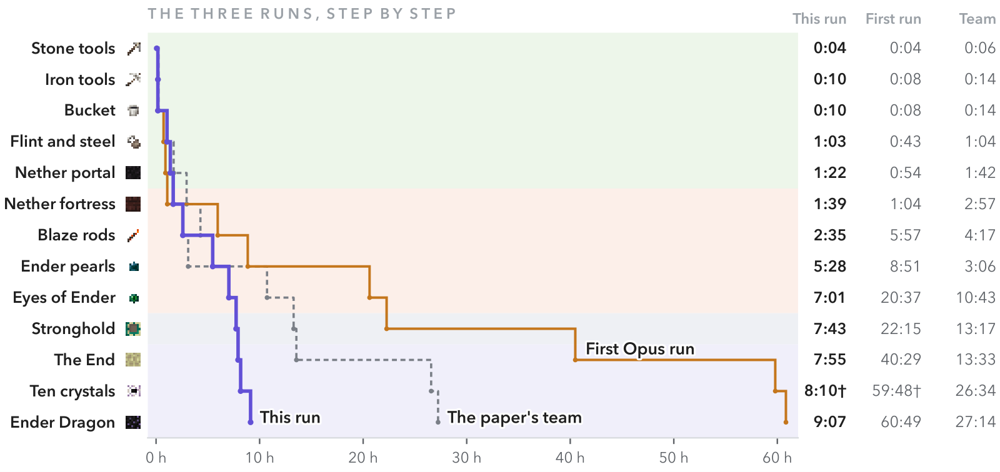
<figcaption>The three runs step by step: this run, the first Opus run and the paper’s team, in hours:minutes after each run’s first program. <math display="inline" xmlns="http://www.w3.org/1998/Math/MathML"><semantics><msup><mi></mi><mo>†</mo></msup><annotation encoding="application/x-tex">^{\dagger}</annotation></semantics></math>From the agent’s own commit, since no event marks this step. Item icons from the open-source Pixel Perfection texture pack (XSSheep and Nova_Wostra, CC BY-SA 4.0), not Minecraft’s textures.</figcaption>
</figure>

# Introduction

A single Claude Opus 5.5 agent has already defeated the Ender Dragon alone in the environment of Faldor et al. (2026): it took 60 hours and 49 minutes, against 27 hours and 14 minutes for that paper’s team of four Gemini 4 Argon agents (Batsuk 2026). Most of those 60 hours were not hard play. Nearly seventeen went to replacing one lost Eye of Ender, about seventeen more passed between its third crystal and its fourth, and more than six passed while the Mac slept. Its tools, notes and records all survived it. This paper asks how far the same model gets when it starts from those traces, works under stated engineering rules, and plays in the same environment. We ask four questions: how far the time falls under the same harness (Sections <a href="#sec:run" data-reference-type="ref" data-reference="sec:run">3</a> and <a href="#sec:compare" data-reference-type="ref" data-reference="sec:compare">12</a>); what the player takes from the traces, counted by line, by call and by search (Section <a href="#sec:stigmergy" data-reference-type="ref" data-reference="sec:stigmergy">4</a>); whether it changes its tools as it plays and uses what it writes (Section <a href="#sec:rsi" data-reference-type="ref" data-reference="sec:rsi">5</a>); and what each stated rule does, measured against the records (Sections <a href="#sec:principles" data-reference-type="ref" data-reference="sec:principles">6</a> and <a href="#sec:deaths" data-reference-type="ref" data-reference="sec:deaths">7</a>).

We use two terms narrowly. *Stigmergy* is coordination through traces left in a shared medium (Grassé 1959; Theraulaz and Bonabeau 1999; Heylighen 2016). Here one player’s files steer a later player that never communicates with it, so the coordination runs one way, across time. *Recursive self-improvement* (RSI) means here only that the agent changes its own tools and notes during the run in response to measured errors. The model’s weights do not change, no harness code is touched, and the session is a single episode with no resets.

The second agent kept the first player’s route and most of its code. It measured the first run before it played, set a target for every step, and after each death or miss changed a tool or a rule. It reached the dragon’s defeat in 9 hours and 7 minutes, with 16 deaths and no researcher action during play. It was slower than the first player up to the fortress, in part because its rules made it build a base and mine obsidian first, and far faster afterwards. Its death rate was about the same as before; it recovered from each death faster and traveled far less. We had predicted 15 to 25 hours from the first program to the win, a rough guess by the Claude Code session that planned the run, committed to the project’s README 37 minutes before the agent’s session began. The run beat the low end by almost 6 hours. The agent’s own target, set after it had measured the first run, was 22 minutes off. Section <a href="#sec:limits" data-reference-type="ref" data-reference="sec:limits">14</a> sets out why one run cannot separate the inherited files from the manifests, the higher effort, the speedrun wording, the awake Mac or the world it drew.

 h 07 min

from the first program to the dragon’s defeat

programs written and run by the agent

%

of its library’s lines identical to a line in the first player’s library

deaths along the way

\$81

of model use at API list prices

# Setup

## What stayed the same

The environment is the one of the first paper. The game is Minecraft Java Edition 1.20.4, the vanilla server from Mojang, in survival mode on Easy difficulty in a randomly generated world, with cheat commands disabled and no human input to the game. The world’s seed was `8187166780328365400`. One Claude Code session (Anthropic 2026) plays one player through a Mineflayer bot (PrismarineJS 2026) with its pathfinding plugin and no helpers. The agent never sees pixels: it writes a JavaScript program, sends it with a command-line client, `mc`, and reads the text that comes back. A camera draws a view of the player every 10 seconds for the researchers, and the agent cannot read the frames as they are drawn. The clock runs from the first `mc` program to the line \[Free the End\] in the server log. Everything ran on one Mac.

We changed neither the harness nor the game rules. A frozen start until the agent finished reading, a practice world and an automatic resume were all left out, because each would have shifted the rules against the earlier runs. Between the first paper’s last commit and this run’s start, `git diff` is empty for the harness (which includes the bot host, the client and the camera), the scripts that start and stop the agent and the environment, the verification script, the strategy guides and the team’s paper. The files that did change are the player’s instructions, the two new manifests, the configuration, the documentation and five scripts that build a run and its inherited copy, test the wiring, compare runs and keep the Mac awake. The last change to the harness itself is the Pause and Stop change made during the first run, at its hour 16.

|  | **Team** | **First run** | **This run** |
|:---|:---|:---|:---|
| Players | Gemini 4 Argon agents | 1 Claude Opus 5.5 agent | 1 Claude Opus 5.5 agent |
| Reasoning effort | Not applicable | Medium until hour 59, then xhigh | xhigh for all 771 requests up to the win |
| Earlier material | None | The team’s paper and four guides | The same, plus the first player’s folder and the paper about it |
| Manifests | None | None | Infrastructure (992 words) and planning (1,026 words) |
| Objective | Defeat the dragon | The same | The same, plus speedrun wording with both earlier times |
| Requests before play | None | Read the paper and guides | Also measure the first player’s losses and plan from them |
| Compaction | When the context grows too long | At about 967k tokens until hour 7, then 350k | At 350k from the start |
| Pause and Stop | Pause the session | From hour 16 also end a running program | The same, from the start; not used |
| Blocked reads | Own cloud machine | The run’s server folder | Also the first run’s original folder, other projects and Claude Code’s data other than its own session’s |
| Machine | One per agent | One Mac, asleep 6.4 h | One Mac, kept awake |
| Researcher changes in play | None | Three | None |

What differs between the three runs. Everything else (game version, difficulty, the library, the client and the program rules) is shared. {#tab:setup}

<figure id="fig:setup" data-latex-placement="t">
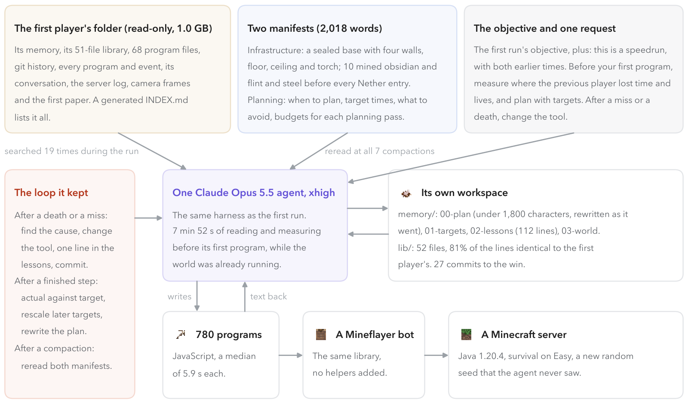
<figcaption>What the agent was given and what it kept. The top row is new in this run. The harness below the agent is unchanged. Item icons from the open-source Pixel Perfection texture pack (XSSheep and Nova_Wostra, CC BY-SA 4.0), not Minecraft’s textures.</figcaption>
</figure>

## What the agent was given

Table <a href="#tab:setup" data-reference-type="ref" data-reference="tab:setup">1</a> and Figure <a href="#fig:setup" data-reference-type="ref" data-reference="fig:setup">2</a> list the differences. Three of them are new material for the player.

#### The first player’s folder.

A read-only copy of 1.0 GB: the first player’s library (51 files), memory, 68 program files and git history; its programs, game events, server log and report; its conversation; its 21,094 camera frames; the first paper; and a generated `INDEX.md` that also lists what was cleaned. The copy leaves out personal details and, from the conversation, the thinking blocks and raw API records, so the agent read what the first player did and said, not how it reasoned. The seed prompt points to it and notes that its coordinates belong to another world and its lessons came from one run. The agent was blocked from reading the original folder, and it did not try. It never sees this run’s world seed.

#### The infrastructure manifest.

It holds three rules from the project’s owner, marked `[owner]`: build your base in a small hole dug in the ground and blocked off from monsters; give it four walls, a floor, a ceiling and a torch; and never enter the Nether without enough obsidian and flint and steel to build a portal out. Eight supporting rules follow, each with a source: a bed in the base, a chest of spares, end every program in a sealed cell, enclosed routes through the Nether, a second base before the End. Its principle is that “Finished, safe infrastructure counts as progress”. The owner asked for the Nether rule to be strict.

#### The planning manifest.

It says when to plan and when to stop: “Plan in bursts at these triggers. Between them, don’t plan: send the next step.” The triggers are the time before the first program (no budget), a finished step (150 seconds, three searches), a compaction (60 seconds), a death (30 seconds) and a repeated failure or a large overrun (150 seconds). Its own first line admits that “Budgets are advice; nothing enforces them.” It frames the game in the terms of reinforcement learning (Sutton and Barto 2018) as a vocabulary, since nothing is trained: the reward is minus one per second on the clock, the value is the sum of the remaining targets, the temporal-difference error is actual minus target for a step, the policy is the library, and “You improve by changing tools.” It also fixes the fields of a short plan file and lists searches for each kind of question about the first player’s records.

The seed prompt only points to the manifests, apart from one request and the speedrun wording:

> “Before your first program, measure where the previous player lost time and lives, and write a plan in `memory/` with a target time for each step. During the run, compare your times with those targets. After a missed target or a death, find the cause, change the tool or method that allowed it, and record that in your memory.”

> “This session is a speedrun. Your time runs from your first `mc` program to that advancement, as in the paper; lower is better. The paper’s team took 27 h 14 min and the previous player 60 h 49 min. The time before your first program is recorded and reported next to it. The world is already running while you read, so the time of day passes and your player can be attacked before your first program.”

# The nine-hour run

Figure <a href="#fig:run" data-reference-type="ref" data-reference="fig:run">3</a> shows the whole run and Figure <a href="#fig:frames" data-reference-type="ref" data-reference="fig:frames">4</a> six frames from it. Times are hours:minutes after the first program, which came at 19:10:31 Central Standard Time on 4 November 2026.

<figure id="fig:run" data-latex-placement="t">
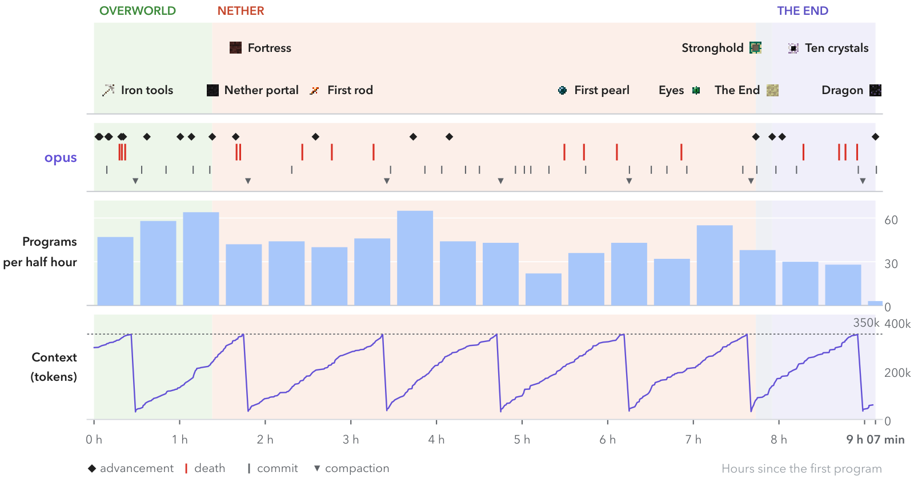
<figcaption>The whole run. Top: the steps. Second row: the agent’s 18 advancements (diamonds), 16 deaths (red ticks), commits (grey ticks) and 7 compactions (triangles). Third row: programs per half hour. Bottom: the size of the agent’s context in tokens, with the 350k compaction threshold. The context is already near 300k at the first program, after the reading and measuring. Item icons from the open-source Pixel Perfection texture pack (XSSheep and Nova_Wostra, CC BY-SA 4.0), not Minecraft’s textures.</figcaption>
</figure>

## Before the first program

The agent spent 7 minutes and 52 seconds before its first program while the world ran, and died in none of them; the first player’s bot had died before it read its first instruction. It read the manifests, the guides and the team’s paper, spent 16 tool calls in the first player’s folder (the index, the first paper, the report, lessons, progress notes and library files), and wrote its own Python to measure the first player’s programs and events. The result is a table in its `memory/01-targets.md` of ten stretches, with hours, running time, cause and what it would change. It names two as the largest: “One missing eye” at 16.75 hours and “Crystal 3 to crystal 4” at 16.90. Below the table it writes “Pauses were not the loss (84% of time had a program running). Wrong work was.” That conclusion echoes a line in the planning manifest, so it does not show independent discovery, but the numbers are its own.

Its first commit, made as its first program started, holds that table, a target for each step, a finish of 9:30, a limit of under 20 deaths, and a library of 50 files and 2,749 lines, of which 163 are not in the first player’s library.

<figure id="fig:frames" data-latex-placement="tbp">

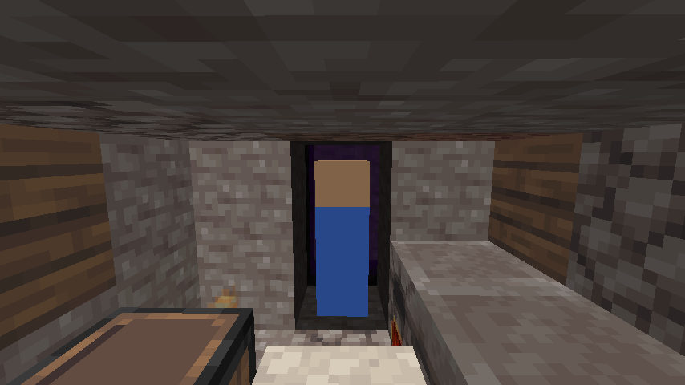

(a) 1:21, Overworld. The sealed base: bed and chest, with the portal cut into the rock at the end of the room.

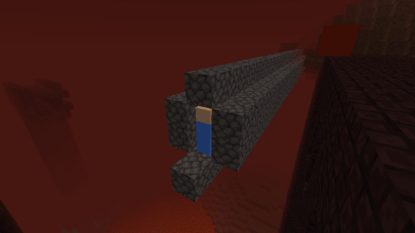

(b) 2:43, Nether. A walled cobblestone bridge across open air above the lava.

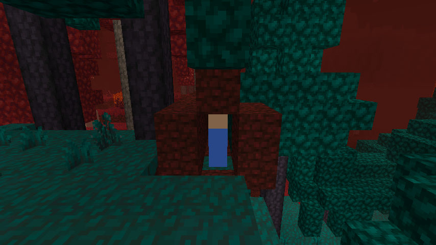

(c) 6:40, Nether. The pearl farm’s mouth in the warped forest.

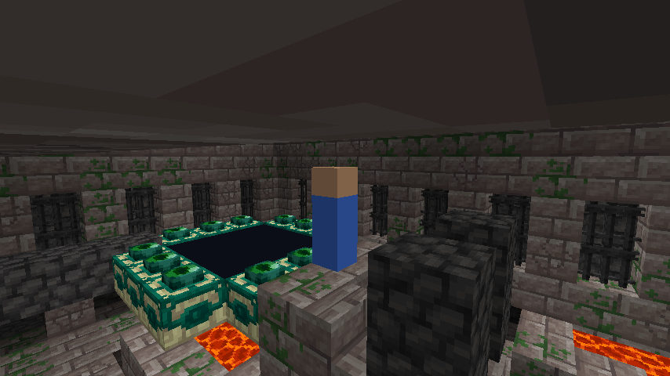

(d) 7:55, Overworld. The End portal lit in the portal room.

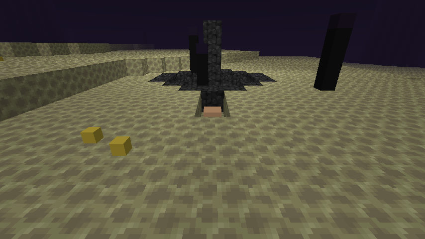

(e) 8:25, End. A pit beside the exit-portal fountain, during the fight.

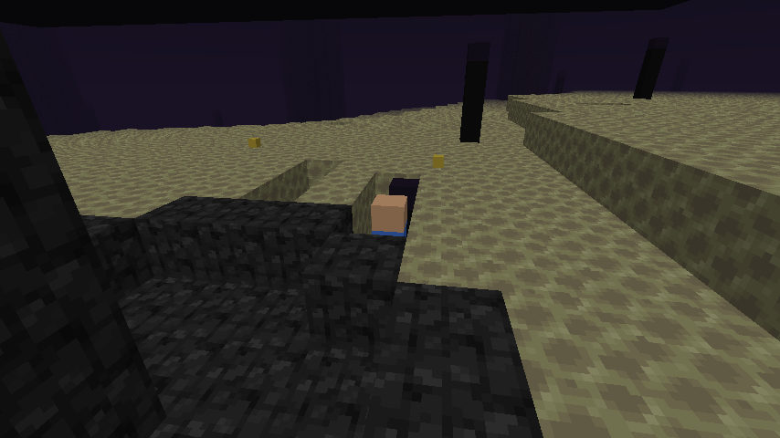

(f) 9:07:34, End. The stage cell against the fountain, about 4 seconds before the win.

<figcaption>Six frames from the researchers’ camera, which drew a view of the player every 10 seconds from a copy of the blocks around it. The agent never opened a frame, in this run or from the first. Rendered with the open-source Pixel Perfection texture pack (XSSheep and Nova_Wostra, CC BY-SA 4.0), not Minecraft’s textures.</figcaption>
</figure>

## Hours 0 to 1.4: a base before the Nether

It had stone tools at 0:04 and iron tools and a bucket at 0:10, then died three times in four minutes: a skeleton in its own dark stair at 0:17, a zombie at spawn with 2.5 health at 0:19, and a stalactite at 0:21. Its stair had cut through its bed, so it respawned at world spawn, far from its kit, and the kit expired at 0:27. It rebuilt from a stone pick and had a new bed and chest in the base by 0:50. It made a diamond pick at 1:01. The manifest requires 10 mined obsidian before the first entry, and casting a frame in place does not provide them, so it poured water over a one-deep lava pool and mined 32 obsidian by 1:14. It lit its portal inside the sealed base at 1:20 (Figure <a href="#fig:frames" data-reference-type="ref" data-reference="fig:frames">4</a>a) and entered the Nether at 1:22, 28 minutes behind the first player, who had cast a frame without diamonds and entered at 0:54.

## Hours 1.4 to 4.5: blaze rods

A fortress lay 80 blocks from the portal. The agent had planned to use the first player’s method, a closed room and a window, and here inheritance misled it. Windows in this fortress drew almost nothing: “Yield is 1 rod per about 8 min.” It built a walled bridge (Figure <a href="#fig:frames" data-reference-type="ref" data-reference="fig:frames">4</a>b), walked fortress corridors in spite of its plan, and died five times between 1:39 and 3:15. Its first rod came at 2:35, 3 hours and 22 minutes ahead of the first player’s. At 3:44 it invented an obsidian generator, pouring lava into a cell fed by water, at about one block in 12 seconds. Around 4:00 it timed the two methods: 60 seconds at a window gave no kills, and 60 seconds of melee in the crowd gave 2 rods for 20 health. Its notes conclude “Melee + eating is the method”. It wrote `L.melee`, carried food in, and banked six rods by 4:29: four of them in five minutes, for 11 meals.

## Hours 4.5 to 7: the forest and the pearl farm

It then searched for a warped forest for 30 minutes to the northwest, through 500 cells of tunnel and bridge. The forest turned out to be about 300 blocks southeast of the portal, found at 5:18, “in the direction I should have tried first”. A wait loop in its shell, reading the newest output file, read its own output and cost 5 GB and 3 minutes. Its first pearl came at 5:28. Two deaths followed at the farm: a piglin at the mouth at 5:29, and at 5:43 knockback from an open fight into lava, which burned its kit with 3 pearls and 20 obsidian. It had taken all spares out of the chest for that trip, and rebuilt by 6:36. The method that worked took the first player’s two-high pit and added a walk: stare at an Enderman, walk back, and hit it from inside as it teleports to the mouth (Figure <a href="#fig:frames" data-reference-type="ref" data-reference="fig:frames">4</a>c). That gave 3 pearls in 151 seconds with no damage, and about one a minute after that. It had 13 pearls at 7:00, one short of the 14 in its rescaled target row, which it logged as met to the minute.

## Hours 7 to 7:55: from eyes to the End

Here the run outpaced every target. It had 12 eyes at 7:02 and bow and arrows at 7:07. It spent its reserve obsidian on a portal in its Nether corridor, which came out more than 1,000 blocks from its first throw, and threw a second eye there. The rays crossed 1,696 blocks from the origin. After 2.5 minutes stuck in a swamp, a scan of loaded chunks found the portal room at 7:19, 71 minutes ahead of its target. It dug a second sealed base about 8 blocks from the room and mined a full diamond set from ore beside its tunnel. Breaking the room’s spawner woke infested bricks, which took it from 20 to 5 health in 20 seconds. It lit the End portal at 7:55 (Figure <a href="#fig:frames" data-reference-type="ref" data-reference="fig:frames">4</a>d) and entered at once.

## Hours 7:55 to 9:07: crystals and dragon

Section <a href="#sec:end" data-reference-type="ref" data-reference="sec:end">8</a> covers the End. All ten crystals fell by 8:10. The dragon took 57 more minutes and four deaths. The server log recorded \[Free the End\] at 04:18:09 Central Standard Time on 5 November, 32,858,368 milliseconds after the first program.

## After the win

The agent recorded its result and committed. Then a message it had scheduled for itself at 5:01 arrived, asking it to “Check the bridge job output and continue the search for the warped forest.” It replied that no search was left and that it would not enter the Nether with no obsidian. Later we resumed the session with one message, to complete the game: “Please jump through the end portal. The win is already recorded, so this comes after the run and is not counted in its result.” It did so with two programs, arriving at its bed 9 seconds after setting off. Four programs ran after the win, and none is counted. The server was then stopped with the world saved.

# What it took from the first player

The first player’s traces entered this run in two ways: as code it started from and as records it searched when a step needed them (Figure <a href="#fig:stigmergy" data-reference-type="ref" data-reference="fig:stigmergy">5</a>).

<figure id="fig:stigmergy" data-latex-placement="t">
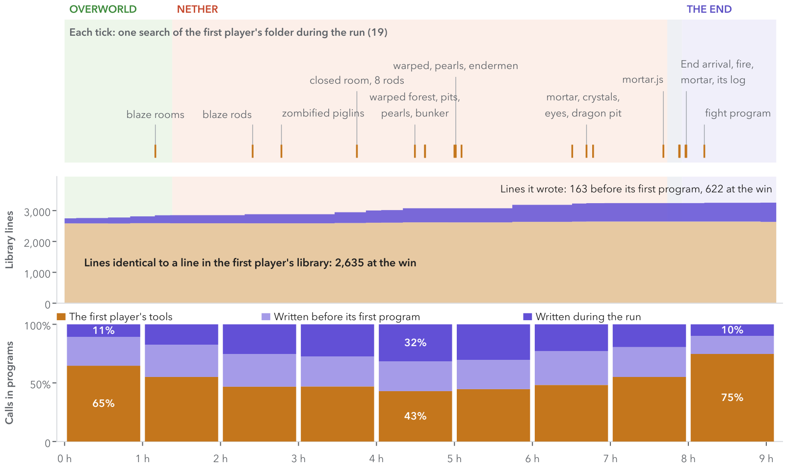
<figcaption>Use of the first player’s folder. Top: the 19 searches during the run, with what each was looking for. Middle: the library at each commit, split into lines identical to a line in the first player’s library and lines it wrote. Bottom: the share of calls in programs in each hour, by when the called name was first written. A name counts once per program, and the last 8 minutes join hour 8.</figcaption>
</figure>

#### Code.

The final library has 52 files and 3,257 lines, not counting blanks and comments; 2,635 of them, 81%, are identical to some line in the first player’s library. Short lines such as closing braces inflate that figure, so we also counted lines of at least 20 characters: 77%. Of the 52 files, 48 keep the first player’s file names and 37 are unchanged, among them `mortar.js`, `bow.js` and `shot.js`, the tools that had finally destroyed the crystals in the first run (Table <a href="#tab:lib" data-reference-type="ref" data-reference="tab:lib">2</a>). It dropped three. Programs called 141 library functions, 78 of them from the first player, and those 78 account for 53% of 3,623 uses counted per program. The 12 names it wrote before its first program took 25% of the uses and the 51 it wrote during the run 22%. The most used inherited names are `pos`, `sleep`, `count`, `inv` and `dig`. The most used new ones are `wrapRun`, `walkPath`, `sealed` and `walkMinHp`.

| **File** | **Lines** | **Identical** | **What it does** |
|:---|---:|---:|:---|
| `core.js` | 372 | 351 | Core helpers, reworked in places |
| `base.js` | 375 | 64 | New. “The manifest’s rules live here as checks, so a note is not the only guard.” |
| `pillbox.js` | 185 | 124 | Fight from a sealed cell; now also holds `L.melee` |
| `pearl.js` | 135 | 19 | New. The pearl farm at a two-high mouth |
| `wallbridge.js` | 101 | 65 | Walled bridges; rewritten after silent wall failures |
| `bow.js` | 86 | 86 | Unchanged. Arrow simulation and aiming |
| `mortar.js` | 31 | 31 | Unchanged. Lobbing arrows from a covered pit |
| `shot.js` | 30 | 30 | Unchanged. Finding spots from which an arrow reaches a crystal |
| `fight.js` | 27 | 15 | The melee fight from a pit, adapted during the fight |
| `endpit.js` | 12 | 0 | New. Mortar pits for this world’s End, with a simulated hit rate |

Some files of the final library. Lines exclude blanks and comments. “Identical” counts lines that also appear somewhere in the first player’s library. {#tab:lib}

#### Records.

Before its first program it read the folder directly (Section <a href="#sec:run" data-reference-type="ref" data-reference="sec:run">3</a>). During the run it searched the folder 19 times, each shortly before the step that needed it: blaze rooms at 1:09, the fight pit and the mortar at 6:30 to 6:46, the arrival in the End at 7:52, the fight program at 8:12. It never opened a camera frame. No recorded command touches the part of the project’s README where we predicted 15 to 25 hours for this run. It made no attempt to reach the first player’s original folder.

#### Where inheritance did not help.

It took the first player’s coordinates out of its blaze tools by 1:11, and `endentry.js` still holds some in the final library. The closed-room method for blazes did not carry over to this fortress, and its rods target slipped by 74 minutes before it found `L.melee`. The first player’s pit by the fountain did not hold in full either: the fight needed a new pit, a stage and a jump rule, and took about as long as it had before (Section <a href="#sec:end" data-reference-type="ref" data-reference="sec:end">8</a>).

# How it improved during the run

The session has no resets, so improvement could come only from changing tools and notes between programs. The agent kept the loop it was asked to keep. It made 26 commits before the win and a 27th recording it. By our count of tool calls, it rewrote its plan 20 times, edited its targets 27 times and its lessons 42 times; the lessons file reached 112 lines, 74 of them its own discoveries. Its plan went over the manifest’s limit of 1,700 characters twice, to 1,793 at 1:56 and 1,702 at 3:27. Within 8 seconds of each of the seven compactions it had read both manifests, and its next program came 3 to 7 seconds after the compaction; at the one that came at 4.8 health, the program came first.

<figure id="fig:targets" data-latex-placement="t">
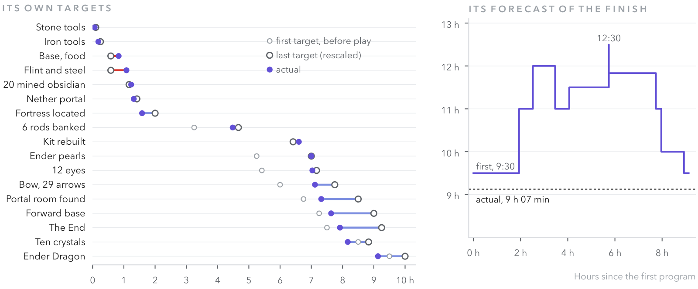
<figcaption>Its own targets. Left: 17 of the rows in its targets table, with the first target set before play, the last target after rescaling, and the actual time, as it recorded them. Some goals are stricter than Figure <a href="#fig:steps" data-reference-type="ref" data-reference="fig:steps">1</a>’s first-item steps: six rods banked, not one rod; fourteen pearls in its table (it had thirteen), not one. Red bars mark steps later than their last target. Right: the finish time it forecast in its table and plan during the run.</figcaption>
</figure>

#### Targets.

Figure <a href="#fig:targets" data-reference-type="ref" data-reference="fig:targets">6</a> compares its targets with what happened. The early steps ran late, by 15 minutes for the base and 30 for flint and steel. Its forecast rose from 9:30 at the start to 11:50 in its targets table, and 12:30 in its plan’s status line, at hour 5.74, just after the kit burned. The later steps then ran far ahead: 80 minutes at the End, 40 at the crystals and 52 at the dragon, against targets it had rescaled upward. It finished 22 minutes inside its first estimate, though not by following it: against that first plan, pearls came 105 minutes late and crystals 20 minutes early. The target it wrote before play was close in total and wrong in its parts. Its error column follows the planning manifest’s definition, actual minus target, and rescaling followed its rule of thumb: “Same-sign errors over 2 steps: rescale later targets.”

#### Deaths to tools.

Table <a href="#tab:deaths" data-reference-type="ref" data-reference="tab:deaths">3</a> lists every death with the change it recorded. Ten ended in a named change to a tool. Deaths 5 and 8 ended in a rule alone, three in a change of method or in another death’s entry, and death 11 in a tool that exists only in its notes. Suffocation shows why the distinction mattered. After unexplained damage at 1:48 and at 3:17 it worked out the cause, falling gravel, and wrote a rule. At 3:22 the same thing nearly killed it at 1.8 health. It then wrote: “The note after t+197 changed nothing: only the guard does.” It changed `L.dig` to refuse such blocks. The planning manifest had told it that “A note changes nothing”, citing the first player’s 17 drownings, so this is a lesson confirmed and not one discovered. At 6:06 it suffocated anyway, by another path: a pickup routine walked it under a column of sand and gravel. Its lessons then name a tool for this, `L.safeGravel`, but no library file defines it and no recorded program calls it; about 13 minutes later the agent searched for the name itself. So this fix was a note, the kind it had just called useless. Only one later program called `L.pickup`, and no later death was by suffocation. In the first run’s lessons, by contrast, a rule against drowning stood from hour 0 while 17 drownings followed. This agent drowned zero times.

| **\#** | **Time** |  | **Killed by** | **What allowed it** | **What it changed** |
|---:|:---|:--:|:---|:---|:---|
| 1 | 0:17 | O | Skeleton | Unarmored in its own dark stair | Guard equips the sword first; armor before surface trips |
| 2 | 0:19 | O | Zombie | At spawn with 2.5 health and no food | Recorded with death 1 |
| 3 | 0:21 | O | Stalactite | Digging path into a dripstone cave; stair had cut its bed | `L.dig` refuses beds, chests, furnaces and tables |
| 4 | 1:39 | N | Wither skeleton | Program ended at 8 health after a fortress run | `L.runTo` seals and heals inside the program |
| 5 | 1:42 | N | Blaze | 24 steps in a fortress corridor | Rule: never walk fortress corridors |
| 6 | 2:25 | N | Zombified piglin | `L.toCell` dug its own plug, then it fought in the open cell | `L.peek` refuses unless sealed |
| 7 | 2:46 | N | Zombified piglin | Bridge wall failures ignored; audited for 40 s in the open | `fastBridge` starts a wall chain and stops on a failure |
| 8 | 3:15 | N | Withering | Overrode its own risk call on one surprising result | Rule: no dash under 14 health; “never override a risk call” |
| 9 | 5:29 | N | Piglin | The farm did not treat piglins as hostile | Gold armor; the farm hits any attacker |
| 10 | 5:43 | N | Lava | Knockback in open melee; kit burned; spares out of the chest | No open melee; provoke by walking; bank spares first |
| 11 | 6:06 | O | Suffocation | Pickup walked under sand and gravel; fourth such event | Rule against pickups near gravel; the `L.safeGravel` it names is not in the library |
| 12 | 6:51 | N | Piglin | The farm hit a neutral piglin | Never hit a piglin first with gold on; check the attacker |
| 13 | 8:17 | E | Dragon breath | Program returned in an open pit; 37 s writing the next | `L.fightStep` always retreats |
| 14 | 8:42 | E | Enderman | A jump into the wing push flung it to the surface | A height gate on jumps; `L.dive` digs down |
| 15 | 8:46 | E | Dragon breath | A program ended under open sky | `L.wrapRun` dives when an End program ends under sky |
| 16 | 8:54 | E | Dragon breath | `L.fleeWait` ran to a fixed cell inside the cloud | Flee along the line away from the cloud; never ran in play |

Every death, with what allowed it and the change the agent recorded, shortened from its `memory/02-lessons.md`. O: Overworld, N: Nether, E: End. {#tab:deaths}

#### Use of what it wrote.

A tool that is written and never called is only another note, so we dated each library name by the first commit that defines it and counted the programs that call it (Figure <a href="#fig:stigmergy" data-reference-type="ref" data-reference="fig:stigmergy">5</a>, bottom). Calls to names written during the run rose from 11% in the first hour to 32% in hour 4, as the first player’s method failed at this fortress and the agent built its melee and pearl tools. They fell to 10% in the last stretch, where the first player’s names took 75% of the calls. So new tools did not steadily replace old ones. The agent wrote tools where the inherited ones failed and returned to inherited ones where they worked. A name counts as inherited even if the agent later changed its body, as it did with `L.dig`. Programs also grew, from a median of 4 lines in the first two hours to between 11 and 16 after that.

Use of the named fixes was uneven. `wrapRun` appears in 700 programs and `L.dig` in 100, so a guard placed in them reached most of the run. Others ran far less: `fastBridge` in 21 programs, `fightStep` in 13, `peek` in 8, `L.melee` in 3, `L.runTo` and `L.dive` in 2, and `fleeWait` in none. These count direct calls from programs, so a tool called from inside another tool is undercounted. Still, a fix used twice has hardly been tested.

#### Limits of the loop.

A tool change is tested only by further play. Its last fix was never tested at all, as the agent reported itself: the flee routine “never actually ran after the fix”. The same monsters kept killing it by new paths: piglins of both kinds four times, the dragon’s breath three. It also wrote a line-of-sight check on its own initiative at 1:32, after its guard hit a blaze through a wall: “That’s an unfair reach I don’t want.” Its instructions ask it not to exploit flaws in the environment, and this change could only cost it time.

# The engineering principles, measured

Table <a href="#tab:principles" data-reference-type="ref" data-reference="tab:principles">4</a> sets each rule against the records. Some held, some did not, and the rules cost time that the run did not get back until the rods.

| **Rule** | **Source** | **What the records show** |
|:---|:---|:---|
| Sealed base with four walls, floor, ceiling and torch | Owner | Sealed by 0:10 by its commit; bed and chest back inside by 0:50, portal by 1:20. Opened once by its own mistake: a creeper came down a shaft it had left open at 3:38 |
| Never enter the Nether without 10 mined obsidian and flint and steel | Owner, strict | Held at 15 of 15 entries (below). The reserve was never used to escape. It was spent on a shortcut at 7:08 |
| Bed in the sealed base | Run 1 | Respawns at world spawn: 3 of 16, all by 0:21. First run: 19 of 115, up to hour 53.5 |
| Chest of spares | One player | Broken twice by its own account, with a 25-minute rebuild the first time and a burned kit the second |
| End every program in a sealed cell | Run 1 | Not met: 30% of 685 status lines show sealed. 9 of 16 deaths came between programs |
| Enclosed routes through the Nether | Run 1 | Bridges and tunnels built, about 45 minutes for one bridge. 8 deaths in the Nether, 3.1 per hour against the first player’s 1.8 |
| Sealed base and bed by the stronghold before the End | Run 1 | Built by 7:38, about 8 blocks from the portal room. After deaths in the End it was back in seconds: 9 s from base to End |
| Plan in bursts, reread both manifests after a compaction | Owner, judgement | Reread 7 of 7 times within 8 s. Median pause between programs 11.6 s, longest 194 s |
| s to plan after a death | Judgement | Next program 0 to 75 s after a death, median 14 s; 7 of 16 over budget. Advisory |
| Measure the first player, set targets, rescale | Seed prompt | Done before play and kept to the end; six rows added to the first report’s thirteen steps |

The rules the agent was given and what the records show. Sources are the manifests’ own tags. {#tab:principles}

#### The Nether rule.

The agent entered the Nether 15 times. In 14 the last status line before the entry shows at least 10 obsidian and flint and steel; for the fifteenth the last status is out of date, and the first one inside shows both. So the owner’s rule held at every entry, on that evidence. It wrote the rule into its tools: `L.usePortal` refuses to go from the Overworld when `L.netherGate` reports a missing item. The tool has an override, `force:true`, which 14 programs passed. Where a gate result is printed shortly before a forced entry, the failed check is armor (gold at 2:26 and 3:10, chestplate and leggings at 3:52 and 7:07), which the agent had added itself and the owner’s rule does not cover. So the tool did not enforce the rule by itself; the agent kept it. The cost was about 0.5 hours of programs that use obsidian or its tools, not counting trips or thinking. The promised escape never happened. Its one use of the reserve was the portal it built at 7:08 as a shortcut, leaving it for a few seconds in the Nether with none.

#### Sealed endings.

The manifest asks for every program to end in a sealed cell. About 30% of status lines show that: 149 of 469 in the Overworld, 41 of 166 in the Nether, 13 of 50 in the End. The rule was not followed, and the cost is visible: nine deaths came between programs, six of them within 10 seconds of a program ending. The agent’s notes call it out: “second time a program ended under open sky”. It responded in the End with a wrapper that digs down whenever a program ends under the sky.

#### The cost of infrastructure.

The rules made the agent slower at first. It reached the portal 28 minutes after the first player and the fortress 34 minutes after, and it stayed behind until the rods. Part of that is the kit it lost at 0:27, so the rules’ share cannot be isolated. It did not fall behind the first player again. Its bed also meant that no death after 0:21 sent it back to world spawn.

# Deaths

<figure id="fig:deaths" data-latex-placement="t">
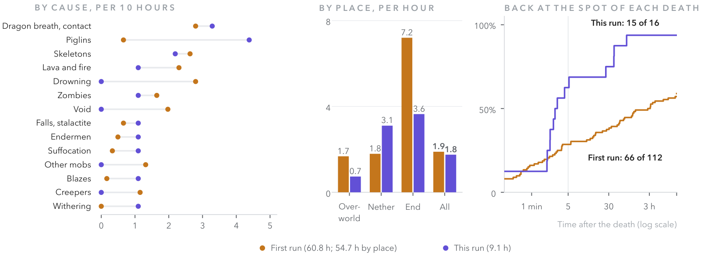
<figcaption>Deaths in the two Opus runs, as rates so that runs of different length compare. Left: by cause, per 10 hours. Middle: by place, per hour. Right: the share of deaths after which the player was back within 16 blocks of the spot, by time after the death, from camera frames (112 of the first run’s 115 deaths could be measured).</figcaption>
</figure>

The death rate did not fall (Figure <a href="#fig:deaths" data-reference-type="ref" data-reference="fig:deaths">7</a>). The agent died 16 times in 9.13 hours, 1.75 per hour, against the first player’s 115 in 60.83 hours, 1.89 per hour. The rate ratio is 0.93, with a 95% interval of 0.55 to 1.56. The first player’s rate excluding its sleeping hours is higher, 2.08, which does not change the picture. Per program the rate is about the same too: 2.05% against 1.96%, or 3.09% if the first player’s one-line library checks are left out.

The place matters. This agent spent a smaller share of its time in the Overworld, where the first player died most. By place the rates are 0.73 against 1.68 per hour in the Overworld, 3.11 against 1.79 in the Nether and 3.65 against 7.20 in the End (the first run’s place rates use the 54.7 hours the camera saw, without its sleep). Most of the End’s difference had already gone by the first player’s last hours: its rate was 8.4 per hour on medium (24 deaths in 2.86 hours) and 4.3 on xhigh (5 in 1.16). Had it died at the first player’s rate in each place for the hours it spent there, it would have died 21.7 times; it died 16, which a Poisson model puts at $`p = 0.13`$, within chance. The causes changed more than the count: it never drowned, fell, entered the void or met a creeper or pillager fatally, which together killed the first player 43 times, while piglins of both kinds killed it four times in nine hours.

What fell was what each death cost. After 15 of its 16 deaths it was back within 16 blocks of the spot, with a median of 168 seconds. The first player got back after 66 of the 112 deaths the camera saw, with a median of 338 seconds among those. That second median leaves out the 46 deaths it never returned from. Counting those as unfinished at the win (a Kaplan–Meier estimate), the median time back is 168 seconds against 2.8 hours, with bootstrap 95% intervals of 135 to 1,583 seconds and 0.8 to 15.7 hours. A log-rank test gives $`\chi^2 = 14.9`$, $`p = 0.0001`$, and $`p \approx 10^{-6}`$ when stratified by place. Fisher’s exact test on having returned at all gives $`p = 0.006`$. Leaving out the first run’s sleeping hours changes little ($`p = 0.0002`$). The difference appears in each place. In the Overworld, 4 of 4 returned with a median of 64 seconds against 39 of 67 and 105 seconds ($`p = 0.002`$); in the Nether, 7 of 8 and 1,583 seconds against 12 of 17 and 3,264 seconds ($`p = 0.02`$); in the End, 4 of 4 and 152 seconds against 15 of 28 and 339 seconds ($`p = 0.0003`$). These tests describe these two runs and nothing wider. They treat deaths as independent, which deaths in one run are not, and a player may also choose not to return to a spot it has finished with.

Respawns at world spawn stopped after 0:21, and the first player’s went on to hour 53.5. The next program came a median of 14 seconds after each death. Deaths between programs also fell: 2.35 per hour against 5.33 (7.4 outside the first run’s sleep), while deaths during programs stayed level at 1.32 against 1.21. So the base, the bed, the forward base and the kit discipline did not stop deaths, but they kept most of them from becoming the long rebuilds that cost the first player about an hour each by its own estimate. This reading fits the records, but no control tests it.

# The End

The End shows the clearest transfer and its limit (Figure <a href="#fig:end" data-reference-type="ref" data-reference="fig:end">8</a>). The first player spent 19 hours and 19 minutes from entering the End to its tenth crystal, most of it before it found the mortar pit, and then took its last seven crystals in 17 minutes on xhigh. This agent carried `mortar.js`, `bow.js` and `shot.js` across unchanged and added a 12-line file, `endpit.js`, that digs a pit and simulates the hit rate from it. With that it chose a single pit from which every crystal could be reached. It had a bow and 29 arrows before it entered. Fifteen minutes after entering, all ten crystals were down: eight by lobbed arrows, one by a direct shot from a peek, and the last, caged, by more lobs. It used 27 arrows and took no damage, and by its notes five shots hit the pit’s rim. Three fell in the first volley of 26 seconds.

<figure id="fig:end" data-latex-placement="t">
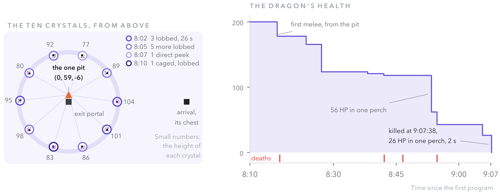
<figcaption>The End. Left: the ten crystals from above, with the single pit that reached them all, and when each group fell. Right: the dragon’s health as the agent’s programs read it, from the last crystal to the win, with its four deaths as red ticks.</figcaption>
</figure>

The dragon was different. From the last crystal to the win took about 57 minutes and four deaths; the first player, on xhigh with the same idea of a pit by the fountain, took 61 minutes. Inherited code did not shorten the fight by much (Section <a href="#sec:effort" data-reference-type="ref" data-reference="sec:effort">12.1</a>). The method changed during the fight: from a melee line with a stage against the fountain and a pit under the body’s edge, 56 health points fell in one perch at 8:53 (118 to 62) and the last 26.25 in 2 seconds of one perch. Two perches were lost to a jump rule at height 65.10 with the dragon at 65.07, and lowering it to 65.06 let the agent finish. It recorded the wing’s push box and the height gate in its lessons for any later player.

# Verification and integrity

Every program and its output, the agent’s full conversation, the server log and the game events were recorded, with 3,339 camera frames up to the win. The win is in the server log: `[04:18:09] [Server thread/INFO]: opus has made the advancement [Free the End]`. The project’s verification script, unchanged since the first paper, passes all its checks. The world did not stall: the longest gap between frames is 22.7 seconds and the server log has no “Can’t keep up” warning. The Mac did not sleep.

We also searched the records for what would compromise the result. The programs and the library contain no raw protocol writes, no writes to the player’s position or velocity, no use of process, file or network modules, no reference to the world seed, and no slash commands in chat. Two programs read a physics flag as a diagnostic, and one of them, at 7:06, also set it to true, the value it already held. No shell command touches the server’s folder, Claude Code’s settings or the first player’s original folder, and none was refused. The agent’s own report flags one thing to check: its melee attacks go straight to the dragon’s body-part entities, in code it limited to 3 blocks and a clear line of sight.

# Researcher actions

We made no change and sent no message during play. There was no pause, no bot restart and no server restart. We ran the Mac’s keep-awake command for the server process, which affects only sleep. Apart from its opening prompt (“Begin the session. Your instructions are in CLAUDE.md.”), the agent received the Stop hook’s standard line three times, each when it ended a turn while waiting for a background job, and its own scheduled wake-up after the win. The one message from a researcher is the post-win request quoted in Section <a href="#sec:run" data-reference-type="ref" data-reference="sec:run">3</a>.

# Cost

The run used a Claude subscription, so nothing was billed per token. Claude Code’s own estimate at API list prices was \$81.46 at the end of the winning turn and \$82.38 after the trip through the exit portal. Table <a href="#tab:cost" data-reference-type="ref" data-reference="tab:cost">5</a> breaks down the first figure. The first player’s run came to \$207.99 and the team’s to about \$520 at Gemini 4 Argon’s introductory list price. These are estimates from list prices and token counters, not the cost of serving either model.

| **Tokens** | **Count** | **Price per million** | **Cost** |
|:---|---:|---:|---:|
| Input read from the cache | 154.48 M | \$0.20 | \$30.90 |
| Input written to the cache, one-hour | 2.45 M | \$8.00 | \$19.61 |
| Input written to the cache, five-minute | 0.007 M | \$5.00 | \$0.04 |
| Input not cached | 0.02 M | \$4.00 | \$0.08 |
| Output, including 0.81 M thinking | 1.54 M | \$20.00 | \$30.85 |
| Total |  |  | \$81.46 |

Model use up to the end of the winning turn at Claude Opus 5.5 list prices. The unrounded rows add up to Claude Code’s own estimate. {#tab:cost}

Higher effort shows in each response. By the transcript the agent averaged 1,864 output tokens per response, 1,052 of them thinking, against the first player’s 761 and 329. Claude Code’s API time was 4.13 hours, 45% of the run, against 7.01 hours and 12%. The run cost less in total because it was shorter: 771 responses against 3,149.

# Comparison of the three runs

Table <a href="#tab:headline" data-reference-type="ref" data-reference="tab:headline">[tab:headline]</a> sets the three runs side by side and Table <a href="#tab:stages" data-reference-type="ref" data-reference="tab:stages">7</a> splits them by stage. Compared with the first player, this agent lost 0.48 hours before the portal and saved 14.06 from there to the eyes (6.4 of them the first player’s sleep), 18.98 from the eyes to the End and 19.13 in the End. The three losses the agent named, one missing eye (16.75 hours), the gap between crystals 3 and 4 (16.90 by its count, which stops at the effort switch; the fourth crystal itself came about half an hour later) and the Mac’s sleep (6.4), come to 40.05 of the 51.70 hours between the runs. None recurred. The remaining 11.65 hours came from everything else.

|  | **This** | **First** | **Team** |
|:---|---:|---:|---:|
| Time to the win | 9 h 07 | 60 h 49 | 27 h 14 |
| Programs | 780 | 5,879 | 2,783 |
| without library checks | 780 | 3,725 |  |
| Distinct lines of JavaScript | 6,658 | 6,637 | 63,313 |
| Chat messages | 0 | 0 | 229 |
| Deaths | 16 | 115 | 605 |
| Deaths per player-hour | 1.75 | 1.89 | 5.6 |
| Programs ending in an error | $`^{\ddagger}`$ | 1% | 22% |
| Median program duration | 5.9 s | 0.0 s$`^{\S}`$ | 33.5 s |
| Time with a program running | 58% | 84% | $`{\sim}`$<!-- -->40%$`^{*}`$ |
| Server restarts | 0 | 0 | 6 |
| Researcher changes in play | 0 | 3 | 0 |
| Cost at list prices | \$81 | \$208 | \$520 |

Hours:minutes per stage, rounded down. {#tab:stages}

$`^{*}`$Per player. $`^{\S}`$<!-- -->2.3 s without library checks. $`^{\ddagger}`$Not comparable: its wrapper catches exceptions, so the recorded rate is 0%, and 17 of 780 programs print a caught error.

| **Stage** | **This** | **First** | **Team** |
|:----------|---------:|----------:|---------:|
| To portal |     1:22 |      0:54 |     1:42 |
| To eyes   |     5:39 |     19:42 |     9:01 |
| To End    |     0:53 |     19:52 |     2:50 |
| To win    |     1:12 |     20:20 |    13:41 |

Hours:minutes per stage, rounded down. {#tab:stages}

A program was running 58% of the time, against 84% for the first player and about 40% per player for the team. We left the first player’s library checks out of the pauses, since each fired just before a real program and they would give a meaningless median of 0.04 seconds. Pauses between programs then had a median of 11.6 seconds against 5.0, a mean of 17.9 against 9.6, and a total of 3.83 hours against 9.76 (6.93 outside its Mac’s sleep). No gap reached 15 minutes, against seven in the first run, all seven while its Mac slept. The longest here was 194 seconds, against 148 seconds in the first run’s waking hours. The manifest had told the agent that the first player’s mean pause rose from 8.5 seconds to 25 on xhigh; with library checks left out we count 6.9 to 19.9, and 17.9 here. So each pause was about twice as long as on medium, and the total was much smaller. Thinking took more of each minute. Whether that is what reduced the wrong work, this run cannot say.

The comparison with the team is not one of equal runs, and it does not compare the two models. The team had four players at once, no account of an earlier session and a different model. This agent had the team’s paper, the first player’s files, its rules and its target to beat.

## Where effort matched

The first player’s last 1.86 hours are the nearest thing to a control that these runs offer: the same model at the same effort on the same job. It had built its bow tool and arrow simulation on medium, at hour 43. On xhigh it wrote the peek shot (`shot.js`) 33 minutes after the switch and the mortar (`mortar.js`) 43 minutes after it, and all seven remaining crystals were down 50 minutes after it, following 17 hours without one on medium. Table <a href="#tab:effort" data-reference-type="ref" data-reference="tab:effort">8</a> sets that stretch beside this agent’s End. The two look alike: the same share of time running, about the same long pauses and a similar death rate in the End. With those tools inherited, this agent took ten crystals in 15 minutes. Once the first player began shooting, its seven took 17, and it needed 61 minutes for the dragon against 57 here.

So 18.5 of the 19.1 hours saved in the End are time the first player spent there before the switch. That points to effort but does not show it, since by hour 59 the first player also had the bow and 17 hours of failed attempts in its notes. At the same effort, the fight shows little gain from the inherited code, the manifests or the speedrun wording, though this rests on about an hour of play on each side.

|  | **First run, from hour 58.97** | **This run, from the End** |
|:---|---:|---:|
| Hours | 1.86 | 1.21 |
| Programs | 133 | 66 |
| Time with a program running | 60% | 60% |
| Pause: median, mean | 9.4 s, 19.9 s | 11.6 s, 26.2 s |
| Pause: 90th percentile, longest | 67 s, 148 s | 69 s, 125 s |
| Deaths in the End, per End-hour | 5, 4.3 | 4, 3.65 |
| Crystals | Last 7 in 17 min | All 10 in 15 min |
| Last crystal to the win | 61 min | 57 min |

The first player’s stretch on xhigh against this agent’s End, measured the same way. Library checks are left out of programs and pauses. The first player’s stretch includes 0.64 hours in the Overworld. {#tab:effort}

## How much of the gap was the world?

Each setup drew one world, so we cannot remove the world’s effect, but we can measure part of it. Table <a href="#tab:worlds" data-reference-type="ref" data-reference="tab:worlds">9</a> uses one method for both runs. Horizontal distances in the Nether run from the player’s position in its first Nether frame, and those in the Overworld from its last Overworld frame before that entry, to its position when each step’s event fired. This world’s fortress, pearls and stronghold were all nearer. Even so, the first player reached its farther fortress sooner after entering the Nether, in 10.7 minutes against 16.4, and made its diamond advancement half an hour earlier. At the first player’s own speeds, one trip over the three differences in distance takes about 18 minutes, and it would take about 170 such trips to fill the 51.70-hour gap. Repeated trips did happen, so this is an illustration and not a bound. Other parts of a world went unmeasured, such as terrain, monsters and loot. The first player’s notes record an ocean above its stair towards the stronghold and water flooding that stair, while this agent’s fortress yielded few blazes at a window.

|  | **This run** | **First run** |
|:---|---:|---:|
| Nether portal to fortress | 80 | 247 |
| Nether portal to first rod | 66 | 247 |
| Nether portal to first pearl | 300 | 477 |
| First Overworld portal to stronghold | 1,673 | 2,143 |
| World spawn to stronghold | 1,692 | 1,952 |
| Portal to fortress, time | 16.4 min | 10.7 min |
| \[Diamonds!\] advancement | 1:00 | 0:31 |
| Path: Overworld, Nether, End | 9,759, 5,760, 1,467 | 114,345, 22,458, 3,510 |
| Path: total | 16,986 | 140,313 |
| Blocks per hour: Overworld, Nether, End | 1,808, 2,273, 1,350 | 2,852, 2,392, 889 |

The two worlds and how far each player moved. Distances and speeds are in blocks; paths come from the camera’s 10-second samples, skipping jumps of 120 blocks or more. The first run’s camera starts at hour 0.89, so its path is slightly low. {#tab:worlds}

The larger change is how far each player went. This agent’s path was about 17,000 blocks against about 140,000, eight times shorter, and it moved no faster in the Overworld or the Nether. So the time it saved is travel that did not happen, and not travel done more quickly. That fits the deaths, since a sealed base and a forward base keep a respawn close to the work.

## How much further

This run set out to see how far engineering could push the time. Its records show what remains, and we tested none of it.

- **Rods and the stretch after them.** From the fortress to the banked rods took 174 minutes, and the kit and the forest after that 127 more: 301 of the agent’s 548 minutes, 55%.

- **Lost kits.** The kit lost at 0:27 and the kit burned at 5:43 each forced a rebuild from early tools. The second is in that total.

- **Search.** Thirty minutes went to the wrong side of the portal. The agent’s own lesson: “short probes in all directions first”.

- **Time between programs.** 3.83 hours, 42% of the run, had no program running. Lower effort might recover some of it, and might bring back wrong work; the first run does not separate the two.

- **Bartering.** Human speedrunners commonly get pearls by trading gold to piglins. No program in either Opus run names bartering or mentions both piglins and gold ingots, and the first player’s notes list it once as an option. In this run the stretch from the rods to 13 pearls took from 4:29 to 7:00, rebuild included.

- **The dragon.** At its best rate of 56 health points a perch, the fight is about four perches. It took 57 minutes because it found the method during the fight, and those lessons are now in writing for a next player.

For scale, not for comparison: Astra’s latest recorded run finished in 8 minutes 43 seconds, on a fixed seed in Peaceful difficulty that its README says has a village, three supply chests with 21 obsidian and a naturally active End portal (Malde 2026). The fastest human on speedrun.com’s random-seed, any% glitchless board for version 1.16 and later took 6 minutes 40 seconds of game time (speedrun.com 2026). Those runs differ from this one in rules, clock, version and, for Astra, in world and difficulty. They do show that 9 hours is far from any floor that the game itself sets. Nothing here shows where the floor lies for an agent working through this harness. A third player could inherit from both, but the world and the bundle would change again.

# Related work

Stigmergy was named by Grassé (1959) to explain how termites coordinate nest building through what has already been built, and has grown into a general account of indirect coordination through traces in a medium (Theraulaz and Bonabeau 1999; Heylighen 2016). Here the medium is a folder of files, the two players never overlap, and the trace can be searched.

Self-improving systems range from Gödel machines, which would rewrite themselves only on a proof of benefit (Schmidhuber 2003), to the Darwin Gödel Machine, which keeps an archive of coding agents that modify their own code and checks each change on benchmarks, and which beat ablations without self-improvement and without open-ended search (J. Zhang et al. 2025). Reflexion has language agents reflect verbally on failures and use the reflections in later attempts (Shinn et al. 2023). The loop here is far simpler: one agent, one episode, no population and no held-out test, with tools and notes changed by the agent in the course of play. Other work keeps memory across tasks: Agent Workflow Memory induces reusable workflows from past experience (Z. Z. Wang et al. 2024), Dynamic Cheatsheet gives a black-box model a persistent, evolving memory of strategies and code snippets (Suzgun et al. 2025), and Agentic Context Engineering treats contexts as playbooks that evolve (Q. Zhang et al. 2025). Here the memory was not built for transfer. It is whatever an earlier player happened to leave, in a read-only folder, and the later player chooses what to use.

Minecraft has long been a testbed for open-ended agents. MineRL released human demonstrations and ran a competition on sample-efficient learning of the diamond task (Guss, Houghton, et al. 2019; Guss, Codel, et al. 2019). Video PreTraining learned keyboard and mouse control from online videos and crafted diamond tools (Baker et al. 2022), DreamerV3 collected diamonds from scratch with reinforcement learning (Hafner et al. 2025), and STEVE-1 followed short-horizon text instructions (Lifshitz et al. 2023). MineDojo named defeating the Ender Dragon, starting barehanded in a fresh world, as one of its moonshot goals (Fan et al. 2022). SIMA and SIMA 2 act from pixels with a keyboard and mouse across many 3D games (SIMA Team 2024, 2025).

Another line of work uses language models as planners or programmers, building on interleaved reasoning and tool use (Yao et al. 2023) and code as policy (Liang et al. 2023). Voyager wrote Mineflayer programs into a growing skill library under an automatic curriculum (G. Wang et al. 2024); here such a library is handed from one player to the next. DEPS, GITM, JARVIS-1, Plan4MC and Optimus-1 added Minecraft-specific planners, knowledge, memory or learned skills (Wang et al. 2023, 2025; Zhu et al. 2023; Yuan et al. 2023; Li et al. 2024). Multi-agent studies examined coordination in games, including Minecraft (Gong et al. 2024; Altera.AL et al. 2024; White et al. 2025).

Earlier end-to-end dragon kills include a single Claude Opus 5 agent calling 37 high-level Minecraft tools on Normal difficulty (AI Bengineering 2026), a planner paired with an action-selection model on a fixed speedrun seed in Peaceful difficulty (Malde 2026), the team of four general-purpose coding agents with only the standard Mineflayer library (Faldor et al. 2026), and the single agent whose files this run inherited (Batsuk 2026).

# Limitations

- **Everything changed at once.** The inherited folder, the two manifests, the measurement request, the speedrun wording, xhigh effort from the start, early compaction, the awake Mac and the world all differ from the first run. With no control, we cannot attribute the gain to any one of them.

- **Single runs.** Each Opus run happened once. A second run of the first setup might also have avoided its rare disasters. Some of the difference is regression to the mean, and we cannot say how much.

- **World luck.** Each setup drew one world. This world’s fortress, pearls and stronghold were nearer than the first player’s, though one trip over those differences takes about 18 minutes (Section <a href="#sec:worlds" data-reference-type="ref" data-reference="sec:worlds">12.2</a>). We did not measure terrain, monsters or loot.

- **Effort is confounded.** The first player used medium effort until hour 59, then xhigh. This run cannot say what xhigh would have done without the files or the files without xhigh. Where effort matches, the two players look alike (Section <a href="#sec:effort" data-reference-type="ref" data-reference="sec:effort">12.1</a>), and the first player’s crystals fell soon after its switch to xhigh, but that switch came with 17 hours of failed attempts behind it.

- **The agent knew the scores.** It read both earlier times and the paper about the first run, and was told it was a speedrun. That may have changed the risks it took. Its target of 9:30 also came with no independent check, and the manifest had told it where the first player’s losses lay.

- **The clock excludes reading.** As in the earlier papers, the time runs from the first program. The agent read and planned for 7 minutes 52 seconds first, with the world running. From the session’s start the win took 9 hours, 15 minutes and 30 seconds. The first player’s first program came 23 seconds into its session.

- **Measures.** A wrapper hides program errors, so the error rate does not compare. Line identity counts any matching line anywhere in the first player’s library, wherever it sits and whether or not it does the same job. Recovery comes from camera frames every 10 seconds and measures being back at the spot, not having the kit back. Paths from those frames miss small moves. Appendix <a href="#app:defs" data-reference-type="ref" data-reference="app:defs">16</a> gives each definition.

- **Perception through code and Easy difficulty.** As in the earlier runs, Mineflayer reports exact blocks and entities, including the dragon’s internal state, and its pathfinding plans routes that humans plan by eye. On Easy, monsters deal less damage and hunger cannot kill.

- **Who did the analysis.** The researcher who wrote the rules wrote this paper, and the model under study helped: the analysis scripts and the draft of this text were written with Claude Opus 5.5 in a separate Claude Code session. Another Claude agent checked the numbers in the first version. The measurements added later (recovery, worlds, matched effort, use of tools) were checked only by the session that made them, by recomputing them from the records. There is no independent replication.

The direct test is an ablation: run the bundle with one part removed, on several worlds, with each variant on the same set of seeds. At this run’s rate a full-bundle run costs about \$80 and nine hours, though variants without the files may run much longer.

# Responsible development

The agent ran in a sandbox on one machine. Its shell could write only inside its workspace and its temporary folder and reach only the game client’s socket. Its reads were blocked for this run’s server folder, the first run’s original folder, other projects and Claude Code’s data other than its own session’s, though it could read the harness code and the project’s other files. Its programs could control only its own player and could neither start processes nor write files, and none used a server command. Its settings were outside the workspace, so it could not change them. The self-improvement here is limited to files inside that workspace, and all of it is in git. Every program, model call and game event was recorded. We found no attempt to exploit the environment or its evaluation in the checks above or in our reading of the logs. The agent reported its own failures and flagged the fix it had not tested.

# Data and code

The main measurements and statistics are computed from the run records by `scripts/run_data.py`, and the figures are drawn from its output by `scripts/make_figures.py`. Both are kept with this paper’s source, and the one statistic that resamples uses a fixed seed. Details of the narrative come from our reading of the same records. The records (programs, events, server log, camera frames and transcripts) are held by the author and are not public at the time of writing. The world’s seed is withheld.

# Acknowledgments

We thank Maxence Faldor, Satinder Singh and Roberta Raileanu, whose paper describes the environment we copied and which the agent read before it began.

Minecraft is a registered trademark of Mojang Synergies AB / Microsoft Corporation. This independent research is not approved by or affiliated with Mojang or Microsoft. All in-game visual assets in this report were rendered using the open-source Pixel Perfection texture pack by XSSheep and Nova_Wostra, licensed under CC BY-SA 4.0 (XSSheep and Nova_Wostra 2026).

# Definitions

From the start of the first recorded program to the win event taken from the server log’s \[Free the End\] line.

One JavaScript program sent with `mc` and recorded in `programs.jsonl`.

A program under 120 characters that contains `L.bot===bot`. The first run has 2,154 of them and this run none.

The time covered by the union of program spans, divided by the time from the first program to the win.

The gap between one program’s end and the next program’s start, after merging overlapping spans and leaving out library checks.

A death outside every merged program span, library checks included.

The dimension of the last camera frame at or before an event. The first run’s place rates use the counts published in the first paper, which also place void and pre-camera deaths by rule.

The first camera frame more than 5 seconds after a death, at or before the win, in the death’s dimension and within 16 blocks of its position. A death with no such frame counts as unfinished at the win.

A library line, stripped of indentation and not blank or a comment, that appears anywhere in the first player’s library.

An `L.name` is the first player’s if its library defines that name. Otherwise it dates from the first commit that defines it: before the first program if that commit came by then, and during the run if later.

Programs that mention `L.name`, once per program, leaving out library installs.

AI Bengineering. 2026. *Mine AI MCP: beating Minecraft with an LLM agent*. <a href="https://github.com/aibengineering/mine-ai-mcp" class="uri">Https://github.com/aibengineering/mine-ai-mcp</a>.

Altera.AL, A. Ahn, N. Becker, et al. 2024. “Project Sid: Many-agent simulations toward AI civilization.” *arXiv Preprint arXiv:2411.00114*, ahead of print. <https://doi.org/10.48550/arXiv.2411.00114>.

Anthropic. 2026. *Claude Code*. <a href="https://code.claude.com/docs" class="uri">Https://code.claude.com/docs</a>.

Baker, B., I. Akkaya, P. Zhokhov, et al. 2022. “Video PreTraining (VPT): Learning to Act by Watching Unlabeled Online Videos.” *Advances in Neural Information Processing Systems*. <https://doi.org/10.48550/arXiv.2206.11795>.

Batsuk, Ben. 2026. *A Single Claude Opus 5.5 Agent Beats Minecraft*.

Faldor, Maxence, Satinder Singh, and Roberta Raileanu. 2026. “A team of Gemini 4 Argon agents beats Minecraft.” *arXiv Preprint arXiv:2610.22319*, ahead of print. <https://doi.org/10.48550/arXiv.2610.22319>.

Fan, L., G. Wang, Y. Jiang, et al. 2022. “MineDojo: Building Open-Ended Embodied Agents with Internet-Scale Knowledge.” *Advances in Neural Information Processing Systems (NeurIPS), Datasets and Benchmarks Track*. <https://doi.org/10.48550/arXiv.2206.08853>.

Gong, R., Q. Huang, X. Ma, et al. 2024. “MindAgent: Emergent Gaming Interaction.” *Findings of the Association for Computational Linguistics: NAACL 2024*, 3154–83. <https://doi.org/10.18653/v1/2024.findings-naacl.200>.

Grassé, Pierre-Paul. 1959. “La Reconstruction Du Nid et Les Coordinations Interindividuelles Chez *Bellicositermes Natalensis* et *Cubitermes* Sp. La Théorie de La Stigmergie: Essai d’interprétation Du Comportement Des Termites Constructeurs.” *Insectes Sociaux* 6 (1): 41–80. <https://doi.org/10.1007/BF02223791>.

Guss, W. H., C. Codel, K. Hofmann, et al. 2019. “The MineRL 2019 Competition on Sample Efficient Reinforcement Learning using Human Priors.” *arXiv Preprint arXiv:1904.10079*, ahead of print. <https://doi.org/10.48550/arXiv.1904.10079>.

Guss, W. H., B. Houghton, N. Topin, et al. 2019. “MineRL: A Large-Scale Dataset of Minecraft Demonstrations.” *Proceedings of the Twenty-Eighth International Joint Conference on Artificial Intelligence (IJCAI)*, 2442–48. <https://doi.org/10.24963/ijcai.2019/339>.

Hafner, D., J. Pasukonis, J. Ba, and T. Lillicrap. 2025. “Mastering diverse control tasks through world models.” *Nature* 640 (8059): 647–53. <https://doi.org/10.1038/s41586-025-08744-2>.

Heylighen, Francis. 2016. “Stigmergy as a Universal Coordination Mechanism I: Definition and Components.” *Cognitive Systems Research* 38: 4–13. <https://doi.org/10.1016/j.cogsys.2015.12.002>.

Li, Z., Y. Xie, R. Shao, G. Chen, D. Jiang, and L. Nie. 2024. “Optimus-1: Hybrid Multimodal Memory Empowered Agents Excel in Long-Horizon Tasks.” *Advances in Neural Information Processing Systems*. <https://doi.org/10.48550/arXiv.2408.03615>.

Liang, J., W. Huang, F. Xia, et al. 2023. “Code as Policies: Language Model Programs for Embodied Control.” *2023 IEEE International Conference on Robotics and Automation (ICRA)*, 9493–500. <https://doi.org/10.1109/ICRA48891.2023.10160591>.

Lifshitz, S., K. Paster, H. Chan, J. Ba, and S. McIlraith. 2023. “STEVE-1: A Generative Model for Text-to-Behavior in Minecraft.” *Advances in Neural Information Processing Systems*. <https://doi.org/10.48550/arXiv.2306.00937>.

Malde, R. 2026. *Astra and JEV Minecraft agent*. <a href="https://github.com/rmalde/minecraft-agent" class="uri">Https://github.com/rmalde/minecraft-agent</a>.

PrismarineJS. 2026. *Mineflayer: create Minecraft bots with a stable, high level JavaScript API*. <a href="https://github.com/PrismarineJS/mineflayer" class="uri">Https://github.com/PrismarineJS/mineflayer</a>.

Schmidhuber, Jürgen. 2003. *Goedel Machines: Self-Referential Universal Problem Solvers Making Provably Optimal Self-Improvements*. arXiv:cs/0309048.

Shinn, Noah, Federico Cassano, Edward Berman, Ashwin Gopinath, Karthik Narasimhan, and Shunyu Yao. 2023. “Reflexion: Language Agents with Verbal Reinforcement Learning.” *Advances in Neural Information Processing Systems* 36.

SIMA Team. 2024. “Scaling Instructable Agents Across Many Simulated Worlds.” *arXiv Preprint arXiv:2404.10179*, ahead of print. <https://doi.org/10.48550/arXiv.2404.10179>.

SIMA Team. 2025. “SIMA 2: A Generalist Embodied Agent for Virtual Worlds.” *arXiv Preprint arXiv:2512.04797*, ahead of print. <https://doi.org/10.48550/arXiv.2512.04797>.

speedrun.com. 2026. *Minecraft: Java Edition, Any% Glitchless, Random Seed, 1.16+*. <a href="https://www.speedrun.com/mc/runs/y44238ky" class="uri">Https://www.speedrun.com/mc/runs/y44238ky</a>.

Sutton, Richard S., and Andrew G. Barto. 2018. *Reinforcement Learning: An Introduction*. Second. MIT Press.

Suzgun, Mirac, Mert Yuksekgonul, Federico Bianchi, Dan Jurafsky, and James Zou. 2025. “Dynamic Cheatsheet: Test-Time Learning with Adaptive Memory.” *arXiv Preprint arXiv:2504.07952*, ahead of print. <https://doi.org/10.48550/arXiv.2504.07952>.

Theraulaz, Guy, and Eric Bonabeau. 1999. “A Brief History of Stigmergy.” *Artificial Life* 5 (2): 97–116. <https://doi.org/10.1162/106454699568700>.

Wang, G., Y. Xie, Y. Jiang, et al. 2024. “Voyager: An Open-Ended Embodied Agent with Large Language Models.” *Transactions on Machine Learning Research*, ahead of print. <https://doi.org/10.48550/arXiv.2305.16291>.

Wang, Z., S. Cai, G. Chen, A. Liu, X. Ma, and Y. Liang. 2023. “Describe, Explain, Plan and Select: Interactive Planning with Large Language Models Enables Open-World Multi-Task Agents.” *Advances in Neural Information Processing Systems*. <https://doi.org/10.48550/arXiv.2302.01560>.

Wang, Z., S. Cai, A. Liu, et al. 2025. “JARVIS-1: Open-World Multi-Task Agents With Memory-Augmented Multimodal Language Models.” *IEEE Transactions on Pattern Analysis and Machine Intelligence* 47 (3): 1894–907. <https://doi.org/10.1109/TPAMI.2024.3511593>.

Wang, Zora Zhiruo, Jiayuan Mao, Daniel Fried, and Graham Neubig. 2024. “Agent Workflow Memory.” *arXiv Preprint arXiv:2409.07429*, ahead of print. <https://doi.org/10.48550/arXiv.2409.07429>.

White, I., K. Nottingham, A. Maniar, et al. 2025. “Collaborating Action by Action: A Multi-agent LLM Framework for Embodied Reasoning.” *arXiv Preprint arXiv:2504.17950*, ahead of print. <https://doi.org/10.48550/arXiv.2504.17950>.

XSSheep, and Nova_Wostra. 2026. *Pixel Perfection Legacy texture pack*. <a href="https://modrinth.com/resourcepack/pixel-perfection-legacy" class="uri">Https://modrinth.com/resourcepack/pixel-perfection-legacy</a>.

Yao, S., J. Zhao, D. Yu, et al. 2023. “ReAct: Synergizing Reasoning and Acting in Language Models.” *International Conference on Learning Representations*. <https://doi.org/10.48550/arXiv.2210.03629>.

Yuan, H., C. Zhang, H. Wang, et al. 2023. “Skill Reinforcement Learning and Planning for Open-World Long-Horizon Tasks.” *arXiv Preprint arXiv:2303.16563*, ahead of print. <https://doi.org/10.48550/arXiv.2303.16563>.

Zhang, Jenny, Shengran Hu, Cong Lu, Robert Lange, and Jeff Clune. 2025. *Darwin Godel Machine: Open-Ended Evolution of Self-Improving Agents*. arXiv:2505.22954.

Zhang, Qizheng, Changran Hu, Shubhangi Upasani, et al. 2025. “Agentic Context Engineering: Evolving Contexts for Self-Improving Language Models.” *arXiv Preprint arXiv:2510.04618*, ahead of print. <https://doi.org/10.48550/arXiv.2510.04618>.

Zhu, X., Y. Chen, H. Tian, et al. 2023. “Ghost in the Minecraft: Generally Capable Agents for Open-World Environments via Large Language Models with Text-based Knowledge and Memory.” *arXiv Preprint arXiv:2305.17144*, ahead of print. <https://doi.org/10.48550/arXiv.2305.17144>.

