# A Claude Opus 5.5 agent, given three earlier players’ files, beats Minecraft in 6 hours 51 minutes and misses its 5-hour plan

> Text version of the paper, made from `main.tex` by `tools/make_text.py`. The PDF is the version of record: [Run-4-Opus-5.5-beats-Minecraft-in-6h51m.pdf](../../Run-4-Opus-5.5-beats-Minecraft-in-6h51m.pdf). Source: [main.tex](main.tex), data: [data/](data/).

**Ben Batsuk**

**We ran the Minecraft experiment of Faldor et al. (2026) a fourth time with Claude Opus 5.5, under a written plan to finish in under 5 hours. The plan drew on three earlier single-agent attempts: 60 hours 50 minutes, 9 hours 16 minutes, and one stopped at 10 hours 58 minutes with no win. The new agent inherited all three players’ files, the game rules did not change, and the world came from a new random seed. It defeated the Ender Dragon 6 hours, 50 minutes and 52 seconds after its player’s first spawn, 2 hours 25 minutes faster than the best earlier run and 1 hour 51 minutes over the plan; we had put the odds of beating 5 hours at about 15%. It cost about \$61 at API list prices and needed no researcher action during play. The plan failed on deaths, not on work: the stages took about 3 hours 25 minutes of work, 69 minutes under budget, and about as long again went to recovering from 10 deaths. No two deaths came within 11 minutes, while 27% of the gaps in each earlier run were under 5 minutes, but the death rate is not clearly lower than the second run’s (1.46 per hour against 1.73, 95% interval on the ratio 0.38 to 1.86), and getting back to the spot of a death took longer (median 642 seconds against 168). Rules in code held: an override the previous attempt used in 29 programs did not exist here. Inherited knowledge also did harm: a safety routine from the second run dug through the End’s arrival platform into the void, and an inherited note to stay under a lid missed a mechanism the agent worked out only after its third death to dragon breath. It did not die again after that, and the dragon fell 15 minutes after the last crystal, against 57 minutes and four deaths in the second run. This is one run in one world, so it shows what this bundle reached and not which part of it did the work.**

<figure id="fig:steps" data-latex-placement="H">
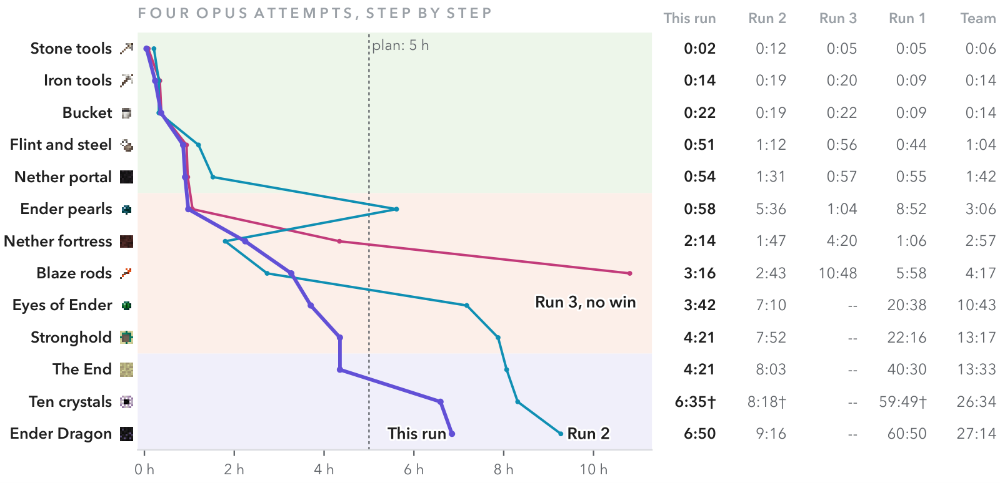
<figcaption>Four Opus attempts and the paper’s team, step by step, in hours:minutes after each player’s first spawn (the team’s from its first program). Run 3 stopped with no win. <math display="inline" xmlns="http://www.w3.org/1998/Math/MathML"><semantics><msup><mi></mi><mo>†</mo></msup><annotation encoding="application/x-tex">^{\dagger}</annotation></semantics></math>From the agent’s own commit or program output, since no event marks this step. Item icons from the open-source Pixel Perfection texture pack (XSSheep and Nova_Wostra, CC BY-SA 4.0), not Minecraft’s textures.</figcaption>
</figure>

# Introduction

A single Claude Opus 5.5 agent defeated the Ender Dragon in the environment of Faldor et al. (2026) in about 61 hours (Batsuk 2026b). A second one, given the first player’s files, took about nine (Batsuk 2026a). We then asked what a written plan could do: the session that built those runs measured their losses and planned for under 5 hours. A third agent tried that plan and failed. The owner stopped it at 10 hours 58 minutes, with 34 deaths and no win. This paper reports the fourth attempt, which used a new plan built from that failure.

We ask four questions. How far did the time fall, and where did a plan that was committed before the start go wrong (Sections <a href="#sec:run" data-reference-type="ref" data-reference="sec:run">5</a> and <a href="#sec:plan" data-reference-type="ref" data-reference="sec:plan">6</a>)? Did rules written into code hold where rules written in notes had not (Section <a href="#sec:rules" data-reference-type="ref" data-reference="sec:rules">7</a>)? What did deaths cost (Section <a href="#sec:deaths" data-reference-type="ref" data-reference="sec:deaths">8</a>)? And what did this player take from the three before it, and what did it have to find for itself (Sections <a href="#sec:inherit" data-reference-type="ref" data-reference="sec:inherit">9</a> and <a href="#sec:end" data-reference-type="ref" data-reference="sec:end">10</a>)?

As in the second paper, we use two terms narrowly. *Stigmergy* is coordination through traces left in a shared medium (Grassé 1959; Theraulaz and Bonabeau 1999; Heylighen 2016): here one player’s files steer a later player that never communicates with it. *Recursive self-improvement* (RSI) means here only that the agent changes its own tools and notes during a run in response to measured errors. No model weights change, no harness code is touched, and the session is one episode with no resets.

The short answer has four parts. The agent’s working stages beat their budgets by 69 minutes, so the plan’s account of the work held up. It priced a death about right, at about 20 minutes, but allowed for far too few of them. Rules in code were obeyed, and some of that code caused deaths of its own. And much of its largest loss traces to a game mechanism that earlier players had also died to and had not explained. Section <a href="#sec:limits" data-reference-type="ref" data-reference="sec:limits">16</a> sets out why one run cannot separate any of these from the world it drew.

 h 51 min

from the player’s first spawn to the dragon’s defeat

programs written and run by the agent

%

of the clock spent recovering from deaths

deaths along the way, none within 11 minutes of another

\$61

of model use at API list prices

# Setup

## What stayed the same

The environment is the one of the earlier papers. The game is Minecraft Java Edition 1.20.4, the vanilla server from Mojang, in survival mode on Easy difficulty in a randomly generated world, with cheat commands disabled and no human input to the game. One Claude Code session (Anthropic 2026) plays one player through a Mineflayer bot (PrismarineJS 2026) with its pathfinding plugin and no helpers. The agent never sees pixels: it writes a JavaScript program, sends it with a command-line client, `mc`, and reads the text that comes back. A camera draws a view of the player every 10 seconds for the researchers. Everything ran on one Mac, and nobody chose or filtered the world.

The rules were not moved to make this time easier. A frozen start until the agent finished reading, a practice world and an automatic resume were all left out, because each would have shifted the rules against the earlier runs. One change to the harness affects the time, and it makes the clock stricter: from run 3 on, the official clock runs from the player’s first spawn, so reading and planning count. Earlier papers ran from the first program, so we recompute all runs on the official clock and give the time from the first program beside it. Run 1 becomes 60:50:46 and run 2 becomes 9:16:17; their papers give 60:49 and 9:07.

Between run 2’s commit and this run’s, the only harness files that differ are `gateway.js` (the spawn clock) and `dashboard.html` (display fixes the owner asked for, which the player cannot reach). Between run 3’s commit and this run’s, only `dashboard.html` differs. Five scripts that build, compare or check a run also changed, along with the player’s instructions.

|  | **Run 1** | **Run 2** | **Run 3** | **This run** |
|:---|:---|:---|:---|:---|
| Reasoning effort | Medium until hour 59, then xhigh | xhigh | xhigh | xhigh for all 555 requests to the win |
| Earlier players’ files | None | Run 1 | Runs 1, 2 | Runs 1, 2, 3 |
| Manifests (words) | None | Infrastructure 992, planning 1,026 | Infrastructure 997, planning 1,093, speedrun 1,100 | Infrastructure 1,046, planning 1,205, speedrun 2,465 |
| Targets | None | Measured and set by the agent | Given, with a 5-hour plan | Given, with what to do when a row is missed |
| Clock the player was told | First program | First program | First spawn | First spawn |
| Owner’s rules | None | Sealed base, strict Nether rule | Also jump through the exit portal, no beds outside the Overworld | The same |
| Compaction | About 967k tokens until hour 7, then 350k | 350k | 350k | 350k |
| Machine | One Mac, asleep 6.4 h | One Mac, awake | One Mac, awake | One Mac, awake |
| Researcher changes in play | Three | None | None; the owner ended it at 10:58 | None |

What differs between the four Opus runs. Game version, difficulty, client and program rules are shared. {#tab:setup}

## What the agent was given

Table <a href="#tab:setup" data-reference-type="ref" data-reference="tab:setup">1</a> lists the differences across the runs. Against run 3, only what the player reads changed: the speedrun manifest was rewritten, the other two were edited, one factual sentence in the seed prompt changed, and run 3’s own folder joined the inherited copies.

#### Three players’ folders.

Read-only copies of run 1 (1.0 GB), run 2 (239 MB) and run 3 (209 MB): code libraries, memory, programs, git history, records, conversations and camera frames, with personal details removed and, as before, without thinking blocks. The seed prompt says of run 3 only that it came “from a later player who stopped after 10 h 58 min without defeating the dragon and has no paper.” Coordinates in these folders belong to other worlds, and the prompt says so.

#### The speedrun manifest.

This is the plan (Section <a href="#sec:planmade" data-reference-type="ref" data-reference="sec:planmade">4</a>), written for the player and with a source tag on each rule. It opens its section on gates with a lesson from run 3: “Tools changed behaviour where notes didn’t. A rule in `memory/` stops nothing, so put each of these in code.” It then asks for “One gate, no override” for the Nether, with “no `force` option”; for a health floor and automatic sealing in the wrapper around every program; and for a fixed order after a death: “seal, armor and food first, then the dropped kit. Never rush back unarmored.” A second death in a step bans the method: “ban that method in `Banned:` and search earlier runs for that step before you try again.” Its target table has a last column for what to do on a miss, because “Run 3 wrote ‘5 h goal missed’ at 5:51 and carried on as before; its rods step ran to 10:48 with no change of method.” It limits those cuts: “If the slack is gone, keep playing for the fastest win. Never trade safety for time: run 3’s deaths 16 to 19 came from doing that.” And: “**Never cut:** the owner’s rules, the gate, sealing, the chest.”

#### The owner’s rules.

The strict Nether rule from run 2 stands: 10 obsidian plus flint and steel before every entry, with no exception for the first trip. Two more rules date from run 3: the player must actually jump through the exit portal after the win, and no beds may be used outside the Overworld, which rules out killing the dragon with bed explosions, a common human method.

#### The seed prompt.

It only points to these files, apart from the speedrun wording and one request:

> “The file `speedrun-manifest.md` holds a plan already measured from those records, with a target time for each step. Copy the targets into `memory/` and start from them; don’t redo the measuring. During the run, compare your times with those targets. After a missed target or a death, find the cause, change the tool or method that allowed it, and record that in your memory.”

> “This session is a speedrun. Your official time runs from your player’s first spawn, which has already happened, to that advancement; reading and planning count, and lower is better.”

# The attempt that failed

Run 3 has no paper of its own, so we describe it here. It had the same model, effort, harness and owner’s rules as this run, a first version of the 5-hour plan, and the folders of runs 1 and 2. Before it started we predicted “Under 5 hours about 1 in 10 at best, most likely 6 to 10 hours, and about 1 in 4 of not beating run 2.” It did not beat run 2. The owner ended it at 10 hours 58 minutes on the official clock, with first blaze rods at 10:48 and no trip to the End. Its records and the audit behind the next plan show these losses:

- **Recovery.** By hand-labelled stretches, 422 of its 658 minutes went to recovering from deaths. Of 34 deaths, 6 were deliberate resets, in which it banked its items and stepped into fire to respawn at full health. Of the other 28, 19 came during recovery from an earlier death, and 9 of the 34 came within 5 minutes of the one before.

- **The gate had an override.** Its Nether check was a tool with a `force` option. The tool’s result was also changed to an object once a later file loaded, so a length check on it could no longer refuse. `force:true` appears in 29 programs from 1:14 on.

- **A world with a distant fortress.** Its fortress was 967 blocks from its portal, against 80 and 247 in the earlier runs, and it reached it at 4:20.

- **A target missed with no change of method.** It wrote “5 h goal missed” at 5:51 and kept going as before.

- **Clock checks and file churn.** `date -u` appears in 585 of its 645 shell calls, and it left 564 program files.

The owner asked afterwards whether to reject worlds with a distant fortress. We kept random seeds with no filter: a filter would change the experiment, and fortress distance was not the main loss. Recovery was.

# The plan and what we predicted

The plan was written by the Claude Code session that built the runs, with five Opus 5.5 subagents at xhigh effort at the owner’s request, and committed to the project before the start. Its stage budgets are in Table <a href="#tab:budget" data-reference-type="ref" data-reference="tab:budget">2</a>. Its best-case arithmetic was stated plainly: the best stage in any earlier run sums to about 4:20, which leaves 40 minutes for everything that goes wrong in a single run. Its prediction, written into the README that the agent could read, was “About 15% under 5 hours, range 5 to 25%”. No recorded call of the agent opened that README. It was an estimate, not a calculation.

The plan named five conditions for a finish under 5:00, and five things that would prove it wrong. Table <a href="#tab:conditions" data-reference-type="ref" data-reference="tab:conditions">3</a> gives both with their outcomes. Only one budget was left for accidents: “The slack covers about one Nether death: the median return was 17 minutes in run 3 and 26 in run 2. Aim for at most 2 Nether deaths.”

# The run

Figure <a href="#fig:run" data-reference-type="ref" data-reference="fig:run">2</a> shows the whole run and Figure <a href="#fig:frames" data-reference-type="ref" data-reference="fig:frames">3</a> six frames from it. Times are hours:minutes after the first spawn, which came at 22:42:24 Central Standard Time on 6 November 2026; the first program followed 13 seconds later.

<figure id="fig:run" data-latex-placement="t">
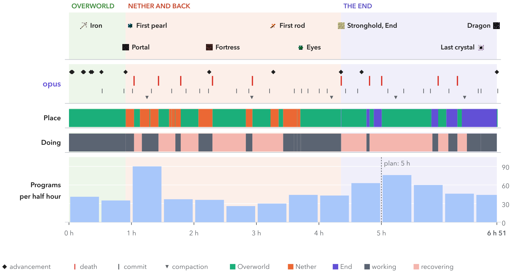
<figcaption>The whole run. Top: the steps. Second row: the 16 advancements (diamonds), 10 deaths (red ticks), commits (grey ticks) and 5 compactions (triangles). Third row: the player’s dimension. Fourth row: working and recovering, labelled by hand from the agent’s text and programs, good to about 3 minutes either way. Bottom: programs per half hour, with the plan’s 5:00 marked. Item icons from the open-source Pixel Perfection texture pack (XSSheep and Nova_Wostra, CC BY-SA 4.0), not Minecraft’s textures.</figcaption>
</figure>

## The first seconds

The official clock changed how the agent started. Run 2 spent 519 seconds before its first program and this agent 13. By then it had read the three manifests, the guide index, the Overworld guide and run 2’s index. It copied run 3’s library into its workspace at 18 seconds and read on while playing: its first program looked at its surroundings, and by 35 seconds it was gathering wood with the inherited `L.starter`. As the seed prompt asked, it did not redo the measuring. No recorded call opens the team’s paper in `paper/`, which the seed prompt says to read before beginning, so part of the saving is a skipped instruction.

<figure id="fig:frames" data-latex-placement="tbp">

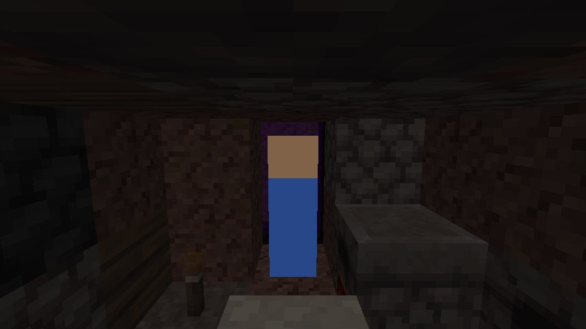

(a) 0:52, Overworld. The sealed base, with bed and chest, just before the first entry to the Nether.

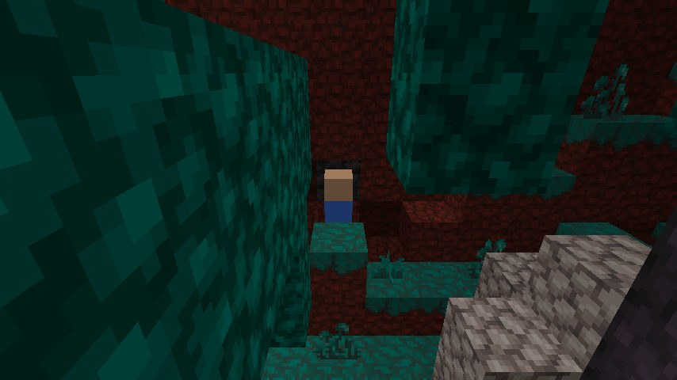

(b) 1:15, Nether. The warped forest at the pearl farm’s mouth, 49 blocks from the portal.

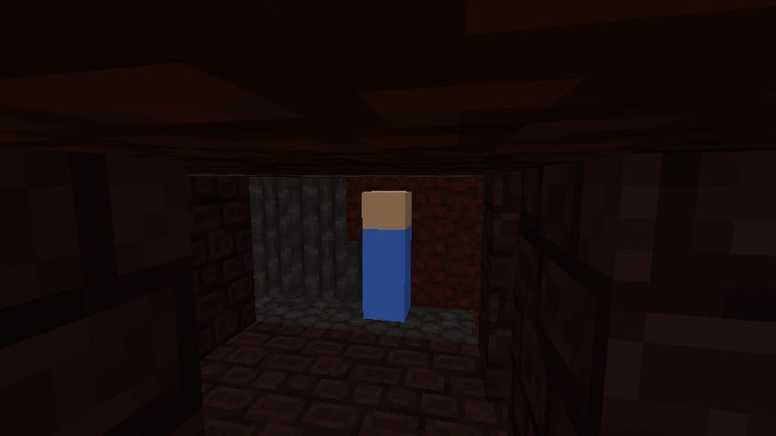

(c) 3:33, Nether. The mole tunnel under the blaze room’s floor, during the 7 rods.

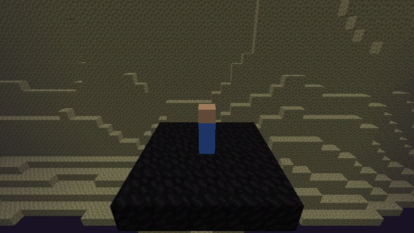

(d) 4:21, End. The arrival platform, 16 seconds before death 6.

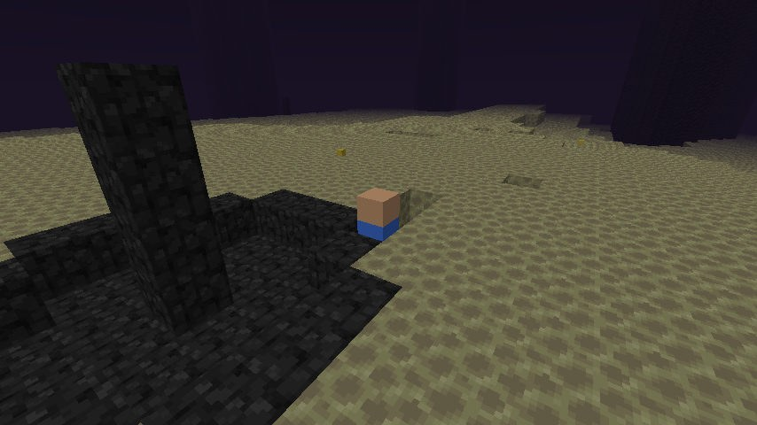

(e) 6:43, End. The stage beside the exit-portal fountain, during the fight.

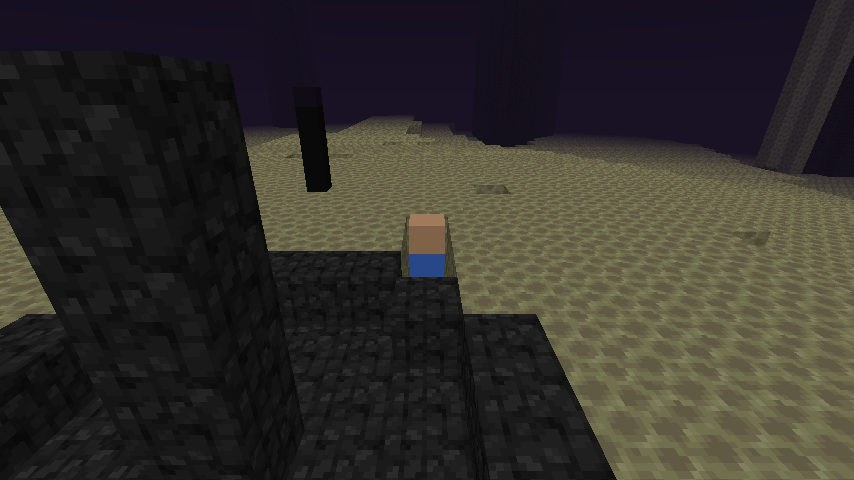

(f) 6:50:53, End. The same place, about 1 second after the win.

<figcaption>Six frames from the researchers’ camera, which drew a view of the player every 10 seconds from a copy of the blocks around it. No recorded call of the agent opened a frame, in this run or from the earlier ones. Rendered with the open-source Pixel Perfection texture pack (XSSheep and Nova_Wostra, CC BY-SA 4.0), not Minecraft’s textures.</figcaption>
</figure>

## 0:00 to 0:54: to the Nether in budget

Stone tools came at 0:02:47, a bed and an iron pick by 0:14, diamonds at 0:20:52 and a bucket at 0:22:16. It never died in the Overworld, here or later in the run. A shallow lava pool nearby paid off: its notes record “two pours gave 59 obsidian in about 30 s”. It stocked a spare chest by 0:53 and entered the Nether at 0:54:20, 12.5 minutes under budget and the earliest of any run.

## 0:54 to 1:37: pearls first

The plan’s order depended on the world: “If warped forest is within 150 blocks at the first scan, do pearls first; otherwise rods first.” The forest stood 49 blocks from its portal, so it took pearls first, the first at 0:58:35, 4 hours 38 minutes ahead of run 2. It then adapted run 2’s mouth farm and reached “4 pearls in 146 s (1.6/min, budget 0.45)”. The farm was also dangerous. At about 1:00 it fell “17.6 -\> 0.9 HP in one instant” when its own wide block scan froze the bot’s event loop: “8 enderman hits flushed at once.” Deaths 1 and 2 came at the same mouth. In the first, the health floor cancelled its walk home, so it switched the floor off for the farm; in the second, the farm ran with the floor off. After the second it banned provoking walks, as the manifest’s rule on second deaths asked. It had 10 pearls by 1:37.

## 1:37 to 3:36: fortress and rods

Here most of the first half’s time went (Figure <a href="#fig:plan" data-reference-type="ref" data-reference="fig:plan">4</a>). A dig route east along a cliff slid it into lava at 1:47, burning a kit with 20 obsidian, and it rebuilt from ore in 16 minutes. A probe west reached nether bricks at about 2:09, and the advancement fired at 2:14:39, 375 blocks from the portal. It tried the closed-room method it had inherited, and the room killed it twice. At 2:17 blazes came down an open shaft and burned it while its tool called the room sealed, and at 2:56 a blaze killed it as it stood on a rod it could not pick up, with a full inventory. After the 2:17 death, the gate would not let it back in until it had rebuilt: “Clock lost after death 4: 22 min for 9 obsidian, 24 iron, 4 diamonds, return. Gate works: it forced this.” At 3:16 it picked up its first rod, 32 minutes behind run 2’s first, while recovering its kit. It then changed method:

> “RODS METHOD THAT WORKS (3:30): blazes without LoS sit idle on the floor and never come to a fixed hole (rate falls to 0 after 45 s). Mole: tunnel under the floor at feet y67, open the floor cell directly under an idle blaze, hit it from below (LoS through the hole), rod falls to me or a jump collects it, refill. 3 rods in 50 s, 0 damage.”

It had 7 rods by 3:36, the last 6 in 4.5 minutes by its own table (Figure <a href="#fig:frames" data-reference-type="ref" data-reference="fig:frames">3</a>c).

## 3:36 to 4:21: eyes, stronghold, End

Three more pearls took 94 seconds at 3:41, and it took the plan’s cut: “14 pearls to 13”. Eyes were crafted by 3:42. It walked overland to the stronghold, about 1,560 blocks from its portal, instead of taking the plan’s Nether tunnel. It lost an eye on its third throw, spent about 20 minutes on string for a bow, which came in the end from cobwebs, and built the minimal base the plan required. It entered the End at 4:21:11, 38 minutes after leaving, within the stage’s budget. That was 50 minutes behind the plan’s sum of stages (3:31) and 35 behind its checkpoint (3:46).

## 4:21 to 6:35: the End’s first two hours

> “DEATH 6, 4:21, fell out of the world at (100,40,0), whole kit lost in the void: L.wrapRun auto-dive dug through the End arrival platform, which floats over the void in this world (run 2’s was inside end stone).”

The agent had been in the End for 17 seconds. The kit was gone, and a rebuild took 24 minutes. It came back with a plan to tunnel to a firing spot, but at 4:48 a tunnel routine left the tunnel and walked the surface, where dragon breath killed it. Its dropped kit despawned 40 seconds before it returned. At 5:00:18, the moment its plan had aimed to win, the dragon’s wing threw it up through an open hole to a fatal fall. Worse, its automatic sealing and a pillar had filled the cells beside its bed, so it respawned at world spawn, about 1,500 blocks from its forward base. It rebuilt its kit and walked back, and those two deaths cost 60 minutes together. At 5:21 it wrote “under 5:00 goal missed, keep playing safe.”

Ten crystals were still up at 5:49. Section <a href="#sec:end" data-reference-type="ref" data-reference="sec:end">10</a> covers how they fell, with two more deaths, by 6:35:30.

## 6:35 to 6:50: the dragon

The fight took 15 minutes from the last crystal. Building the fight line took until about 6:41, and the first hit came at about 6:42:50. The dragon’s health went 184, 128, 72, 52.75, 33.5, 19.5, 0 across eight perches, with the player’s health at 20 in every status line of that stretch. The server log recorded \[Free the End\] at 05:33:15 Central Standard Time on 7 November, and the win event falls 24,652,168 milliseconds after the first spawn.

## After the win

One program followed, and it did what the owner’s rule asks: the agent jumped into the exit portal, and it reappeared in the Overworld 37.5 seconds after the win, with no death in between. As the owner had decided before run 2, no retrospective was requested of the player. It committed its final notes and stopped.

# Plan against outcome

<figure id="fig:plan" data-latex-placement="t">
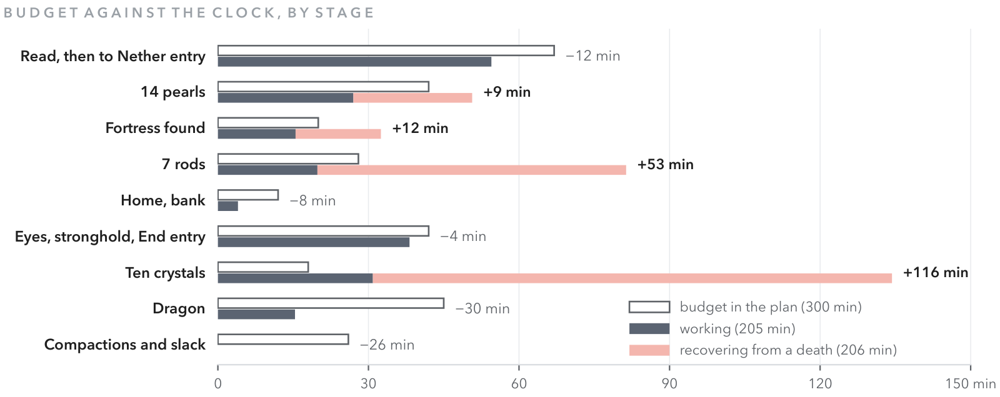
<figcaption>The plan’s budgets against this run. A hollow bar is a stage’s budget, and the solid bars below it are the time spent on that stage: working, then recovering from deaths that interrupted it. Pearls appear before rods in the order this run played them. Numbers are minutes over or under budget.</figcaption>
</figure>

| **Stage** | **Budget** | **Working** | **Recovering** | **Actual** | **Over** |
|:---|---:|---:|---:|---:|---:|
| Read, then to Nether entry | 67 | 54.5 | 0 | 54.5 | $`-`$<!-- -->12.5 |
| 14 pearls (13 taken) | 42 | 27.0 | 23.7 | 50.7 | +8.7 |
| Fortress found | 20 | 15.5 | 17.0 | 32.5 | +12.5 |
| 7 rods | 28 | 19.8 | 61.5 | 81.4 | +53.4 |
| Home, bank | 12 | 4.0 | 0 | 4.0 | $`-`$<!-- -->8.0 |
| Eyes, stronghold, End entry | 42 | 38.2 | 0 | 38.2 | $`-`$<!-- -->3.8 |
| Ten crystals | 18 | 30.9 | 103.4 | 134.3 | +116.3 |
| Dragon | 45 | 15.4 | 0 | 15.4 | $`-`$<!-- -->29.6 |
| Compactions, slack | 26 |  |  |  | $`-`$<!-- -->26.0 |
| Total | 300 | 205.3 | 205.6 | 410.9 | +110.9 |

Budget against outcome by stage, in minutes. Working and recovering come from hand-labelled stretches, good to about 3 minutes either way, and sum to the 410.9 minutes on the clock. {#tab:budget}

Figure <a href="#fig:plan" data-reference-type="ref" data-reference="fig:plan">4</a> and Table <a href="#tab:budget" data-reference-type="ref" data-reference="tab:budget">2</a> carry the main result. Work took 205 minutes, 69 under the 274 budgeted to the stages. Recovery took 206 minutes, against 26 of compaction allowance and slack. The difference between those, 206 minus 69 minus 26, is the 111-minute miss.

In every stage with no death, the agent beat its budget. It went over in four stages. In three of them, its working time alone was under budget. The ten crystals went over by 13 minutes of work and 103 of recovery, more than the whole miss on their own.

The plan priced a death correctly. It expected a return in 17 to 26 minutes. Recovery averaged 20.4 minutes after a Nether death and 20.7 after an End death. It was wrong about how many there would be. Its slack covered one, it aimed at no more than two in the Nether, it set no allowance for the End, and the run had ten. With this much work and this cost per death, finishing under 5:00 left room for 95 minutes of recovery, or about 4.6 deaths. No run has had fewer than 10.

The agent’s own account was “rods 101 min over (deaths 3-5), stronghold 50 over, crystals 163 over (deaths 6-10)”. Those are clock offsets at each stage and so overlap, and our table gives the increment per stage instead. Its account also gives the cause we find most useful: “Deaths 7, 9, 10 share one cause found only at 6:13”. We return to this in Section <a href="#sec:end" data-reference-type="ref" data-reference="sec:end">10</a>.

| **Condition for under 5:00** | **Outcome** |
|:---|:---|
| At most 2 Nether deaths | Missed: 5 |
| No death chain | Met: closest pair 11.7 minutes apart |
| Bricks by about 1:40 | Missed: 2:09 by its notes, advancement at 2:14:39 |
| rods within 35 minutes of the fortress | Missed: about 82 minutes, 2:14 to 3:36 |
| Dragon within 50 minutes | Met: 15.4 minutes from the last crystal |
| **“What could prove this wrong”** |  |
| $`\times`$<!-- -->5$`\times`$<!-- -->4 room stalls, or rods take over 45 minutes | Happened: two deaths at the room; the mole replaced it |
| Dragon takes over 60 minutes | Did not happen |
| Mouth farm under 0.3 pearls a minute | Did not happen: best 1.6 a minute |
| Player re-adds `force` or lowers the floor | `force` passed in 0 programs. Floor never lowered, but switched off with `L.floorOff=true` in 23 programs, including the farm at death 2 |
| Auto-seal fails with a mob in the cell | Worked with a skeleton in the cell (“sealed, killed it. Works.”); failed on a cliff and in open ground; side effects at death 8 |

What the plan said would have to hold, and what would prove it wrong, with the outcomes. {#tab:conditions}

| **Plan** | **Checkpoint**               | **Actual** |
|---------:|:-----------------------------|-----------:|
|     0:30 | Iron pick, sealed bed        |       0:14 |
|     1:22 | In the Nether, chest stocked |       0:54 |
|     1:42 | Bricks                       |       2:09 |
|     2:02 | 4 rods                       |       3:34 |
|     2:10 | 7 rods                       |       3:36 |
|     3:04 | 14 pearls (13 by the cut)    |       3:41 |
|     3:46 | In the End                   |       4:21 |
|     4:04 | No crystals left             |       6:35 |
|     4:27 | Dragon under 100 health      |       6:44 |

The plan’s checkpoints on the clock, as given to the player, with this run’s actual times. {#tab:checkpoints}

#### Did it use the cuts?

Run 3’s failure was to write down a miss and change nothing. This agent’s `Cut` field read “none” until 2:40, when it became “14 pearls to 13 (leave with 13); stronghold base minimum”. Its table states the reason: “Line at 2:53: remaining 2:30, sum 5:23: cuts taken 13 pearls, base minimum. Rebuilds after deaths 3 and 4 cost 16 + 31 min.” At 5:21 it recorded the goal as missed and kept to its safety rules, which is what the manifest asks. It reported its result as “under 5:00 goal missed by 1:50:51 (honest)”. The cuts were small, and there was little else to cut: the manifest forbids cutting the rules that consumed the time.

# Did the rules hold?

Table <a href="#tab:rules" data-reference-type="ref" data-reference="tab:rules">5</a> sets each rule against the records. The manifest’s bet was that rules in code would hold where rules in notes had not. On the first question, whether the player followed them, the bet paid. On the second, whether following them helped, the record is mixed.

| **Rule** | **Source** | **What the records show** |
|:---|:---|:---|
| obsidian and flint and steel before each Nether entry | Owner, strict | Held at 11 of 11 entries by the first status inside (below) |
| One gate, no `force` | Owner, run 3 | `force` in 0 programs against run 3’s 29. `L.gate` has no such option, and `L.usePortal` strips its arguments |
| Sealed base, walls, floor, ceiling, torch | Owner | 0 deaths in the Overworld in 4.49 hours |
| End each program sealed | Run 1 | 48.5% of 303 status lines sealed, against 29.6% in run 2 and 39.1% in run 3. Overworld 118 of 211, Nether 27 of 43. In the End, 2 of 49, where the plan uses `L.dive` instead |
| Automatic sealing | Judgement | 76 attempts printed, 50 succeeded. Switched off in 227 programs for chained work; the wrapper turns it on again after each program. “Floor + autoSeal saved me” at 1:52, after a creeper took it from 20 to 1.7 |
| Health floor at 12 | Judgement | Fired 16 times. Value never lowered, but off in 23 programs |
| Recovery order: seal, armor, food, kit | Judgement | No death within 11 minutes of another; about 20 minutes a death |
| Second death in a step bans the method | Judgement | Bans written after deaths 2 (provoking walks), 5 (rod walks) and 9 (pillar peeks), each replaced by a new method |
| Act on a missed row | Judgement | Cuts at 2:40; goal recorded as missed at 5:21 |
| Beds only in the Overworld | Owner | 1 program named a bed before the win, none outside the Overworld; 2 beds placed, 0 anchors, 0 bed-blast deaths |
| Jump through the exit portal | Owner | Done; four proofs agree (Section <a href="#sec:verify" data-reference-type="ref" data-reference="sec:verify">11</a>) |
| Reread manifests after a compaction | Seed prompt | All 3 reread at 5 of 5 compactions, first read 2.7 to 20.7 s after; next program 5.4 to 21.0 s after |
| Read the clock only at checkpoints | Run 3 | `date -u` in 210 of 636 shell calls, against 585 of 645 |

The rules the agent was given and what the records show. {#tab:rules}

#### The Nether rule.

The gate requires at least 10 obsidian, flint and steel, gold worn, health of at least 15 and a stocked chest, and its source reads “THE gate. No force option exists.” The camera shows 11 Nether entries. In every one the first status inside shows at least 10 obsidian and a flint and steel. For seven of them the last Overworld status does too; the other four are stale, printed before a restock at the chest, and gate output with no failing check appears in six programs before entries. Nineteen programs call the gate directly, and `L.leaveHome` holds it for others. It printed a refusal in three programs, at 1:06 and at 1:34 to 1:35, each for missing flint and steel, and each was followed by a restock and an entry. More often the agent planned around it, as in “Gate blocks after each death unless chest has 20 obsidian total and 2 F&S: keep 30+ banked.”

#### The cost of a gate with no override.

It cost time and the agent said so. After death 4 it spent 22 minutes on 9 obsidian, 24 iron, 4 diamonds and the return trip. Run 3’s override existed for such moments. We do not know what entering without the kit would have cost here. Run 3, with forced entries, had 13 Nether deaths in 2.97 hours (4.38 per hour). This run, with the gate, had 5 in 1.33 hours (3.76). Those counts are too small to separate.

#### When safety code killed.

This is the main complication. Five of the ten deaths, or their costs, involve a safety routine doing what it was written to do, or being switched off because of what it did:

- **Death 6.** `L.wrapRun`’s automatic dive digs down when a program ends under the open sky in the End. Run 2 wrote it after its own death 15. Here it dug through the arrival platform into the void, with the kit. The routine came from a world where that platform lay inside end stone.

- **Death 4.** `L.sealed` reported yes in a closed room, because a closed room counts as a closed flood fill. It burned 39.6 seconds after a program ended.

- **Death 8.** Automatic sealing and a pillar filled the cells beside its bed, so the respawn missed the bed and sent it about 1,500 blocks away. This cost more than the fall itself.

- **Deaths 1 and 2.** At death 1 the floor cancelled the walk home and left it sealing in the open. The agent then ran the farm with the floor off. At death 2 the farm timed out, auto-seal failed in open ground, and it restarted with the floor off and outside its cell.

Deaths 1, 2, 4 and 6 got a fix in code within the run. For death 8 its notes name the cause and no change, and no later death sent it to world spawn. The same routines also saved it: at 1:52 a creeper took it from 20 to 1.7, and “Floor + autoSeal saved me.” Still, a safety routine is code that acts when the player isn’t watching, and a rule in code can be wrong in a way a rule in a note can’t. The manifest’s own line stands as far as it goes: “A rule in `memory/` stops nothing.” The other half of that sentence is that a rule in code stops whatever it stops, including the wrong things.

# Deaths

<figure id="fig:deaths" data-latex-placement="t">
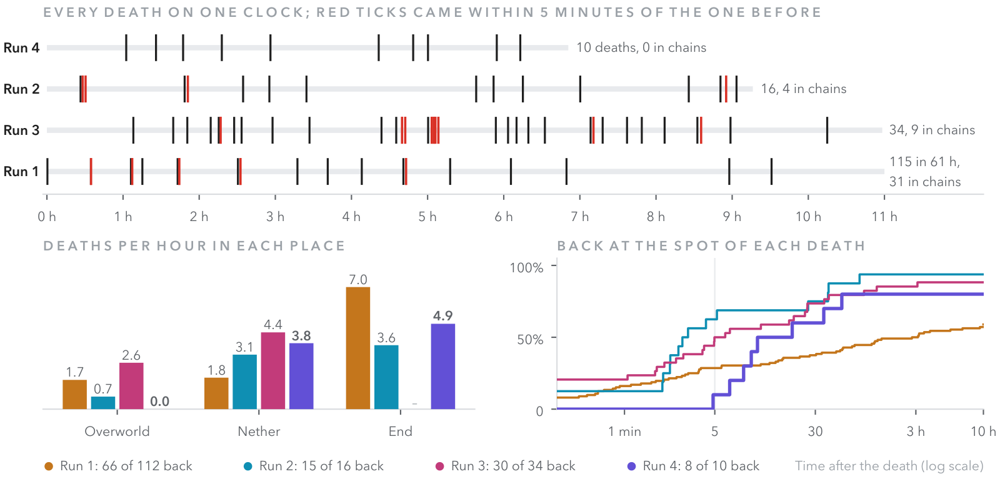
<figcaption>Deaths in the four Opus runs. Top: every death on one clock, with red ticks where a death came within 5 minutes of the one before; run 1 continues past 11 hours. Lower left: deaths per hour spent in each place. Lower right: the share of deaths after which the player was back within 16 blocks of the spot, by time after the death, from camera frames (112 of run 1’s 115 deaths could be measured).</figcaption>
</figure>

| **\#** | **Time** |  | **Killed by** | **What allowed it** | **What it changed** |
|---:|:---|:--:|:---|:---|:---|
| 1 | 1:02 | N | Enderman | Farm resumed with an angry enderman; floor cancelled the walk home | Farm runs floor-off with its own retreat; checks on walks |
| 2 | 1:25 | N | Enderman | Farm timed out mid-walk; auto-seal failed; restarted floor-off outside its cell | Refuses off its cell; provoking walks banned |
| 3 | 1:47 | N | Lava | `L.probeTo` routed along a cliff; 23-block slide; kit burned | Route refuses cells beside a drop of 6 or more; minimum height |
| 4 | 2:17 | N | Fire, fighting a blaze | Rod program ended without a retreat, shaft open; `L.sealed` said yes in a closed room | `wrapRun` treats over 10 sealed cells outside home as open |
| 5 | 2:56 | N | Blaze | Full inventory, stood on a rod under fire | Rod walks banned; fight from below; toss surplus first |
| 6 | 4:21 | E | Void | Inherited auto-dive dug through the arrival platform; kit lost | `L.dive` refuses thin ground; `L.noDive` on arrival |
| 7 | 4:48 | E | Dragon breath | `L.digTo` with `enclosed:0` left the tunnel for the surface; kit despawned | End tunnels at surface$`-`$<!-- -->4 or lower; no `L.digTo` for long legs |
| 8 | 5:00 | E | Fall, from the wing | Flung up through an open hole; cells beside the bed filled, so it respawned at world spawn | Cause recorded, no change; about 1,500-block trek |
| 9 | 5:54 | E | Dragon breath | Fireball into the open column of a pillar peek | Pillar peeks banned; mortar pit |
| 10 | 6:13 | E | Dragon breath | Under a lid: the cloud moves onto a player within 4 blocks of impact | Mechanism recorded; sealed columns; no more deaths |

Every death, with what allowed it and the change the agent recorded, shortened from its `memory/02-lessons.md`. N: Nether, E: End. No death came in the Overworld. {#tab:deaths}

Table <a href="#tab:deaths" data-reference-type="ref" data-reference="tab:deaths">6</a> lists every death and Figure <a href="#fig:deaths" data-reference-type="ref" data-reference="fig:deaths">5</a> compares the runs.

#### Chains.

The plan aimed first at death chains: 19 of run 3’s 28 real deaths came during recovery. Here it succeeded. All nine gaps between deaths exceed 11 minutes. In runs 1, 2 and 3, the share of gaps under 5 minutes was the same to within a point: 31 of 114, 4 of 15 and 9 of 33, about 27% each. At that share, nine gaps with none under 5 minutes would happen about 6% of the time. This does not prove the point: 10 deaths placed at random over this run’s clock would have no pair within 5 minutes 31% of the time, simply because deaths were rarer. Earlier runs stayed at 27% whatever their rate, which makes zero more notable, and it fits the rule that kept the player sealed and fed before it went back. One run can’t settle it.

#### The rate did not clearly fall.

Ten deaths in 6.85 hours is 1.46 per hour, the lowest of the four: 1.89, 1.73 and 3.10 for runs 1, 2 and 3 (2.55 for run 3 without its deliberate resets). The ratio to run 2 is 0.85 with a 95% interval of 0.38 to 1.86, so the difference from run 2 could be chance. The ratio to run 3 is 0.47 (0.23 to 0.95), which is the only comparison whose interval excludes 1. The rate per place tells more. It was 0 per hour in the Overworld, against 0.71 in run 2 (0 deaths in 4.49 hours, where run 2’s rate predicts 3.2). In the Nether it was 3.76 against 3.11, and in the End 4.86 against 3.65, so the deaths moved and did not disappear. At run 2’s place rates, this run’s hours predict 11.09 deaths; it had 10. The sealed base seems to have ended deaths in the Overworld, but nothing in this run lowered the rate in the dimensions where the fighting happens.

#### Between programs.

Run 2’s paper found that a death often came in the pause while the agent wrote its next program. Four of these 10 came between programs (run 1 52, run 2 9, run 3 20), three of them within 20 seconds of a program’s end. Per hour spent between programs, the rate was 1.8, against 5.3, 2.3 and 5.5. While a program ran, it was 1.3, against 1.2, 1.3 and 1.9. So this run’s gain in deaths is here, and none shows while programs ran. A sealed ending covers the pause and does nothing during a fight. Again, these are small counts.

#### Recovery took longer.

We expected a better recovery order to bring the player back sooner, and it did not. The player was back within 16 blocks of the spot after 8 of 10 deaths, with a median among those of 608 seconds, against 168 in run 2, 272 in run 3 and 338 in run 1. Counting deaths with no return as unfinished at the win (a Kaplan–Meier estimate), the median is 642 seconds against 168, 298 and 10,061. The interval here is wide, with bootstrap 95% limits of 391 to 2,885 seconds, and the log-rank test against run 2 gives $`\chi^2 = 2.60`$, $`p = 0.107`$. So the data don’t show a slower return with confidence, and they give no sign of a faster one overall. By place, the median was 917 seconds in the Nether (4 returns), against 1,583 in run 2 (7 returns), and 538 in the End (4), against 152 (4). Only one of these returns came within 5 minutes, against 10 of 15 in run 2.

The obvious reading is that this is the rules’ price. Run 3’s manifest had told its player to recover the kit first, and the plan’s audit tied that line to naked rushes back. This run’s order asks the player to seal, armor and eat first, and the gate won’t allow a return to the Nether without a rebuilt kit. Run 2 often ran straight back. Its 16 deaths produced 4 in chains, and this run’s 10 produced none, so a slower return and the missing chains may be one change seen twice. No control tests this reading. Three of these ten deaths also lost the whole kit (deaths 3, 6 and 7), so part of the delay is plain loss.

# What it took from the earlier players

<figure id="fig:lineage" data-latex-placement="t">
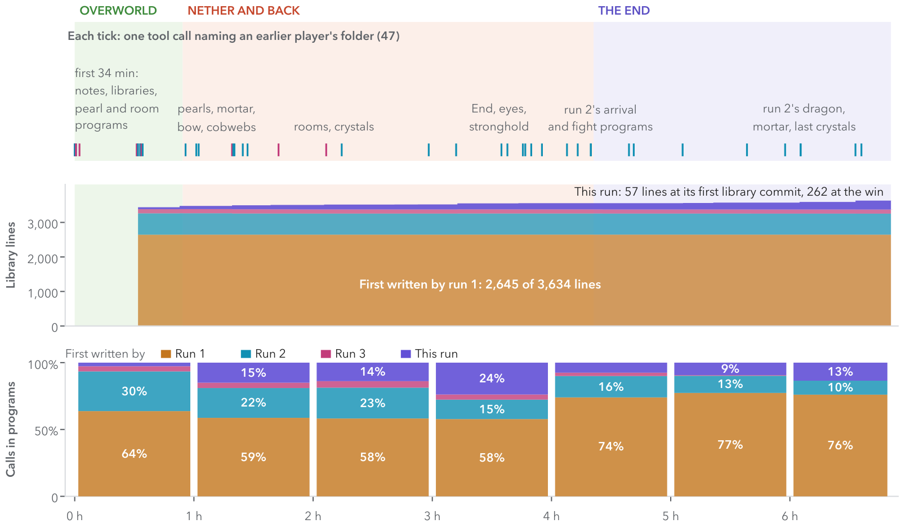
<figcaption>Use of the earlier players’ work. Top: the 47 tool calls that name an earlier player’s folder, coloured by folder, with what each group was looking for. Middle: the library at each commit, by the run that first wrote each line. Bottom: the share of calls in programs in each hour, by the run that first wrote the called name. A name counts once per program.</figcaption>
</figure>

#### Code.

The final library has 65 files and 3,634 lines, not counting blanks and comments. By the run that first wrote each line, 2,645 (72.8%) come from run 1, 609 (16.8%) from run 2, 118 (3.2%) from run 3 and 262 (7.2%) from this player (Figure <a href="#fig:lineage" data-reference-type="ref" data-reference="fig:lineage">6</a>). Its first library commit, at 0:31:52, had 3,440 lines and only 57 of its own. Of the 53 files named as in run 3, 44 are unchanged, and 12 files are new. Programs called functions 3,391 times, counted once per program: 68.0% of those uses go to names run 1 defined, 17.8% to run 2, 2.5% to run 3 and 11.7% to this player. The most used names show the layers. `L.s`, `L.sleep`, `L.say` and `L.count` are from run 1, `L.wrapRun`, `L.sealed` and `L.shaftUp` from run 2, `L.digTo` from run 3 and `L.rf`, `L.gate` and `L.huntG` from this run. Run 1’s share rises to 74–77% in the last three hours.

The failed run still contributed. Run 3’s `digroute.js` keeps 98 of its 112 lines, and `L.digTo` took 78 of run 3’s 86 uses. That is the only part of run 3’s work that much of this run depends on, and the same tool’s open-air mode led to death 7. The main thing this player took from run 3 is its losses, through the plan.

#### Records.

In all, 47 tool calls name an earlier folder: 36 run 2’s, 13 run 3’s and 1 run 1’s, with some naming more than one. Most are a few lines of lessons or a program, read shortly before the step that needed them: pearl farm programs at about 0:32, run 2’s arrival and fight programs from about 4:00, its mortar and dragon programs at 5:38 to 6:36. No call reads a camera frame, the project’s README or the inherited papers by the file names `preprint`, `main.pdf` or `main.tex`.

#### Memory.

It kept 27 commits (26 before the win), edited its plan 26 times, targets 19 and lessons 49, and left 229 program files against run 3’s 564. Its lessons file is 71 lines.

#### Where inheritance misled it.

Three cases cost it most.

- **Auto-dive** (death 6), a fix from run 2 that assumed a property of run 2’s world.

- **The closed room** (deaths 4 and 5). Run 2’s paper had already noted that this method did not carry over to its own fortress. It was run 3’s method too, and it stayed in the plan as the first attempt, with a stated limit. The limit worked: the room was tried and dropped, at the cost of two deaths.

- **“Stay under a lid.”** Run 2’s lessons say: “Destroying a crystal makes the dragon strafe: 1 fireball; cloud is Harming II (12 dmg/s) ignoring armor. Stay under a lid.” Run 2’s deaths 13, 15 and 16 were to this cloud, as were this run’s deaths 7, 9 and 10, the last of them under a lid.

So the traces transfer mistakes too, and they arrive with the confidence of something that worked. Lessons are records of what one run saw, and the seed prompt warns about this: “Its lessons came from one run. When one matters, check it against the records.”

# New methods and the End

<figure id="fig:end" data-latex-placement="t">
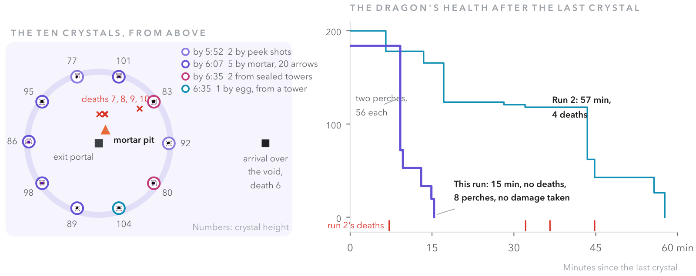
<figcaption>The End. Left: the ten crystals from above with their heights, how and by when each fell, and where the End deaths happened. Right: the dragon’s health as the agents’ programs read it from the last crystal to the win, here and in run 2, with run 2’s deaths as red ticks. This run had none in that stretch.</figcaption>
</figure>

The End is where this run was both worst and best (Figure <a href="#fig:end" data-reference-type="ref" data-reference="fig:end">7</a>). Run 2 took 15 minutes over its crystals and 57 over the dragon. This run took 134 and 15.

#### The mechanism.

The agent died three times to the dragon’s breath before it could say why, at 4:48, 5:54 and 6:13, the last under a lid. It then wrote:

> “DEATH 10, 6:13, dragon magic at (24,58,-21) under lid y60. MECHANISM (vanilla DragonFireball.onHit): cloud moves onto any living entity within dist 4 of impact (box inflate 4,2,4), through blocks. Explains deaths 7, 9, 10. So: lid alone does not protect”

This is its account of the game’s code. A search of the earlier players’ notes, libraries and conversations for the code’s names finds nothing. We did not test it separately; the only evidence here is the agent’s later play, which is consistent with it: no further deaths. Breath had killed run 1’s player 13 times and run 2’s 3 times, and the advice they left that came closest was the lid. By the agent’s attribution, this one fact explains deaths 7, 9 and 10. Recovering from those, with death 8 inside, took 79 minutes, though death 7 also needed a routine that left its tunnel, so that is an upper limit on what the fact was worth. It stated the mechanism from its own knowledge of the game once three deaths forced the question, and nothing had prompted it earlier. In a later note it recorded a related fact: “strafe (phase 1) ends only when it fires, so hiding keeps it in phase 1 forever”.

#### Crystals.

From 5:49 the crystals fell in three waves. Two came from peek shots at a pillar top, by 5:52, and those ended with death 9. Five came from a mortar pit at (4,62,-8), using run 1’s unchanged `mortar.js`: 20 arrows from 6:04:49 to 6:07:41, with no damage. In its notes it wrote “7 crystals dead with 20 arrows”, which counts the two before. Thrown eggs also destroy crystals, but three were wasted at low odds at about 6:10 and one missed a caged crystal at about 6:25 (“eggs at caged crystals miss, peeks kill”). Then came the sealed tower:

> “6:25 SEALED TOWER METHOD WORKS: tunnel to tower foot, L.climbRing(y_c) (2.6 s/level, end stone rings 3 ahead, no LoS, dragon immune), L.towerHit(c,dir): obsidian shield at feet level in place of bar, window at head level, hit: C dead, HP 20 to 19.8, 80 s total.”

Two caged crystals fell this way, and one egg from a tower top killed the last at 6:35:30. Its own lesson says 6:32, and the program output says otherwise; we use the output. Its summary is “Should have used sealed columns from the start”.

#### The dragon.

Run 2’s paper suggested that “At its best rate of 56 health points a perch, the fight is about four perches.” This tests that estimate: the fight took eight, and the best rate came twice (Table <a href="#tab:perches" data-reference-type="ref" data-reference="tab:perches">7</a>). The player copied run 2’s stage and pit and its `L.fightStep`. Which side the dragon faces on its perch decided the rate: near yaw 160 the head is in reach for 7 a hit, near yaw 0 only the body for 2.75 a hit, near yaw 210 nothing. The method transferred, without a death.

Its own summary is “Dragon 184 to 0 in 6 min of fightStep, 0 damage”. The records put the first hit at about 6:42:50 and the last at 6:50:52, about 8 minutes. Health stood at 20 in every status line from program 656 to the win, so “0 damage” holds as far as status lines can show. The dragon read 200 before the last crystal and 184 after it, and we did not establish what took the 16.

| **Program** | **Clock** | **Yaw** | **Hits** | **Damage** | **Health after** |
|------------:|----------:|--------:|:---------|-----------:|-----------------:|
|         660 | 6:42–6:44 |     160 | 8 head   |         56 |              128 |
|         660 |           |     159 | 8 head   |         56 |               72 |
|         661 | 6:44–6:46 |       8 | 7 body   |      19.25 |            52.75 |
|         669 | 6:46–6:48 |     215 | None     |          0 |            52.75 |
|         669 |           |       0 | 7 body   |      19.25 |             33.5 |
|         670 | 6:48–6:50 |     152 | 2 head   |         14 |             19.5 |
|         670 |           |     210 | None     |          0 |             19.5 |
|         671 |      6:50 |     166 | 3 head   |       19.5 |                0 |

The eight perches of the fight, from the program outputs. Yaw is the dragon’s. Head hits take 7, body hits 2.75, and the last perch stopped at zero. {#tab:perches}

#### The mole and the farm.

Two other methods are this run’s own. The mole (`rf.js`) attacks an idle blaze through a one-cell hole from below, which depends on the fact that blazes with no line of sight do not come to a fixed hole. Run 2 had settled on melee in the crowd, with food. The farm’s rate, 1.6 pearls a minute at best, adapts run 2’s mouth; run 2 took 10 in 19 minutes, and this run took 10 by 1:37 with the two deaths and their recoveries inside that.

# Verification and integrity

Every program and its output, the agent’s full conversation, the server log and the game events were recorded, with 2,465 camera frames up to the win. The win is in the server log: `[05:33:15] [Server thread/INFO]: opus has made the advancement [Free the End]`. The project’s verification script passes. The world did not stall: the longest gap between frames is 12.4 seconds, the median 10.0, and the log has no “Can’t keep up” warning. There were no server restarts and one bot connection.

#### The exit portal jump.

Four proofs agree: a respawn 37.5 seconds after the win with no death before it, program output after the win that names the Overworld, the camera in the End at 05:33:46 and in the Overworld at 05:33:56, and `seenCredits=1` in the saved player file.

#### Records of what might compromise the result.

The programs contain no raw protocol writes, no writes to velocity or position outside the tool installs, no slash commands in chat, no reference to the world seed and no bartering. Three things need saying.

- Program 198 tried `require("fs").readFileSync` on its own `prog/mine1.js` file. The seed prompt permits Node’s built-in modules. The agent’s note says “bot host cannot read workspace files”, and it went on to keep parameters in the program itself.

- Program 651 reads `bot.physicsEnabled` as a diagnostic and does not set it.

- `L.reDig` in `lib/tower.js` calls `bot.world.setBlockStateId` to mark a cell as solid in the bot’s own copy of the world, after a dragon’s push interrupted a dig and left a “client ghost cell”. Two programs name it. This changes only the bot’s local view so that it digs that cell again; the server still decides what the block is, and no write goes to the server. We list it because it is the closest thing in this run to touching the world through the client.

# Researcher actions

We made no change and sent no message during play. There was no pause or stop, and the mark button on the dashboard was not used. Before the start, at the owner’s request, we fixed two display bugs on the researchers’ dashboard. At about 0:03 we ran headless read-only dashboard checks with writes blocked, and at about 0:30 the owner’s dashboard and a window watching the agent opened. Neither reaches the player. We ran the Mac’s keep-awake command for the server process. Apart from its opening prompt (“Begin the session. Your instructions are in CLAUDE.md.”), the agent received the Stop hook’s standard line once, at about 0:34, when it ended a turn while a background job ran. After the win we ran the verification script.

# Cost

The run used a Claude subscription, so nothing was billed per token. Claude Code’s own estimate at API list prices was \$61.04 at the end of the session, broken down in Table <a href="#tab:cost" data-reference-type="ref" data-reference="tab:cost">8</a>. Run 2 came to \$81.46 and run 1 to \$207.99. Run 3 has no such line, since its session was ended from outside; its token counts come to about \$68 by the same prices. The team’s run was about \$520 at Gemini 4 Argon’s introductory list price. These are estimates from list prices and token counters, not the cost of serving either model.

| **Tokens** | **Count** | **Price per million** | **Cost** |
|:---|---:|---:|---:|
| Input read from the cache | 109.68 M | \$0.20 | \$21.94 |
| Input written to the cache, one-hour | 1.90 M | \$8.00 | \$15.20 |
| Input written to the cache, five-minute | 0.010 M | \$5.00 | \$0.05 |
| Input not cached | 0.014 M | \$4.00 | \$0.05 |
| Output, including 0.60 M thinking | 1.19 M | \$20.00 | \$23.80 |
| Total |  |  | \$61.04 |

Model use for the whole session at Claude Opus 5.5 list prices. The unrounded rows add up to Claude Code’s own estimate. {#tab:cost}

Effort was xhigh in all 555 requests up to the win. By the transcript the agent averaged 2,012 output tokens per response, 1,088 of them thinking, against run 2’s 1,864 and 1,052. API time was 3.14 hours, 46% of the session. The run cost less than run 2 because it was shorter, not because each response was cheaper.

# Comparison of the runs

Table <a href="#tab:headline" data-reference-type="ref" data-reference="tab:headline">9</a> sets the runs side by side and Table <a href="#tab:stages" data-reference-type="ref" data-reference="tab:stages">10</a> splits them by stage. Against run 2 this run saved 37 minutes to the portal, 2 hours 51 minutes from the portal to the eyes and 14 minutes to the End, and lost 1 hour 17 minutes in the End, which comes to the 2 hours 25 minutes between them. So the End, where the plan ran furthest over, was also the only stage slower than run 2. Against run 2’s End, this run lost 1 hour 59 minutes on crystals and gained 42 minutes on the dragon.

|  | **This run** | **Run 2** | **Run 3** | **Run 1** | **Team** |
|:---|---:|---:|---:|---:|---:|
| Time to the win | 6:50:52 | 9:16:17 | No win, 10:58 | 60:50:46 | 27:14 |
| from the first program | 6:50:39 | 9:07:38 | 10:57:30 | 60:49:42 | 27:14 |
| First spawn to first program | 13 s | 519 s | 47 s | 63 s |  |
| Programs | 671 | 780 | 741 | 5,879 | 2,783 |
| without library checks | 671 | 780 | 741 | 3,725 |  |
| Distinct lines of JavaScript | 5,401 | 6,658 | 6,215 | 6,637 | 63,313 |
| Deaths | 10 | 16 | 34 | 115 | 605 |
| Deaths per hour | 1.46 | 1.73 | 3.10 | 1.89 | 5.6$`^{*}`$ |
| Gaps under 5 minutes | 0 of 9 | 4 of 15 | 9 of 33 | 31 of 114 |  |
| Deaths between programs | 4 | 9 | 20 | 52 |  |
| Median program duration$`^{\S}`$ | 9.4 s | 5.9 s | 5.7 s | 2.3 s | 33.5 s |
| Time with a program running | 67% | 58% | 67% | 84% | $`{\sim}`$<!-- -->40%$`^{*}`$ |
| Median pause between programs | 12.1 s | 11.6 s | 15.6 s | 5.0 s |  |
| Total pause | 2.2 h | 3.8 h | 3.6 h | 9.8 h |  |
| Longest pause | 146 s | 194 s | 154 s | 1,189 s |  |
| Server restarts | 0 | 0 | 0 | 0 | 6 |
| Researcher changes in play | 0 | 0 | 0 | 3 | 0 |
| Cost at list prices | \$61 | \$81 | $`{\sim}`$\$68 | \$208 | \$520 |

The runs’ measures. Times on the official clock except the team’s, which run from its first program. {#tab:headline}

$`^{*}`$Per player. $`^{\S}`$Without library checks.

| **Stage** | **This run** | **Run 2** | **Run 3** | **Run 1** | **Team** |
|:----------|-------------:|----------:|----------:|----------:|---------:|
| To portal |         0:54 |      1:31 |      0:57 |      0:55 |     1:42 |
| To eyes   |         2:47 |      5:39 |           |     19:42 |     9:01 |
| To End    |         0:38 |      0:53 |           |     19:52 |     2:50 |
| To win    |         2:29 |      1:12 |           |     20:20 |    13:41 |

Hours:minutes per stage, rounded down. Run 3 had no eyes. {#tab:stages}

The comparison with the team is not one of equal runs and does not compare the two models. The team had four players at once, no account of an earlier session and a different model. This agent had the team’s paper available, three players’ files, its rules and a target.

## How much of the gap was the world?

Each attempt drew one world, and Table <a href="#tab:worlds" data-reference-type="ref" data-reference="tab:worlds">11</a> measures part of its effect. This world’s forest was very close, its stronghold the closest of the three found and its diamonds the fastest, helped by rich ores and a shallow pool. Its fortress was farther than in runs 1 and 2. The arrival platform over the void was bad luck: it set up death 6, though only because of the dive routine. Taking pearls first would not have been possible in run 2’s world by the plan’s rule, since its forest stood 300 blocks from the portal. Against run 2’s world, the fortress was 295 blocks farther, the forest 251 closer and the stronghold 110 closer. One trip over each of those differences takes about 14 minutes at this run’s speeds. Repeated trips did happen, so this is an illustration and not a bound, and terrain, monsters and loot went unmeasured. Seeds were not filtered in any of the runs. They were `7541594547693313756` (run 1), `8187166780328365400` (run 2), `-4093727550103901162` (run 3) and `1898792991520607232` (this run).

|  | **This run** | **Run 2** | **Run 3** | **Run 1** |
|:---|---:|---:|---:|---:|
| Nether portal to fortress | 375 | 80 | 967 | 247 |
| time | 80.3 min | 16.5 min | 202.7 min | 10.7 min |
| Nether portal to first rod | 376 | 66 | 969 | 247 |
| Nether portal to first pearl | 49 | 300 | 41 | 477 |
| First Overworld portal to stronghold | 1,563 | 1,673 |  | 2,145 |
| World spawn to stronghold | 1,547 | 1,692 |  | 1,954 |
| Diamonds, hours | 0.35 | 1.15 | 0.49 | 0.54 |
| Path: total | 15,155 | 16,986 | 23,845 | 140,312 |
| Path: Overworld | 10,052 | 9,759 | 12,635 | 114,345 |
| Path: Nether | 4,024 | 5,760 | 11,211 | 22,458 |
| Path: End | 1,079 | 1,467 |  | 3,510 |
| Blocks per hour: Overworld | 2,264 | 1,761 | 1,603 | 2,852 |
| Blocks per hour: Nether | 3,095 | 2,273 | 3,845 | 2,392 |
| Blocks per hour: End | 1,065 | 1,350 |  | 889 |

The four worlds and how far each player moved. Distances and speeds are in blocks; paths come from the camera’s 10-second samples, skipping jumps of 120 blocks or more. Hours are on the official clock, so run 2’s Overworld speed differs slightly from its paper. Diamonds are the \[Diamonds!\] advancement. {#tab:worlds}

## How much further

Run 2’s paper listed what remained. We take its list in order, then add what this run shows. We tested none of this.

- **Rods.** Run 2’s list named them first. They are still the largest Nether stage: 81 minutes, 62 of them recovery. The mole took under 5 minutes once found.

- **Lost kits.** Run 2 lost two kits, and this run three, at deaths 3, 6 and 7. They are in the 17, 24 and 60 minutes of recovery that followed.

- **Search.** Fortress search took 15.5 minutes of work this time, and string 20 minutes at the stronghold.

- **Time between programs.** This fell from 3.8 hours to 2.2 hours, 33% of the clock, though the median pause stayed about the same.

- **Bartering.** Still unused: no program barters, though run 2’s paper noted that human speedrunners commonly do. Pearls in this world came too fast for it to matter here.

- **The dragon.** The fight’s 15 minutes beat the plan’s 45 by a wide margin and leave little to gain.

- **Deaths in the End.** New here, and the largest item. Without any of the End’s recovery, this run would have ended at about 5:07, still over the line. A plan would have to get a run through the End without a death and through the Nether with far fewer, on the same work.

So a 5-hour run on this bundle needs about half this many deaths at this cost, or cheaper deaths at this count. No run has shown either. Rules are one lever, and this run shows their limit: the fall in deaths came mostly from time and place. Knowledge is the other. A single mechanism, known from the start, might have saved a good part of 79 minutes.

For scale, not for comparison: Astra’s latest recorded run finished in 8 minutes 43 seconds, on a fixed seed in Peaceful difficulty that its README says has a village, three supply chests with 21 obsidian and a naturally active End portal (Malde 2026). The fastest human on speedrun.com’s random-seed, any% glitchless board for version 1.16 and later took 6 minutes 40 seconds of game time (speedrun.com 2026). Those runs differ from this one in rules, clock, version and, for Astra, in world and difficulty. They do show that nearly 7 hours is far from any floor that the game itself sets. Nothing here shows where the floor lies for an agent working through this harness.

# Related work

Stigmergy was named by Grassé (1959) to explain how termites coordinate nest building through what has already been built, and has grown into a general account of indirect coordination through traces in a medium (Theraulaz and Bonabeau 1999; Heylighen 2016). Here the medium is a folder of files, the players never overlap, and the trace can be searched.

Self-improving systems range from Gödel machines, which would rewrite themselves only on a proof of benefit (Schmidhuber 2003), to the Darwin Gödel Machine, which keeps an archive of coding agents that modify their own code and checks each change on benchmarks (J. Zhang et al. 2025). Reflexion has language agents reflect verbally on failures and use the reflections in later attempts (Shinn et al. 2023). The loop here is far simpler: one agent, one episode, no population and no held-out test, with tools and notes changed by the agent in the course of play. Other work keeps memory across tasks: Agent Workflow Memory induces reusable workflows from past experience (Z. Z. Wang et al. 2024), Dynamic Cheatsheet gives a black-box model a persistent, evolving memory of strategies and code snippets (Suzgun et al. 2025), and Agentic Context Engineering treats contexts as playbooks that evolve (Q. Zhang et al. 2025). Here the memory was not built for transfer. It is whatever earlier players happened to leave, including one who failed, plus a plan a separate session wrote from those records.

Minecraft has long been a testbed for open-ended agents. MineRL released human demonstrations and ran a competition on sample-efficient learning of the diamond task (Guss, Houghton, et al. 2019; Guss, Codel, et al. 2019). Video PreTraining learned keyboard and mouse control from online videos and crafted diamond tools (Baker et al. 2022), DreamerV3 collected diamonds from scratch with reinforcement learning (Hafner et al. 2025), and STEVE-1 followed short-horizon text instructions (Lifshitz et al. 2023). MineDojo named defeating the Ender Dragon, starting barehanded in a fresh world, as one of its moonshot goals (Fan et al. 2022). SIMA and SIMA 2 act from pixels with a keyboard and mouse across many 3D games (SIMA Team 2024, 2025).

Another line of work uses language models as planners or programmers, building on interleaved reasoning and tool use (Yao et al. 2023) and code as policy (Liang et al. 2023). Voyager wrote Mineflayer programs into a growing skill library under an automatic curriculum (G. Wang et al. 2024); here such a library is handed from one player to the next. DEPS, GITM, JARVIS-1, Plan4MC and Optimus-1 added Minecraft-specific planners, knowledge, memory or learned skills (Wang et al. 2023, 2025; Zhu et al. 2023; Yuan et al. 2023; Li et al. 2024). Multi-agent studies examined coordination in games, including Minecraft (Gong et al. 2024; Altera.AL et al. 2024; White et al. 2025).

Earlier end-to-end dragon kills include a single Claude Opus 5 agent calling 37 high-level Minecraft tools on Normal difficulty (AI Bengineering 2026), a planner paired with an action-selection model on a fixed speedrun seed in Peaceful difficulty (Malde 2026), the team of four general-purpose coding agents with only the standard Mineflayer library (Faldor et al. 2026), and the two single agents whose files this run inherited (Batsuk 2026b, 2026a).

# Limitations

- **Everything changed at once.** The inherited folders, the rewritten plan, the gates, the speedrun wording and the world all differ from the earlier runs. With no control, we cannot attribute the gain to any of them.

- **Single runs.** Each attempt happened once. Run 3 shows how far the same setup can vary: the same model with an earlier version of the plan failed outright. Some of this run’s gain over run 3 is the world, some the plan and some chance, and we can’t say how much of each.

- **World luck.** This world’s forest, stronghold and ores were favourable, and its arrival platform was not (Section <a href="#sec:worlds" data-reference-type="ref" data-reference="sec:worlds">14.1</a>). We did not measure terrain, monsters or loot.

- **The plan’s author wrote the paper.** The session that wrote the plan and predicted its odds also built the run, measured the outcome and drafted this text. It has an interest in the plan’s reading of what went wrong.

- **Hand-labelled stretches.** Working and recovering come from our reading of the agent’s text and programs, good to about 3 minutes either way, and Table <a href="#tab:budget" data-reference-type="ref" data-reference="tab:budget">2</a> depends on them. Run 3’s labels differ and no such labels exist for runs 1 and 2, so we compare recovery across runs only through the camera’s back-at-the-spot measure. That measure counts being back at the spot, not having the kit back.

- **Counterfactuals.** The 5:07 and the 79 minutes are arithmetic on the records, not predictions: removing a death would change what came after it.

- **The fireball mechanism.** This is the agent’s account of the game’s code. We did not check it against the game’s source or test it on a separate server.

- **The agent knew the scores.** It read the earlier times and the plan. Its own numbers sometimes differ from the records (the last crystal, the length of the fight, the mortar’s count); we use the records and note each one.

- **The clock.** This paper’s official clock differs from the earlier papers’ (Section <a href="#sec:setup" data-reference-type="ref" data-reference="sec:setup">2</a>). Run 3’s result has no win event, so it runs to the supervisor’s exit after the owner ended it.

- **Perception through code and Easy difficulty.** As in the earlier runs, Mineflayer reports exact blocks and entities, including the dragon’s internal state, and its pathfinding plans routes that humans plan by eye. On Easy, monsters deal less damage and hunger cannot kill.

- **Who did the analysis.** The researcher who wrote the rules wrote this paper, and the model under study helped: the plan, the analysis scripts and the draft of this text were written with Claude Opus 5.5 in a separate Claude Code session, and five Opus 5.5 subagents helped write the plan. The numbers were checked only by that session, by recomputing them from the records. There is no independent replication or independent check.

The direct test is an ablation: run this bundle with one part removed, on several worlds, with each variant on the same set of seeds. At this run’s rate a full-bundle run costs about \$60 and seven hours.

# Responsible development

The agent ran in a sandbox on one machine. Its shell could write only inside its workspace and its temporary folder and reach only the game client’s socket. Its reads were blocked for this run’s server folder, the earlier runs’ original folders, other projects and Claude Code’s data other than its own session’s, though it could read the harness code and the project’s other files. Subagent and messaging tools were denied. Its programs could control only its own player and could neither start processes nor write files, and none used a server command. Its settings were outside the workspace, so it could not change them. The self-improvement here is limited to files inside that workspace, and all of it is in git. Every program, model call and game event was recorded. We found no attempt to exploit the environment or its evaluation in the checks above or in our reading of the logs. The agent reported its miss of the 5-hour goal plainly in its own notes.

# Data and code

The main measurements and statistics are computed from the run records by `scripts/run_data.py`, and the figures are drawn from its output by `scripts/make_figures.py`. Both are kept with this paper’s source, and the one statistic that resamples uses a fixed seed. Details of the narrative come from our reading of the same records. The records (programs, events, server log, camera frames and transcripts) are held by the author and are not public at the time of writing. The world’s seed is withheld.

# Acknowledgments

We thank Maxence Faldor, Satinder Singh and Roberta Raileanu, whose paper describes the environment we copied.

Minecraft is a registered trademark of Mojang Synergies AB / Microsoft Corporation. This independent research is not approved by or affiliated with Mojang or Microsoft. All in-game visual assets in this report were rendered using the open-source Pixel Perfection texture pack by XSSheep and Nova_Wostra, licensed under CC BY-SA 4.0 (XSSheep and Nova_Wostra 2026).

# Definitions

From the player’s first `bot_connected` event to the win event taken from the server log’s \[Free the End\] line. For run 3, to the supervisor’s exit after the owner ended it.

One JavaScript program sent with `mc` and recorded in `programs.jsonl`. Counts stop at the win.

A program under 120 characters that contains `L.bot===bot`. Run 1 has 2,154 of them and the others none.

The time covered by the union of program spans, divided by the time from the first program to the win.

The gap between one program’s end and the next program’s start, after merging overlapping spans and leaving out library checks.

A death outside every merged program span, library checks included.

A death within 5 minutes of the one before.

The dimension of the last camera frame at or before an event.

The first camera frame more than 5 seconds after a death, at or before the win, in the death’s dimension and within 16 blocks of its position. A death with no such frame counts as unfinished at the win.

Stretches of the clock labelled by hand from the player’s text and programs. A recovering stretch runs from a death until the player is back to the work it left, with kit.

Library lines, stripped of indentation and not blank or a comment, go to the earliest run whose final library holds the same line. A name goes to the earliest run whose library defines it.

Programs that mention a library function, once per program, leaving out library installs.

AI Bengineering. 2026. *Mine AI MCP: beating Minecraft with an LLM agent*. <a href="https://github.com/aibengineering/mine-ai-mcp" class="uri">Https://github.com/aibengineering/mine-ai-mcp</a>.

Altera.AL, A. Ahn, N. Becker, et al. 2024. “Project Sid: Many-agent simulations toward AI civilization.” *arXiv Preprint arXiv:2411.00114*, ahead of print. <https://doi.org/10.48550/arXiv.2411.00114>.

Anthropic. 2026. *Claude Code*. <a href="https://code.claude.com/docs" class="uri">Https://code.claude.com/docs</a>.

Baker, B., I. Akkaya, P. Zhokhov, et al. 2022. “Video PreTraining (VPT): Learning to Act by Watching Unlabeled Online Videos.” *Advances in Neural Information Processing Systems*. <https://doi.org/10.48550/arXiv.2206.11795>.

Batsuk, Ben. 2026a. *A Second Claude Opus 5.5 Agent, given the First One’s Files, Beats Minecraft in Nine Hours*.

Batsuk, Ben. 2026b. *A Single Claude Opus 5.5 Agent Beats Minecraft*.

Faldor, Maxence, Satinder Singh, and Roberta Raileanu. 2026. “A team of Gemini 4 Argon agents beats Minecraft.” *arXiv Preprint arXiv:2610.22319*, ahead of print. <https://doi.org/10.48550/arXiv.2610.22319>.

Fan, L., G. Wang, Y. Jiang, et al. 2022. “MineDojo: Building Open-Ended Embodied Agents with Internet-Scale Knowledge.” *Advances in Neural Information Processing Systems (NeurIPS), Datasets and Benchmarks Track*. <https://doi.org/10.48550/arXiv.2206.08853>.

Gong, R., Q. Huang, X. Ma, et al. 2024. “MindAgent: Emergent Gaming Interaction.” *Findings of the Association for Computational Linguistics: NAACL 2024*, 3154–83. <https://doi.org/10.18653/v1/2024.findings-naacl.200>.

Grassé, Pierre-Paul. 1959. “La Reconstruction Du Nid et Les Coordinations Interindividuelles Chez *Bellicositermes Natalensis* et *Cubitermes* Sp. La Théorie de La Stigmergie: Essai d’interprétation Du Comportement Des Termites Constructeurs.” *Insectes Sociaux* 6 (1): 41–80. <https://doi.org/10.1007/BF02223791>.

Guss, W. H., C. Codel, K. Hofmann, et al. 2019. “The MineRL 2019 Competition on Sample Efficient Reinforcement Learning using Human Priors.” *arXiv Preprint arXiv:1904.10079*, ahead of print. <https://doi.org/10.48550/arXiv.1904.10079>.

Guss, W. H., B. Houghton, N. Topin, et al. 2019. “MineRL: A Large-Scale Dataset of Minecraft Demonstrations.” *Proceedings of the Twenty-Eighth International Joint Conference on Artificial Intelligence (IJCAI)*, 2442–48. <https://doi.org/10.24963/ijcai.2019/339>.

Hafner, D., J. Pasukonis, J. Ba, and T. Lillicrap. 2025. “Mastering diverse control tasks through world models.” *Nature* 640 (8059): 647–53. <https://doi.org/10.1038/s41586-025-08744-2>.

Heylighen, Francis. 2016. “Stigmergy as a Universal Coordination Mechanism I: Definition and Components.” *Cognitive Systems Research* 38: 4–13. <https://doi.org/10.1016/j.cogsys.2015.12.002>.

Li, Z., Y. Xie, R. Shao, G. Chen, D. Jiang, and L. Nie. 2024. “Optimus-1: Hybrid Multimodal Memory Empowered Agents Excel in Long-Horizon Tasks.” *Advances in Neural Information Processing Systems*. <https://doi.org/10.48550/arXiv.2408.03615>.

Liang, J., W. Huang, F. Xia, et al. 2023. “Code as Policies: Language Model Programs for Embodied Control.” *2023 IEEE International Conference on Robotics and Automation (ICRA)*, 9493–500. <https://doi.org/10.1109/ICRA48891.2023.10160591>.

Lifshitz, S., K. Paster, H. Chan, J. Ba, and S. McIlraith. 2023. “STEVE-1: A Generative Model for Text-to-Behavior in Minecraft.” *Advances in Neural Information Processing Systems*. <https://doi.org/10.48550/arXiv.2306.00937>.

Malde, R. 2026. *Astra and JEV Minecraft agent*. <a href="https://github.com/rmalde/minecraft-agent" class="uri">Https://github.com/rmalde/minecraft-agent</a>.

PrismarineJS. 2026. *Mineflayer: create Minecraft bots with a stable, high level JavaScript API*. <a href="https://github.com/PrismarineJS/mineflayer" class="uri">Https://github.com/PrismarineJS/mineflayer</a>.

Schmidhuber, Jürgen. 2003. *Goedel Machines: Self-Referential Universal Problem Solvers Making Provably Optimal Self-Improvements*. arXiv:cs/0309048.

Shinn, Noah, Federico Cassano, Edward Berman, Ashwin Gopinath, Karthik Narasimhan, and Shunyu Yao. 2023. “Reflexion: Language Agents with Verbal Reinforcement Learning.” *Advances in Neural Information Processing Systems* 36.

SIMA Team. 2024. “Scaling Instructable Agents Across Many Simulated Worlds.” *arXiv Preprint arXiv:2404.10179*, ahead of print. <https://doi.org/10.48550/arXiv.2404.10179>.

SIMA Team. 2025. “SIMA 2: A Generalist Embodied Agent for Virtual Worlds.” *arXiv Preprint arXiv:2512.04797*, ahead of print. <https://doi.org/10.48550/arXiv.2512.04797>.

speedrun.com. 2026. *Minecraft: Java Edition, Any% Glitchless, Random Seed, 1.16+*. <a href="https://www.speedrun.com/mc/runs/y44238ky" class="uri">Https://www.speedrun.com/mc/runs/y44238ky</a>.

Suzgun, Mirac, Mert Yuksekgonul, Federico Bianchi, Dan Jurafsky, and James Zou. 2025. “Dynamic Cheatsheet: Test-Time Learning with Adaptive Memory.” *arXiv Preprint arXiv:2504.07952*, ahead of print. <https://doi.org/10.48550/arXiv.2504.07952>.

Theraulaz, Guy, and Eric Bonabeau. 1999. “A Brief History of Stigmergy.” *Artificial Life* 5 (2): 97–116. <https://doi.org/10.1162/106454699568700>.

Wang, G., Y. Xie, Y. Jiang, et al. 2024. “Voyager: An Open-Ended Embodied Agent with Large Language Models.” *Transactions on Machine Learning Research*, ahead of print. <https://doi.org/10.48550/arXiv.2305.16291>.

Wang, Z., S. Cai, G. Chen, A. Liu, X. Ma, and Y. Liang. 2023. “Describe, Explain, Plan and Select: Interactive Planning with Large Language Models Enables Open-World Multi-Task Agents.” *Advances in Neural Information Processing Systems*. <https://doi.org/10.48550/arXiv.2302.01560>.

Wang, Z., S. Cai, A. Liu, et al. 2025. “JARVIS-1: Open-World Multi-Task Agents With Memory-Augmented Multimodal Language Models.” *IEEE Transactions on Pattern Analysis and Machine Intelligence* 47 (3): 1894–907. <https://doi.org/10.1109/TPAMI.2024.3511593>.

Wang, Zora Zhiruo, Jiayuan Mao, Daniel Fried, and Graham Neubig. 2024. “Agent Workflow Memory.” *arXiv Preprint arXiv:2409.07429*, ahead of print. <https://doi.org/10.48550/arXiv.2409.07429>.

White, I., K. Nottingham, A. Maniar, et al. 2025. “Collaborating Action by Action: A Multi-agent LLM Framework for Embodied Reasoning.” *arXiv Preprint arXiv:2504.17950*, ahead of print. <https://doi.org/10.48550/arXiv.2504.17950>.

XSSheep, and Nova_Wostra. 2026. *Pixel Perfection Legacy texture pack*. <a href="https://modrinth.com/resourcepack/pixel-perfection-legacy" class="uri">Https://modrinth.com/resourcepack/pixel-perfection-legacy</a>.

Yao, S., J. Zhao, D. Yu, et al. 2023. “ReAct: Synergizing Reasoning and Acting in Language Models.” *International Conference on Learning Representations*. <https://doi.org/10.48550/arXiv.2210.03629>.

Yuan, H., C. Zhang, H. Wang, et al. 2023. “Skill Reinforcement Learning and Planning for Open-World Long-Horizon Tasks.” *arXiv Preprint arXiv:2303.16563*, ahead of print. <https://doi.org/10.48550/arXiv.2303.16563>.

Zhang, Jenny, Shengran Hu, Cong Lu, Robert Lange, and Jeff Clune. 2025. *Darwin Godel Machine: Open-Ended Evolution of Self-Improving Agents*. arXiv:2505.22954.

Zhang, Qizheng, Changran Hu, Shubhangi Upasani, et al. 2025. “Agentic Context Engineering: Evolving Contexts for Self-Improving Language Models.” *arXiv Preprint arXiv:2510.04618*, ahead of print. <https://doi.org/10.48550/arXiv.2510.04618>.

Zhu, X., Y. Chen, H. Tian, et al. 2023. “Ghost in the Minecraft: Generally Capable Agents for Open-World Environments via Large Language Models with Text-based Knowledge and Memory.” *arXiv Preprint arXiv:2305.17144*, ahead of print. <https://doi.org/10.48550/arXiv.2305.17144>.

