# A single Claude Opus 5.5 agent beats Minecraft

> Text version of the paper, made from `main.tex` by `tools/make_text.py`. The PDF is the version of record: [Run-1-Opus-5.5-beats-Minecraft-in-60h51m.pdf](../../Run-1-Opus-5.5-beats-Minecraft-in-60h51m.pdf). Source: [main.tex](main.tex), data: [data/](data/).

**Ben Batsuk**

**We repeated the Minecraft experiment of Faldor et al. (2026) with a single Claude Opus 5.5 agent running in Claude Code, in place of their team of four Gemini 4 Argon agents. The environment follows theirs: a standard Minecraft survival server on Easy difficulty with a random seed and no cheats, a Mineflayer bot with its pathfinding plugin and no helpers, and one goal, defeat the Ender Dragon. The agent acts only by writing JavaScript programs and reading the text they print. The main change is what it knew beforehand: its workspace held the earlier paper and strategy guides drawn from it, and it was told to read them first. The agent wrote 5,879 programs and a library of 51 files of its own, died 115 times, and defeated the dragon 60 hours and 49 minutes after its first program. It took more than twice the team’s time, with a fifth of the team’s deaths and, at API list prices, about \$208 of model use against the team’s \$520. The researchers changed the setup three times during the run: they lowered the context size at which the agent compacts, made Pause and Stop end a stuck program, and, after 17 hours without progress in the End, raised the agent’s reasoning effort from medium to xhigh. The last seven crystals and the dragon fell in the two hours after that change. We describe the setup, how the run unfolded, the methods the agent built for the End, and the limits of one run with prior knowledge.**

<figure id="fig:steps" data-latex-placement="h">
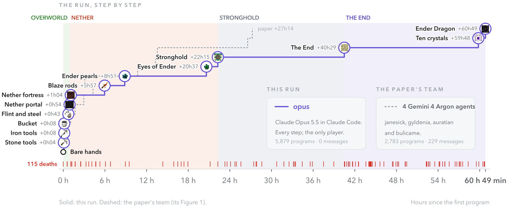
<figcaption>The run step by step: the thirteen steps from bare hands to the Ender Dragon over 60 hours and 49 minutes, with the times of the paper’s team as a dashed grey line. Red ticks along the bottom mark the agent’s 115 deaths. Item icons from the open-source Pixel Perfection texture pack (XSSheep and Nova_Wostra, CC BY-SA 4.0), not Minecraft’s textures.</figcaption>
</figure>

# Introduction

A single Claude Opus 5.5 agent entered a newly generated Minecraft survival world with one instruction: defeat the Ender Dragon. It controlled a player through Mineflayer (PrismarineJS 2026), the open-source JavaScript library for Minecraft bots, and had no teammates. Sixty hours and 49 minutes after its first program, the server log recorded that it had made the advancement \[Free the End\].

The run repeats the one reported by Faldor et al. (2026), in which a team of four Gemini 4 Argon agents defeated the dragon in 27 hours and 14 minutes with the same library and no game-specific tools. Reaching the end of Minecraft from a random spawn takes a long chain of dependent steps (Fan et al. 2022): tools in the Overworld, blaze rods and ender pearls from the Nether, a stronghold found with Eyes of Ender, and ten crystals to destroy before the dragon can be killed in the End. We asked whether one general-purpose coding agent can do the same work alone, and what changes when it starts with the earlier team’s experience. That second question is the main departure from the original: the agent’s workspace held the earlier paper and four strategy guides drawn from it, and its instructions told it to read them before it began.

The agent kept to the paper’s route but not its pace. It reached a Nether fortress in 64 minutes, nearly two hours ahead of the team, then fell behind on every later step. Most of the extra time went to two stretches: 18 hours between finding the stronghold and entering the End, most of it spent replacing one lost Eye of Ender, and 17 hours in the End between its third crystal and its fourth. Along the way it built its own library of tools, wrote rules into its memory after its deaths, and, in the last two hours, designed a way to lob arrows from a covered pit that destroyed the last crystals without exposing it to the dragon.

 h 49 min

from the first program to the dragon’s defeat

,879

programs written and run by the agent

,637

distinct lines of JavaScript in its programs

files in the tool library it wrote for itself

deaths along the way

# How the agent plays

The player is driven by one Claude Code session (Anthropic 2026) running Claude Opus 5.5 with a context window of one million tokens. As in the original, the agent never sees pixels or presses keys. It writes a short JavaScript program, such as *walk to these coordinates and mine every iron ore within 16 blocks*, sends it to the player’s Mineflayer bot, and reads the text that comes back: position, health, inventory, what the program found, or the error it hit. Then it writes the next one. Mineflayer can read the world and order basic actions such as walking, digging, placing, crafting and attacking; it does not know how to play.

<figure id="fig:loop" data-latex-placement="t">
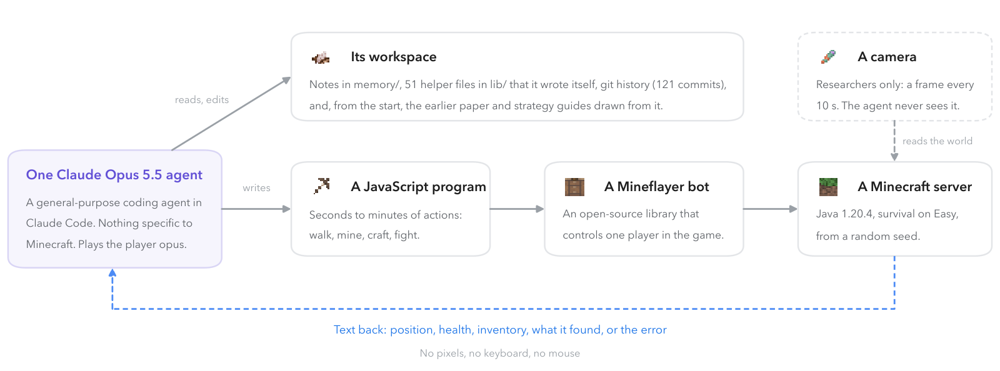
<figcaption>How the agent plays. It writes a JavaScript program, a Mineflayer bot runs it in the world, and text comes back. The agent keeps notes, its own library and a git history in its workspace, which also holds the earlier paper and the strategy guides. A camera, added for the researchers, renders a view of the player every 10 seconds; the agent cannot read it. Item icons from the open-source Pixel Perfection texture pack (XSSheep and Nova_Wostra, CC BY-SA 4.0), not Minecraft’s textures.</figcaption>
</figure>

The game was Minecraft Java Edition 1.20.4, the vanilla server from Mojang, in survival mode on Easy difficulty in a randomly generated world, with cheat commands disabled and no human input to the game. The world’s seed was `7541594547693313756`. Everything ran on one Mac: the server, the bot host and Claude Code.

## Agent and tools

The agent has the tools Claude Code uses for software work: a shell, file reading and editing, web search and web fetch, and a git workspace with a `memory/` folder for notes. It used the shell 3,104 times and never searched or fetched the web. Subagents, cloud agents and messages to other sessions are denied, so it worked alone. Its permission mode refuses anything outside an allowlist without asking, so the run never waited on a person. Shell commands run in a sandbox that can write only inside the workspace and can reach no local port; the only way into the game is a command-line client, `mc`.

`mc` sends a program to the bot over a private socket, waits up to a timeout the agent chooses (60 seconds by default, at most 3,600), and prints what the program logged and returned, capped at 20,000 characters, followed by any chat lines the bot received. The program runs as the body of an asynchronous function that receives the bot with the pathfinding plugin loaded and no helpers added. It can load Node.js built-ins and the installed Mineflayer packages but cannot start processes or write files, which a macOS sandbox enforces. Values it stores on the global object persist between programs. At the timeout a flag, `isCancelled()`, turns true; code that ignores it keeps running, and its later output appears after the next program, as in the original.

Claude Code compacts the conversation when it grows too long. From hour 7 the threshold was 350,000 tokens of context (Section <a href="#sec:interventions" data-reference-type="ref" data-reference="sec:interventions">5</a>), and a hook showed the agent its `memory/` folder again after each of the 9 compactions. A second hook kept the session going until the server log recorded \[Free the End\].

## Instructions and prior knowledge

The original paper publishes summaries of its agents’ instructions and one quoted paragraph. We rebuilt them: general rules for working (observe before acting and verify afterwards, test new tools on short tasks, build your own tools, record mechanics and workarounds in memory, keep working while background jobs run, be honest, do not exploit flaws in the environment or its evaluation), a description of the environment with no game strategy, the note “You are the only player in this session”, and the objective:

> “The objective is to defeat the Ender Dragon, starting from the spawn of the session’s Minecraft survival world. It is met when the server log records that your player has made the advancement \[Free the End\]. This is the only criterion. Any means of meeting it within the rules of survival mode is permitted.”

One section has no counterpart in the original. It points the agent to the earlier paper in its workspace, tells it to read it before it begins so as not to repeat the team’s mistakes, and to record the lessons it wants to keep. It then points to four strategy guides drawn from the paper for a single player (3,105 words in all): an overview of where the team lost time and lives, and one guide each for the Overworld, the Nether and the End. Every point in the guides names its source in the paper, or is marked as standard Minecraft knowledge the paper does not state, or as a change for one player. The guides contain no code. The agent read the guides and both parts of the paper in the first seconds of the session and wrote 14 lessons from them into its memory before its first program.

## Monitoring and the camera

There is no Observer agent. The researchers watched a live dashboard that could pause or stop the session; it showed each program with its output, the thirteen steps and the deaths. We added one thing the original did not have: a camera. From hour 0.9, every 10 seconds, the bot host copied the blocks around the player and a renderer drew a frame from behind it with Pixel Perfection, the texture pack of the original paper’s renders. The agent could not read the frames and never saw them; they are for the reader (Figure <a href="#fig:frames" data-reference-type="ref" data-reference="fig:frames">4</a>). Table <a href="#tab:setup" data-reference-type="ref" data-reference="tab:setup">1</a> lists every difference from the original setup.

|  | **Original** | **This run** |
|:---|:---|:---|
| Players | 4 Gemini 4 Argon agents | 1 Claude Opus 5.5 agent in Claude Code; medium effort until hour 59, then xhigh |
| Observer | A fifth agent reports and never plays | None; a dashboard and a verification script |
| Prior knowledge | No report of an earlier session | The earlier paper and four strategy guides drawn from it, read first |
| Compaction | When the context grows too long | At about 967k tokens until hour 7, then at 350k |
| Client output | No cap stated | Capped at 20,000 characters |
| Pause and Stop | Pause the session | From hour 16 they also end a running program |
| Camera | Renders for the paper | A frame every 10 s for the researchers, unseen by the agent |
| Machines | One cloud machine per agent | One Mac for everything |

What differs from the original setup. Everything else (game version, difficulty, seed, the library, the client and the program rules) follows Faldor et al. (2026). {#tab:setup}

# The 61-hour run

Figure <a href="#fig:run" data-reference-type="ref" data-reference="fig:run">3</a> shows the whole run: the steps, the agent’s deaths and compactions, how many programs it sent each half hour, and the size of its context. Times are hours after the first program (12:13 Central Standard Time on 1 November 2026). The total includes 6.4 hours, from hour 9.4 to hour 15.8, when the Mac was asleep and the server ran at a fraction of its normal speed between brief wakes.

<figure id="fig:run" data-latex-placement="t">
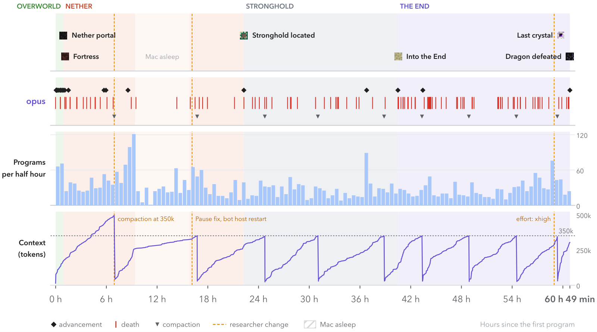
<figcaption>The whole run. Top: the thirteen steps. Second row: the agent’s 21 advancements (diamonds), 115 deaths (red ticks) and 9 compactions (triangles). Third row: real programs per half hour, without the one-line library checks. Bottom: the size of the agent’s context in tokens, with the 350k compaction threshold. Orange dashed lines mark the three researcher interventions; the hatched band is the time the Mac was asleep.</figcaption>
</figure>

## Hour 0: reading first

A zombie killed the bot before the agent had read its first instruction. The agent’s first actions were not in the game: it read the four guides and both parts of the paper, then wrote its memory files, among them 14 lessons such as “end every program in a safe enclosed place”, “items despawn 5 minutes after death; bank in chests” and “destroy all 10 crystals first”. Its first program, 23 seconds after the session began, asked for its position, health, food, time of day and inventory. A minute later it had written `lib/core.js`, the first file of the library it would use for the rest of the run, and installed it in the bot’s global object.

<figure id="fig:frames" data-latex-placement="tbp">

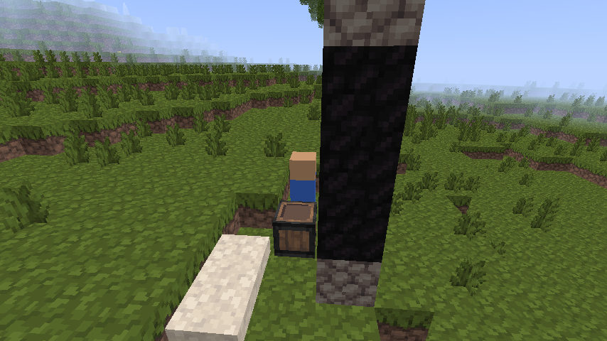

(a) Hour 0.9, Overworld. Home base beside the cast obsidian of the first Nether portal, with a chest and a bed.

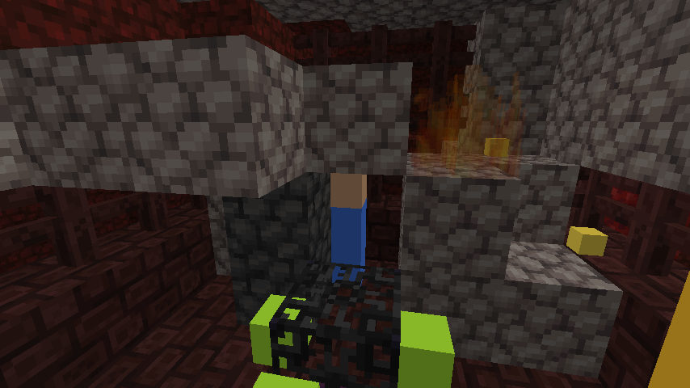

(b) Hour 5.9, Nether. Inside the walled room the agent built around a blaze spawner, minutes before its first rods.

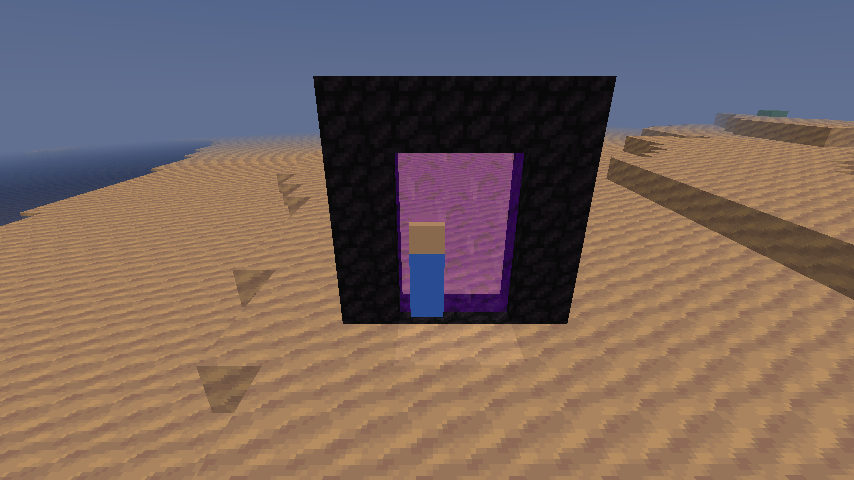

(c) Hour 38.9, Overworld. The second Nether portal, built on the shore above the stronghold to shorten the trip.

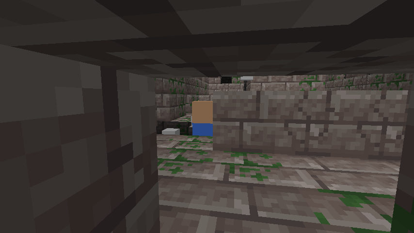

(d) Hour 39.0, Overworld. Mossy stone bricks beside the portal room, just after the End portal lit; silverfish killed the agent here minutes later.

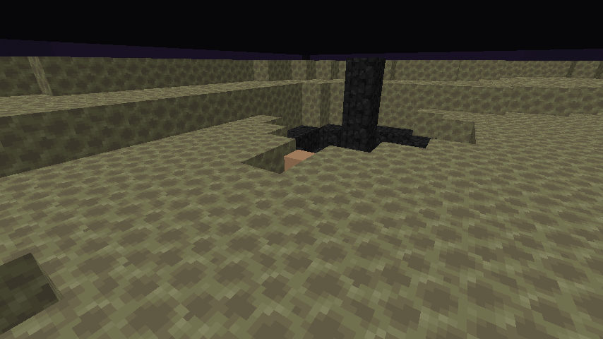

(e) Hour 60.3, End. The melee pit beside the exit-portal fountain, during the fight.

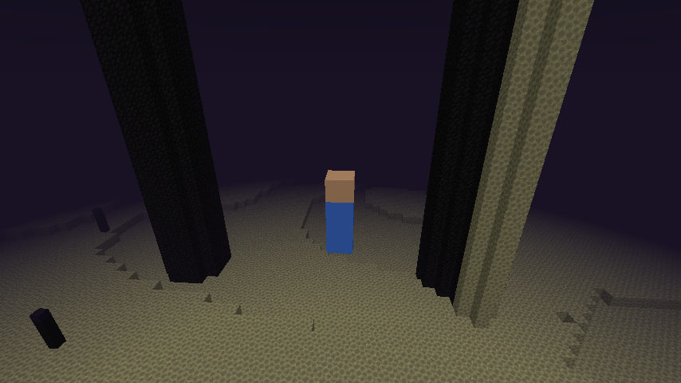

(f) Hour 60.5, End. Thrown into the air among the obsidian pillars seconds before death 112, with the dragon at 8 health points.

<figcaption>Six frames from the researchers’ camera, which drew a view of the player every 10 seconds from a copy of the blocks around it. The agent never saw them. Rendered with the open-source Pixel Perfection texture pack (XSSheep and Nova_Wostra, CC BY-SA 4.0), not Minecraft’s textures.</figcaption>
</figure>

## Hours 0 to 9: into the Nether

The Overworld went fast. The agent had stone tools at 4 minutes, iron tools and a bucket at 8, diamonds at 31 and flint and steel at 43. Instead of mining obsidian, it cast a portal frame by pouring water onto lava sources, a method the guides take from the original team, and entered the Nether at 54 minutes \[We Need to Go Deeper\]. Ten minutes later it found a fortress \[A Terrible Fortress\], and by hour 1.5 it wore full diamond armour \[Cover Me with Diamonds\].

Blaze rods took five more hours. The agent died 15 times between hours 1 and 7, 7 of them in the Nether: to blazes, to lava it walked or dug into, to skeletons, by drowning, and once to a piglin, which cost it 8 rods. After each death it wrote a rule. The one that worked was to fight only from a fully enclosed dark room around the blaze spawner, so that blazes spawn inside within reach and those outside cannot see it. It built that pillbox (Figure <a href="#fig:frames" data-reference-type="ref" data-reference="fig:frames">4</a>b) and had its first rods at 5 hours 57 minutes and 10 rods banked at hour 7.4. For pearls it dug a tunnel high in the Nether’s netherrack, found a warped forest at hour 8.6, where Endermen spawn often, and had its first pearls at 8 hours 51 minutes.

## Hours 9 to 23: eyes and the stronghold

The Mac slept from hour 9.4 to 15.8. Afterwards the agent dug a two-block-high pit in the warped forest, too low for Endermen to follow it, provoked them one at a time by looking at them, and fought them at its entrance. It crafted its first Eyes of Ender at 20 hours 37 minutes and had 15 pearls soon after. Throwing eyes from two points far apart and intersecting their flight lines placed the stronghold under the sea, about 2,100 blocks from its base. It reached the spot by trekking and swimming, and dug a shaft down.

At hour 21.2 a creeper fell into that shaft and killed it; it dropped all 14 eyes, its diamond sword and its iron armour. Dropped items age only while their chunk is loaded, so they were still there when the agent came back, and it recovered the 14 eyes at hour 22.2. It found the portal room minutes later \[Eye Spy\], then burned to death in the lava pool inside the ring of frames while placing them. When it came back it filled the frames it could and was one eye short: eleven of twelve.

## Hours 23 to 40: the twelfth eye

One eye needs one pearl and one blaze rod. Getting both again took 16 hours and 21 deaths. The agent drowned four times between hours 23 and 25, then built a faster route: a tunnel high in the Nether from its first portal to a second one that opens on the shore above the stronghold (Figure <a href="#fig:frames" data-reference-type="ref" data-reference="fig:frames">4</a>c). It had the twelfth eye at hour 30.7 and lost it a minute later, burned while fighting a skeleton in the Nether. Six more deaths followed between hours 31 and 34, to skeletons, soul fire, a pillager, a hoglin and a piglin. Its notes turned into rules (“explore the Nether only through enclosed tunnels high in solid netherrack”) and new tools: a walled bridge that adds side walls as it goes (`lib/wallbridge.js`) and an obsidian-casting routine that checks the lava source is isolated first (`lib/obs2.js`).

Food became a problem too. The agent moved its base to a village and wrote a wheat farm tool \[A Seedy Place\], after which it ate bread. It killed blazes for 2 rods at hour 37.5, lost them to a piglin a minute later, had 2 again at 38.2, crafted the twelfth eye at 38.7 and lit the End portal at 39.0. Moments later silverfish from the stronghold’s infested stone killed it beside the portal (Figure <a href="#fig:frames" data-reference-type="ref" data-reference="fig:frames">4</a>d), and it lost its full kit. It rebuilt the kit, placed a bed by the portal room to respawn there, and entered the End at 40 hours 29 minutes \[The End?\].

## Hours 40 to 59: the End on medium effort

The guides tell the agent to leave the arrival platform at once and destroy all ten crystals before attacking the dragon. It did both. It walled itself into the end stone, then destroyed three uncaged crystals by building a walled column up a pillar and punching the crystal from below, at hours 41.0, 41.7 and 42.1. Two things it learned there shaped the rest of the run: destroying a crystal makes the dragon leave its circling and strafe the player, and the cloud a fireball leaves behind deals Instant Damage II, which armour does not reduce.

No crystal fell in the next 17 hours. The agent wrote a bow tool with a gravity simulation of the arrow’s flight (`lib/bow.js`) \[Take Aim\], tried to shoot from the ground, and climbed pillars inside roofed columns after it found that the dragon breaks cobblestone but not end stone or obsidian. It died 59 times between hours 40.5 and 59, 24 of them in the End to breath, falls into the void and the dragon itself, and 35 in the Overworld while rebuilding what it lost. Each death in the End left its kit (armour, weapons, picks and blocks) on the island or in the void, and each full kit took about an hour to rebuild, by its own estimate; it built kits 3 to 9 in this period. It worked through worn-out picks, mineshaft carts, string from cobwebs for bows, fishing and a new base by the animals at hour 58.2, and was back at the stronghold with kit 9 at hour 59.3.

## Hours 59 to 61: xhigh, the mortar pit and the kill

At hour 58.97 (23:11 on 3 November) we stopped the session and resumed the same conversation with the reasoning effort raised from medium, Claude Code’s default for Opus 5.5, to xhigh (Section <a href="#sec:interventions" data-reference-type="ref" data-reference="sec:interventions">5</a>). Seven crystals and the dragon remained.

At 23:44 the agent climbed a column it had dug up from a tunnel under the island to a peek hole at the surface, and destroyed three crystals with three arrows. Its notes record that the spread of a fully drawn arrow is a narrow triangle of about $`\pm 1^{\circ}`$, so its simulation predicted hits accurately. Each crystal it destroyed sent the dragon to strafe it, and a fireball cloud killed it (death 110); it recovered the whole kit in 123 seconds of End time and wrote new rules for peeking. By 23:54 it had a new method, the *mortar pit* (`lib/mortar.js`): a pit with its feet two blocks below the surface and a lid, opened only to shoot, from which it lobbed arrows at a pitch of at least $`72^{\circ}`$ onto the crystals. The dragon has almost no line of sight into such a pit. Two crystals fell at 23:54. The last two were caged in iron bars; the agent’s simulation, run against the real blocks, showed that the gaps in a cage’s lid let about 40% of lobbed arrows through, and both cages fell by 00:01. All ten were down, with 18 arrows (Figure <a href="#fig:end" data-reference-type="ref" data-reference="fig:end">5</a>).

For the fight it modelled the perched dragon’s body parts from Mineflayer’s entity data: the head, the neck, the body and two wings, each a separate entity whose position follows the dragon’s yaw. Hits on the head do full damage and hits elsewhere a quarter plus one. It dug a one-block pit four blocks from the centre of the exit-portal fountain, at a depth where the dragon’s head, wings and breath could not reach it when it perched (Figure <a href="#fig:frames" data-reference-type="ref" data-reference="fig:frames">4</a>e), and wrote a fight loop that hit whichever part was in reach and retreated on low health. The dragon’s health went from 200 to 128.5 at 00:21, 56.5 at 00:26 and 8 at 00:35. At 00:40 a breath cloud threw the agent out of the pit (Figure <a href="#fig:frames" data-reference-type="ref" data-reference="fig:frames">4</a>f) and killed it; three more deaths followed in the next 16 minutes while the dragon sat at 8 health points. At 00:57 it wrote one program, `prog_final.js`, that walked from its bed into the End portal, ran from the arrival platform to the fountain along a route it had tested, dropped into the pit and started the fight loop. It carried two stone and two wooden pickaxes, a few blocks, and a wooden and a stone sword. Two programs later the fight loop landed the last hit, on the dragon’s neck with the stone sword, at 01:02:54 \[Free the End\].

<figure id="fig:end" data-latex-placement="t">
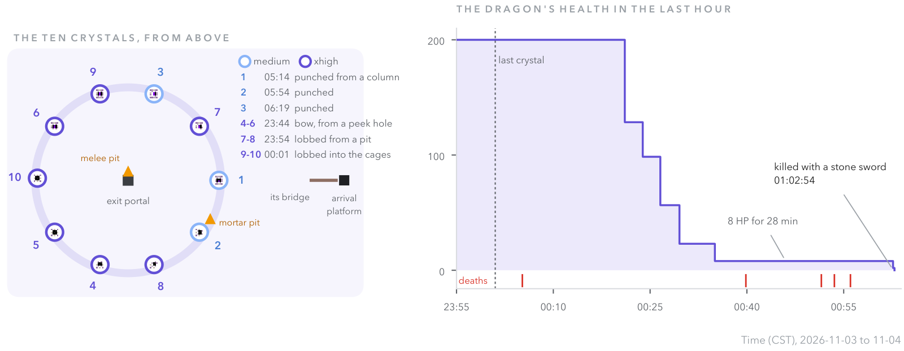
<figcaption>The End. Left: the ten crystals in the order they fell, seen from above, with the places the agent built: the exit portal and its melee pit, the mortar pit, the bridge from the arrival platform. Crystals 1–3 were punched from walled columns on medium effort; 4–10 fell on xhigh, in the 17 minutes from 23:44 to 00:01. Right: the dragon’s health as the agent’s programs read it, with its deaths as red ticks. Times are Central Standard Time on 3–4 November.</figcaption>
</figure>

## After the win

The agent committed its workspace with the message “Objective met: Free the End” and ended its session at 01:03. It did not go through the exit portal. Four hours later we sent five programs of our own: two position checks, and three from a separate Opus 5.5 session on xhigh effort, not the run’s agent, which walked the bot into the exit portal; the bot saw the credits and arrived at its Overworld bed. None of this is counted in the results. We then stopped the environment with the world saved.

# Emergent behaviours

Nothing in the instructions told the agent how to organise its code or its notes. Four patterns stand out.

#### A library of its own.

The original team’s programs were long and largely self-contained: 63,313 distinct lines over 2,783 programs. This agent’s were short calls into a library it kept in `lib/`: 51 files, 2,835 lines of JavaScript, each installed into the bot’s global object with one `mc` command (Table <a href="#tab:lib" data-reference-type="ref" data-reference="tab:lib">2</a>). Its programs over the whole run hold only 6,637 distinct lines. A shell script of its own, `lib/run.sh`, sent a one-line check before each real program and reinstalled the library when the bot had reconnected; 2,154 of the 5,879 programs are these checks. The agent committed the workspace 120 times, often naming in the message the death that prompted the change.

| **File** | **Lines** | **What it does, in the agent’s words** |
|:---|---:|:---|
| `core.js` | 393 | Core helpers; sets the global `L` |
| `run.sh` | 11 | Reinstalls the libraries first if the bot object changed |
| `stairs.js` | 138 | Staircase mining: dig a one-wide staircase toward a target height |
| `tunnel.js` | 89 | Enclosed tunnel along an axis at constant height, sealing liquids |
| `pillbox.js` | 121 | Fight from a sealed one-block cell with one window; close it to heal |
| `ender3.js` | 58 | Stare at one Enderman to anger it and fight it near the bunker |
| `obs2.js` | 94 | Safe obsidian casting from an isolated lava source |
| `wallbridge.js` | 67 | Walk or build a one-wide bridge with skirts and two-high side walls |
| `farm.js` | 26 | Harvest ripe wheat, pick it up and replant |
| `bow.js` | 95 | Bow aiming with gravity, from the vanilla arrow’s per-tick physics |
| `shot.js` | 36 | Find surface spots from which an arrow reaches a crystal |
| `mortar.js` | 36 | Stand two below the rim and lob arrows at a pitch of $`72^{\circ}`$ or more |
| `fight.js` | 31 | Melee fight from a shallow pit near the fountain |

Some of the 51 files in the agent’s library, with the first line of each file’s own description, shortened. {#tab:lib}

#### Rules written from deaths.

The agent’s lessons file grew from 14 lessons taken from the paper to 140 lines, most of them added after a death and many phrased as rules: “never enter the Nether without a gold armour piece”, “never hunt or fight below 12 health”, “never end a trek or shelter in water”, “do terrain scans only from an enclosed cell”. Some rules held, such as fighting blazes only from a sealed room. Others did not stop the deaths they were written after: drowning, the subject of several rules, was still its most common cause of death at the end (Section <a href="#sec:deaths" data-reference-type="ref" data-reference="sec:deaths">6</a>).

#### Modelling the game from its data.

Where the guides said what to do but not how, the agent built models from what Mineflayer reports. It wrote the arrow’s per-tick physics into a simulator and checked shots against the real blocks between it and the target. It worked out that the dragon’s strafe ends only after it has fired with a line of sight, which is why hiding alone never brought the dragon down to perch. It mapped the perched dragon’s parts to entity ids and positions before the fight, and placed its pit by the heights of the head and of the breath cloud.

#### Recovering its own items.

Without teammates, every recovery was its own. It went back for its 14 eyes, recovered a full kit in 123 seconds after death 110, and wrote down that dropped items in the End age only while a player is there, which gave it time to go back for them.

# Researcher interventions

The original team ran without intervention. We changed the setup three times, each listed in the repository’s comparison table and marked in Figure <a href="#fig:run" data-reference-type="ref" data-reference="fig:run">3</a>.

- **Compaction at 350k tokens (hour 6.9).** Claude Code compacts at about 967k tokens of context with a one-million-token window. We restarted the session with a threshold of 350k; the restart compacted the 498,534-token context to 16,921 tokens at once. The other eight compactions came at about 350k and left 7,000 to 11,000 tokens each.

- **Pause and Stop end a stuck program (hour 16.1).** A program survived a Pause. We changed Pause and Stop so that they also cancel running programs and restarted the bot host, which cleared the agent’s library from the bot’s global object; its own check script reinstalled it.

- **Effort raised to xhigh (hour 59.0).** After 17 hours with three of ten crystals down, we stopped the session and resumed the same conversation with reasoning effort xhigh instead of medium. The seven other crystals and the dragon fell within 1 hour and 51 minutes. The bow, the simulator and the plan to lob arrows existed before the switch, and the agent had just returned with a new kit, so this run cannot separate the effect of effort from the work already done.

Apart from its opening prompt, the agent received only the Stop hook’s standard line, “The objective is not met yet: the server log has no \[Free the End\] advancement. Continue working toward the objective.”, once at each of the two resumes. No one sent it a hint, no server command was used, and the server never restarted.

# Deaths

The agent died 115 times before the win, against the team’s 605. Figure <a href="#fig:deaths" data-reference-type="ref" data-reference="fig:deaths">6</a> splits them by cause and by where they happened, which we took from the camera frames before each death: 69 in the Overworld, 17 in the Nether and 29 in the End. Drowning (17), skeletons (16), lava and fire (14) and the dragon’s breath (13) lead the causes. Monsters other than the dragon killed it 49 times, 43% of its deaths, against 58% of the team’s.

The deaths are uneven in time. Fifty of them came before the End, over 40 hours; 65 came after it first entered the End, over 20. Only 29 of those 65 happened in the End itself. The rest happened in the Overworld while it rebuilt its kit, often in the same few ways: drowning, creepers, skeletons at night. Its own notes count 105 deaths by the end; the server log has 115.

<figure id="fig:deaths" data-latex-placement="t">
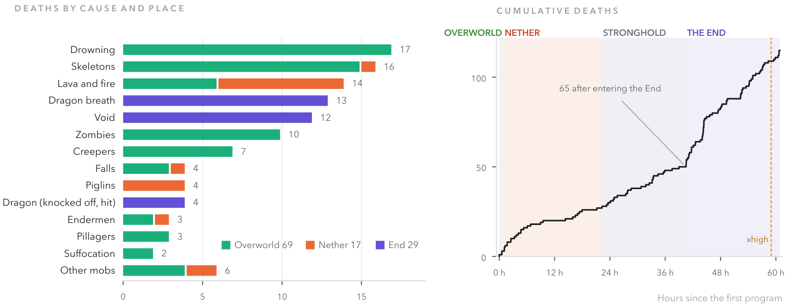
<figcaption>The agent’s 115 deaths. Left: by cause, split by where they happened. Right: cumulative deaths over the run, with the stage the agent had reached and the switch to xhigh effort.</figcaption>
</figure>

# Verification

Every program and its output, the agent’s full conversation, the server log and the game events were recorded, as were 21,094 camera frames. The win is in the server log: `[01:02:54] opus has made the advancement [Free the End]`, 60 hours and 49 minutes after the first program. A script checks the records: no program sent a chat line starting with a slash (a server command), no program tried to load a process module, and the agent created no Claude Code settings files in its workspace. The agent’s shell could not reach the server’s console, its remote console or the dashboard, and the session’s hooks and the script accept only a real advancement line in the log, not a chat message quoting one.

# Cost

The run used a Claude subscription, so nothing was billed per token. Claude Code keeps its own estimate at API list prices across the whole conversation, including its resumed parts: \$207.99 up to the end of the agent’s session, less than a minute after the win. Table <a href="#tab:cost" data-reference-type="ref" data-reference="tab:cost">3</a> breaks it down. The agent processed about 646 million input tokens, 99.4% of them read from the context cache, and generated 2.45 million output tokens, including 1.04 million thinking tokens, over about 3,150 model calls. The original team processed about 1.35 billion input tokens, 91% from cache, and 16 million output tokens over about 24,000 calls, about \$520 at Gemini 4 Argon’s introductory list price (\$1,040 at the standard price). Both figures are estimates from list prices and token counters, not the cost of serving either model.

| **Tokens** | **Count** | **Price per million** | **Cost** |
|:---|---:|---:|---:|
| Input read from the cache | 642.17 M | \$0.20 | \$128.43 |
| Input written to the cache, one-hour | 3.80 M | \$8.00 | \$30.41 |
| Input written to the cache, five-minute | 0.004 M | \$5.00 | \$0.02 |
| Input not cached | 0.03 M | \$4.00 | \$0.13 |
| Output, including 1.04 M thinking | 2.45 M | \$20.00 | \$49.00 |
| Total |  |  | \$207.99 |

Model use up to the end of the agent’s session at Claude Opus 5.5 list prices. Cache writes were almost all at the one-hour rate. The rows add up to Claude Code’s own estimate. {#tab:cost}

# Comparison with the original run

Table <a href="#tab:headline" data-reference-type="ref" data-reference="tab:headline">[tab:headline]</a> sets the run’s measures beside the team’s, and Table <a href="#tab:stepsc" data-reference-type="ref" data-reference="tab:stepsc">5</a> the times of the thirteen steps. The agent was ahead through the Nether fortress and behind from the blaze rods on. By stage, it spent 54 minutes in the Overworld before the Nether (team: 1 hour 42), 19 hours 43 from there to the Eyes of Ender (team: 9 hours 1), including the 6.4 hours the Mac slept, 19 hours 52 from the eyes to the End (team: 2 hours 50), and 20 hours 20 in the End (team: 13 hours 41).

|                              | **This run** |                      **Team** |
|:-----------------------------|-------------:|------------------------------:|
| Time to the win              |      60 h 49 |                       27 h 14 |
| Programs                     |        5,879 |                         2,783 |
| without library checks       |        3,725 |                               |
| Distinct lines of JavaScript |        6,637 |                        63,313 |
| Chat messages                |            0 |                           229 |
| Deaths                       |          115 |                           605 |
| Programs ending in an error  |           1% |                           22% |
| without library checks       |         1.5% |                               |
| Median program duration      |        0.0 s |                        33.5 s |
| without library checks       |        2.3 s |                               |
| Time with a program running  |          84% | $`{\sim}`$<!-- -->40%$`^{*}`$ |
| Server restarts              |            0 |                             6 |
| Cost at list prices          |        \$208 |                         \$520 |

Time of each step after the first program. {#tab:stepsc}

$`^{*}`$Per player.

| **Step**        |        **This run** | **Team** |
|:----------------|--------------------:|---------:|
| Stone tools     |                0:04 |     0:06 |
| Iron tools      |                0:08 |     0:14 |
| Bucket          |                0:08 |     0:14 |
| Flint and steel |                0:43 |     1:04 |
| Nether portal   |                0:54 |     1:42 |
| Nether fortress |                1:04 |     2:57 |
| Blaze rods      |                5:57 |     4:17 |
| Ender pearls    |                8:51 |     3:06 |
| Eyes of Ender   |               20:37 |    10:43 |
| Stronghold      |               22:15 |    13:17 |
| The End         |               40:29 |    13:33 |
| Ten crystals    | 59:48$`^{\dagger}`$ |    26:34 |
| Ender Dragon    |               60:49 |    27:14 |

Time of each step after the first program. {#tab:stepsc}

$`^{\dagger}`$From the agent’s commit “all crystals destroyed”.

The comparison is not between equals. The team had four players working in parallel and no account of an earlier session; this agent worked alone with the team’s paper in hand. Four players covered more ground at once: one gathered pearls while another fought blazes, and teammates recovered each other’s items. A single player had to do every step in series and walk back for everything it lost, which is where much of its extra time went. On the other hand, the lessons it read showed in the early hours and in its death count: it went straight for a cast portal and a fortress, and it died about a fifth as often.

# Related work

Minecraft has long been a testbed for open-ended agents. MineRL released human demonstrations and ran a competition on sample-efficient learning of the diamond task (Guss, Houghton, et al. 2019; Guss, Codel, et al. 2019). Video PreTraining learned keyboard and mouse control from online videos and crafted diamond tools (Baker et al. 2022), DreamerV3 collected diamonds from scratch with reinforcement learning (Hafner et al. 2025), and STEVE-1 followed short-horizon text instructions (Lifshitz et al. 2023). MineDojo named defeating the Ender Dragon, starting barehanded in a fresh world, as one of its moonshot goals (Fan et al. 2022). SIMA and SIMA 2 act from pixels with a keyboard and mouse across many 3D games (SIMA Team 2024, 2025).

Another line of work uses language models as planners or programmers, building on interleaved reasoning and tool use (Yao et al. 2023) and code as policy (Liang et al. 2023). Voyager wrote Mineflayer programs into a growing skill library under an automatic curriculum (Wang et al. 2024); the library this agent built for itself is a similar structure that no one asked for. DEPS, GITM, JARVIS-1, Plan4MC and Optimus-1 added Minecraft-specific planners, knowledge, memory or learned skills (Wang et al. 2023, 2025; Zhu et al. 2023; Yuan et al. 2023; Li et al. 2024). Multi-agent studies examined coordination in games, including Minecraft (Gong et al. 2024; Altera.AL et al. 2024; White et al. 2025).

Three end-to-end dragon kills have been reported recently: a single Claude Opus 5 agent calling 37 high-level Minecraft tools on Normal difficulty (AI Bengineering 2026), a planner paired with an action-selection model on a fixed speedrun seed in Peaceful difficulty (Malde 2026), and the team of four general-purpose coding agents with only the standard Mineflayer library (Faldor et al. 2026). This run keeps the last setting and changes two things: one agent instead of four, and the earlier run’s paper as prior knowledge.

# Limitations

- **A single run.** We describe one run, the first full launch, which cannot show how reliably the setup succeeds or how much the result depends on the world it drew.

- **Prior knowledge from the paper.** The agent read an account of a successful run and guides drawn from it. The run tests whether one agent can carry out a known route, not whether it can find one. We did not run the same agent without the paper.

- **The change of effort is confounded.** The effort rose from medium to xhigh after the agent had already built the bow, the simulator and a new kit. The fast finish may owe as much to that groundwork as to the higher effort.

- **Researcher interventions.** Unlike the original, we changed the compaction threshold and the Pause and Stop behaviour during the run, and restarted the bot host once.

- **Time with the Mac asleep.** About 6.4 of the 60.8 hours passed with the Mac asleep and the game running slowly, which inflates the total.

- **Program counts.** 2,154 of the 5,879 programs are one-line library checks, which inflate the count and pull the median duration to zero.

- **Perception through code and Easy difficulty.** As in the original, Mineflayer reports exact blocks and entities, including the dragon’s internal state, and its pathfinding plans routes that humans plan by eye. On Easy, monsters deal less damage and hunger cannot kill.

# Responsible development

The agent ran in a sandbox on one machine. Its shell could write only inside its workspace and reach only the game client’s socket, its programs could control only its own player and could neither start processes nor write files, and none used a server command. Its settings were outside the workspace, so it could not change them. Every program, model call and game event was recorded, and the researchers watched the run on a dashboard that could pause or stop it. We found no attempt to exploit the environment or its evaluation in the checks above or in our reading of the logs.

# Acknowledgments

We thank Maxence Faldor, Satinder Singh and Roberta Raileanu, whose paper describes the environment we copied and which the agent read before it began.

Minecraft is a registered trademark of Mojang Synergies AB / Microsoft Corporation. This independent research is not approved by or affiliated with Mojang or Microsoft. All in-game visual assets in this report were rendered using the open-source Pixel Perfection texture pack by XSSheep and Nova_Wostra, licensed under CC BY-SA 4.0 (XSSheep and Nova_Wostra 2026).

AI Bengineering. 2026. *Mine AI MCP: beating Minecraft with an LLM agent*. <a href="https://github.com/aibengineering/mine-ai-mcp" class="uri">Https://github.com/aibengineering/mine-ai-mcp</a>.

Altera.AL, A. Ahn, N. Becker, et al. 2024. “Project Sid: Many-agent simulations toward AI civilization.” *arXiv Preprint arXiv:2411.00114*, ahead of print. <https://doi.org/10.48550/arXiv.2411.00114>.

Anthropic. 2026. *Claude Code*. <a href="https://code.claude.com/docs" class="uri">Https://code.claude.com/docs</a>.

Baker, B., I. Akkaya, P. Zhokhov, et al. 2022. “Video PreTraining (VPT): Learning to Act by Watching Unlabeled Online Videos.” *Advances in Neural Information Processing Systems*. <https://doi.org/10.48550/arXiv.2206.11795>.

Faldor, Maxence, Satinder Singh, and Roberta Raileanu. 2026. “A team of Gemini 4 Argon agents beats Minecraft.” *arXiv Preprint arXiv:2610.22319*, ahead of print. <https://doi.org/10.48550/arXiv.2610.22319>.

Fan, L., G. Wang, Y. Jiang, et al. 2022. “MineDojo: Building Open-Ended Embodied Agents with Internet-Scale Knowledge.” *Advances in Neural Information Processing Systems (NeurIPS), Datasets and Benchmarks Track*. <https://doi.org/10.48550/arXiv.2206.08853>.

Gong, R., Q. Huang, X. Ma, et al. 2024. “MindAgent: Emergent Gaming Interaction.” *Findings of the Association for Computational Linguistics: NAACL 2024*, 3154–83. <https://doi.org/10.18653/v1/2024.findings-naacl.200>.

Guss, W. H., C. Codel, K. Hofmann, et al. 2019. “The MineRL 2019 Competition on Sample Efficient Reinforcement Learning using Human Priors.” *arXiv Preprint arXiv:1904.10079*, ahead of print. <https://doi.org/10.48550/arXiv.1904.10079>.

Guss, W. H., B. Houghton, N. Topin, et al. 2019. “MineRL: A Large-Scale Dataset of Minecraft Demonstrations.” *Proceedings of the Twenty-Eighth International Joint Conference on Artificial Intelligence (IJCAI)*, 2442–48. <https://doi.org/10.24963/ijcai.2019/339>.

Hafner, D., J. Pasukonis, J. Ba, and T. Lillicrap. 2025. “Mastering diverse control tasks through world models.” *Nature* 640 (8059): 647–53. <https://doi.org/10.1038/s41586-025-08744-2>.

Li, Z., Y. Xie, R. Shao, G. Chen, D. Jiang, and L. Nie. 2024. “Optimus-1: Hybrid Multimodal Memory Empowered Agents Excel in Long-Horizon Tasks.” *Advances in Neural Information Processing Systems*. <https://doi.org/10.48550/arXiv.2408.03615>.

Liang, J., W. Huang, F. Xia, et al. 2023. “Code as Policies: Language Model Programs for Embodied Control.” *2023 IEEE International Conference on Robotics and Automation (ICRA)*, 9493–500. <https://doi.org/10.1109/ICRA48891.2023.10160591>.

Lifshitz, S., K. Paster, H. Chan, J. Ba, and S. McIlraith. 2023. “STEVE-1: A Generative Model for Text-to-Behavior in Minecraft.” *Advances in Neural Information Processing Systems*. <https://doi.org/10.48550/arXiv.2306.00937>.

Malde, R. 2026. *Astra and JEV Minecraft agent*. <a href="https://github.com/rmalde/minecraft-agent" class="uri">Https://github.com/rmalde/minecraft-agent</a>.

PrismarineJS. 2026. *Mineflayer: create Minecraft bots with a stable, high level JavaScript API*. <a href="https://github.com/PrismarineJS/mineflayer" class="uri">Https://github.com/PrismarineJS/mineflayer</a>.

SIMA Team. 2024. “Scaling Instructable Agents Across Many Simulated Worlds.” *arXiv Preprint arXiv:2404.10179*, ahead of print. <https://doi.org/10.48550/arXiv.2404.10179>.

SIMA Team. 2025. “SIMA 2: A Generalist Embodied Agent for Virtual Worlds.” *arXiv Preprint arXiv:2512.04797*, ahead of print. <https://doi.org/10.48550/arXiv.2512.04797>.

Wang, G., Y. Xie, Y. Jiang, et al. 2024. “Voyager: An Open-Ended Embodied Agent with Large Language Models.” *Transactions on Machine Learning Research*, ahead of print. <https://doi.org/10.48550/arXiv.2305.16291>.

Wang, Z., S. Cai, G. Chen, A. Liu, X. Ma, and Y. Liang. 2023. “Describe, Explain, Plan and Select: Interactive Planning with Large Language Models Enables Open-World Multi-Task Agents.” *Advances in Neural Information Processing Systems*. <https://doi.org/10.48550/arXiv.2302.01560>.

Wang, Z., S. Cai, A. Liu, et al. 2025. “JARVIS-1: Open-World Multi-Task Agents With Memory-Augmented Multimodal Language Models.” *IEEE Transactions on Pattern Analysis and Machine Intelligence* 47 (3): 1894–907. <https://doi.org/10.1109/TPAMI.2024.3511593>.

White, I., K. Nottingham, A. Maniar, et al. 2025. “Collaborating Action by Action: A Multi-agent LLM Framework for Embodied Reasoning.” *arXiv Preprint arXiv:2504.17950*, ahead of print. <https://doi.org/10.48550/arXiv.2504.17950>.

XSSheep, and Nova_Wostra. 2026. *Pixel Perfection Legacy texture pack*. <a href="https://modrinth.com/resourcepack/pixel-perfection-legacy" class="uri">Https://modrinth.com/resourcepack/pixel-perfection-legacy</a>.

Yao, S., J. Zhao, D. Yu, et al. 2023. “ReAct: Synergizing Reasoning and Acting in Language Models.” *International Conference on Learning Representations*. <https://doi.org/10.48550/arXiv.2210.03629>.

Yuan, H., C. Zhang, H. Wang, et al. 2023. “Skill Reinforcement Learning and Planning for Open-World Long-Horizon Tasks.” *arXiv Preprint arXiv:2303.16563*, ahead of print. <https://doi.org/10.48550/arXiv.2303.16563>.

Zhu, X., Y. Chen, H. Tian, et al. 2023. “Ghost in the Minecraft: Generally Capable Agents for Open-World Environments via Large Language Models with Text-based Knowledge and Memory.” *arXiv Preprint arXiv:2305.17144*, ahead of print. <https://doi.org/10.48550/arXiv.2305.17144>.

